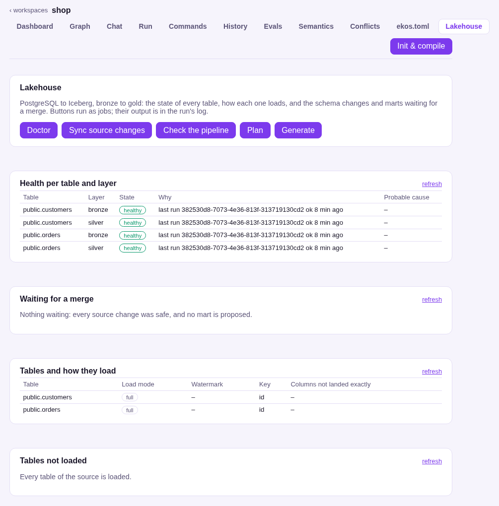

# EKOS Lakehouse

Generated, maintained medallion pipelines from a PostgreSQL or Oracle database into Apache Iceberg tables.
Trino is the engine, Polaris the REST catalog and any S3 store the storage (SeaweedFS in the
sandbox); transforms are dbt-trino and
the orchestrator is Dagster.

EKOS Lakehouse is an extension of [EKOS](https://github.com/alexeyban/EKOS), the compiler for
enterprise knowledge. EKOS reads the source, compiles it into evidence-backed knowledge, and
from that knowledge this extension generates pipeline code into a Git repository you own. It
never moves data itself: Trino moves rows, Dagster schedules runs, and people approve what is
lossy, breaking or business-facing.

**Status: all six milestones of RFC 0190's v1 plan are built (M0–M5).** The design is
[RFC 0190](https://github.com/alexeyban/EKOS/blob/main/ekos/docs/rfcs/0190-lakehouse.md), bronze is
[RFC 0192](https://github.com/alexeyban/EKOS/blob/main/ekos/docs/rfcs/0192-lakehouse-bronze.md).
A PostgreSQL source lands in Iceberg bronze tables on a schedule, every table is reconciled
against its source on every run, and a generated dbt-trino project builds tested silver tables
([RFC 0193](https://github.com/alexeyban/EKOS/blob/main/ekos/docs/rfcs/0193-lakehouse-silver.md)).
Source schema changes are classified and either applied or proposed as branches with their
impact ([RFC 0194](https://github.com/alexeyban/EKOS/blob/main/ekos/docs/rfcs/0194-lakehouse-schema-changes.md)).
Gold marts are drafted from written descriptions, with every term resolved or asked back and
nothing invented ([RFC 0195](https://github.com/alexeyban/EKOS/blob/main/ekos/docs/rfcs/0195-lakehouse-gold.md)).
Health per table and layer, alerts, OpenTelemetry metrics and MCP tools for agents
([RFC 0196](https://github.com/alexeyban/EKOS/blob/main/ekos/docs/rfcs/0196-lakehouse-monitoring.md)).
Pentaho (Kettle) packages are translated into silver and gold dbt models, every step labelled
exact, rewritten, llm-drafted or gap, JavaScript and Java steps included, proposed on a branch
([RFC 0200](https://github.com/alexeyban/EKOS/blob/main/ekos/docs/rfcs/0200-pentaho-to-lakehouse-dbt.md);
[docs/pentaho.md](docs/pentaho.md)).
An Oracle database is a source too: catalog, type map and reconciliation behind one source-engine seam
([RFC 0216](https://github.com/alexeyban/EKOS/blob/main/ekos/docs/rfcs/0216-lakehouse-source-engine-oracle.md)).

## Install

On Linux x86_64 with Docker:

```bash
curl -fsSL https://raw.githubusercontent.com/alexeyban/ekos-lakehouse/main/install.sh | sh
```

One command installs the program, starts the stack, creates a sample project, runs its pipeline
once and opens the web console on its **Lakehouse** tab. For your own database add
`-s -- --source host:5432/db --source-user reader` (password in `EKOS_LH_SOURCE_PASSWORD`).
**[docs/install.md](docs/install.md)** says what it changes and how to remove it;
**[docs/console.md](docs/console.md)** describes the tab.

To do each step yourself instead: **[docs/quickstart.md](docs/quickstart.md)** — your PostgreSQL
database to monitored Iceberg tables. Then the [runbook](docs/runbook.md) and
[troubleshooting](docs/troubleshooting.md).



## Build

From source (any platform Rust and Docker run on; a release package is Linux x86_64 only). The
`[patch]` block in `Cargo.toml` builds against a sibling EKOS checkout when it is uncommented:

```bash
git clone https://github.com/alexeyban/EKOS ../EKOS
cargo build
./target/debug/ekos-lakehouse --help
```

Oracle sources need `cargo build --features oracle`: the driver compiles with a C compiler and loads
Oracle Instant Client from `LD_LIBRARY_PATH` at run time.

The binary is `ekos-lakehouse`, not `ekos`, so it never shadows a plain EKOS install. Every EKOS
command works from it; the Lakehouse commands are under `ekos-lakehouse lakehouse …`.

## Configure

Settings live in the project's `ekos.toml`, in their own table. Credentials never go here.

```toml
[extensions.lakehouse]
trino-url          = "http://127.0.0.1:58080"
polaris-health-url = "http://127.0.0.1:58182/q/health"
s3-url             = "http://127.0.0.1:58333"
dagster-url        = "http://127.0.0.1:53000"
source             = "127.0.0.1:55433"
```

```toml
source-database     = "pagila"
source-user         = "ekos"
source-password-env = "EKOS_LH_PG_PASSWORD"     # the variable's name, never the password
source-catalog      = "pagila"                  # the Trino catalog that reads the source
bronze-schedule     = "0 * * * *"

[extensions.lakehouse.watermarks]
"public.film" = "last_update"     # used only when a BEFORE UPDATE trigger proves it
```

With `require-signoff = true`, `generate`, `sync` and `gold draft` refuse to run until every
review subject of the source model (scope, PII, conflicts, identity, write behaviour, glossary)
has a valid sign-off in EKOS (`ekos signoff approve`, EKOS RFC 0213); the refusal names each
subject that is not signed, stale or revoked. `ekos-lakehouse workflow status` shows the seven
steps: EKOS reports analysis and review, this extension documentation, requirements (gold marts),
extraction (synced tables), bronze/silver and marts (latest run per table).

```bash
ekos-lakehouse lakehouse doctor          # which services answer; --json for a program
ekos-lakehouse lakehouse plan            # each table's mode, mappings and refusals
ekos-lakehouse lakehouse generate        # SQL + lakehouse.lock.json + Dagster project → pipeline/
ekos-lakehouse lakehouse reconcile       # V1–V3 with a planted control, recorded in the ledger
ekos-lakehouse lakehouse check --lint    # lineage, test/doc coverage, drift, sqlfluff
ekos-lakehouse lakehouse sync            # source changes: safe ones committed, the rest proposed
ekos-lakehouse lakehouse reload --table public.rental   # next load empties bronze and loads every row
ekos-lakehouse lakehouse gold draft marts/revenue.md   # a mart from a description, or questions
ekos-lakehouse lakehouse pentaho scan    # Kettle packages: transformations, jobs, steps, links
ekos-lakehouse lakehouse pentaho translate etl   # silver + gold dbt models on a proposal branch
ekos-lakehouse lakehouse pentaho report --package etl   # per model and step: fidelity, gaps, SQL
```

A gold mart starts as a committed description:

```markdown
---
mart: receivables_by_customer_month
grain: [customer, month]
dimensions:
  customer: entity_credit_account.meta_number
  month: month of transactions.transdate
measures:
  invoiced: sum of ar.amount_bc
  average_invoice: the amount_bc total divided by the number of invoices
filters:
  - transactions.approved is true
---
What each customer was invoiced per month.
```

Every term must resolve to a silver column, or it comes back as a question. Prose terms are
drafted by a local model (`gold-model`, Ollama) and must state nothing the description does not
and run on Trino; a prose term names at least one column of the tables the mart reads (else it
is asked back), and its draft is one expression over the columns it names. A table the mart can
reach along more than one foreign-key path is asked about: name the column on the path you mean.
The mart is proposed on a branch with grain and reconciliation tests.

`sync` commits a new table, a new nullable column and a widened type on the pipeline
repository's branch; a rename, a drop, a narrowed type, a new required column, a key change or
a changed watermark trigger becomes a branch `ekos/change/<table>/<id>` with
`proposals/<id>.md` (the change, its evidence, the silver columns and tests it reaches).
Merging the branch is the approval; a merged rename renames the bronze column in place, so the
rows already loaded keep their values. With `git-remote = "origin"` the branch is pushed and a
pull request opened with `gh` (signed in, with rights on the repository); `sync` then starts by
fast-forwarding from the remote, so a request merged there resumes its table on the next run,
pushes the safe changes it commits, and removes merged proposal branches from the remote.
`[extensions.lakehouse.policy]` changes a class's action.

Masking and history are opt-in, by a person:

```toml
[extensions.lakehouse]
history = ["public.customer"]            # SCD2 snapshot in silver

[extensions.lakehouse.pii]
"public.customer.email" = "hmac"         # key from EKOS_LH_PII_KEY
"public.staff.password" = "null"
```

The source's Trino catalog needs `postgresql.array-mapping=AS_ARRAY` and
`unsupported-type-handling=CONVERT_TO_VARCHAR`: with the defaults the connector silently drops
columns of types it does not map. A table whose column the connector does not expose is refused.

### An Oracle source

The connection is the project's `[[databases]]` entry, the one EKOS reads the catalog through (steps 1–3), so the
password stays where the console's Sources page put it:

```toml
[[databases]]
name = "erp"
kind = "oracle"
connect = "db-host:1521/ORCLPDB1"
user = "ekos_ro"                     # read-only
password-env = "ERP_DB_PASSWORD"
owners = ["ADEMPIERE"]

[extensions.lakehouse]
source-engine   = "oracle"
source-database = "erp"              # the [[databases]] entry
source-catalog  = "erp"              # a Trino `oracle` catalog over the same database
```

The Trino catalog needs `unsupported-type-handling=CONVERT_TO_VARCHAR` (see
`deploy/trino/catalog/idempiere.properties`). Names keep Oracle's case (`ADEMPIERE.C_ORDER`); Trino folds them. The
type map: integer `NUMBER(p,0)` → `integer`/`bigint`, `NUMBER(p,s)` → `decimal(p,s)`, an unconstrained `NUMBER` →
`decimal(38,s)` at the scale its data uses (scale 10 when it holds no values yet), `DATE` → `timestamp(6)` (it has a
time), `CHAR` keeps its padding, LOBs land but are not compared, and `LONG`, `TIMESTAMP(p > 6)` and numbers wider
than 38 digits are refused with the reason. Reconciliation reads Oracle directly and needs an AL32UTF8 database. A
watermark is proven by a `BEFORE … FOR EACH ROW` update trigger that assigns `:NEW.<column>`; without one a table
loads in full.

### Incremental loads and deletes from write behaviour

When EKOS has compiled the application's code (RFC 0212 write-behaviour facts), name the column the application sets
on every write:

```toml
[extensions.lakehouse]
application-watermark = "UPDATED"
mass-delete-percent   = 5        # default; and mass-delete-rows = 10000
delete-audit-days     = 7        # default
[extensions.lakehouse.purge-policy]
"ADEMPIERE.AD_PINSTANCE_LOG" = "propagate"   # default for a purge-only table: retain
```

A table loads incrementally on it when the code always sets it (update class `po_only` or `raw_sql_sets_updated`)
and the table has a primary key. Its deletes are then found by `lakehouse deletes --table T`, which the orchestrator
runs after each load: key buckets compared on both sides, keys read only where a bucket differs, tombstones in bronze,
counts in the ledger. When more than the guard's share of keys vanishes at once nothing is applied and the run fails
until `lakehouse deletes --table T --accept`. Tables the code never hard-deletes are audited every `delete-audit-days`
instead of every run.

### The extraction plan, reviewed and approved (EKOS RFC 0226)

`lakehouse plan` applies the decisions of EKOS's review (step 3) from every subject with a valid sign-off: tables out
of scope are not planned, confirmed PII columns are masked in silver (`hash` → HMAC, `redact` → NULL; `ekos.toml`'s
`pii` entries win), and write-behaviour overrides change a table's mode and delete plan. The result is saved as the
proposal in the project's state directory.

```bash
ekos-lakehouse lakehouse extraction show [--table ADEMPIERE.C_ORDER] [--json]
ekos-lakehouse lakehouse extraction change --table C_BPARTNER --full --reason "reload nightly for now"
ekos-lakehouse lakehouse extraction change --table A_ASSET --incremental --reason "the raw update is an upgrade script"
ekos-lakehouse lakehouse extraction change --table C_BPARTNER --undo
ekos-lakehouse lakehouse extraction approve --note "first review"
```

A change (mode, `--deletes-every-run`/`--deletes-audit`, `--keep-purged`/`--remove-purged`) keeps who made it and why,
and is applied to every later plan; one that no longer fits is shown as stale. Loading incrementally against the facts
needs a reason. Approval records a `LakehouseApproval` fact with the plan's digest. With

```toml
[extensions.lakehouse]
require-plan-approval = true
```

`generate` builds only the approved plan; when the source, step 3 or a change has moved since, it refuses and names the
tables. The console's **Extraction** page does all of this, with a reason typed beside each change.

### Silver from the source model (EKOS RFC 0227)

Silver reads what the source and EKOS know about each column:

| The column is… | Evidence | Silver |
|---|---|---|
| a `Y`/`N` flag | a check constraint `c IN ('Y','N')`, or the application model's `boolean` accessor on a one-character column | `boolean`; a flag only the code declares is also tested on bronze (`accepted_values [Y, N]`), so no other value turns into NULL unseen |
| a list of codes | a check constraint | `accepted_values`, fails the build |
| a list of codes | the application model (`AD_Ref_List`) | `accepted_values`, **warns**: the dictionary can add values |
| a logical foreign key | the application model, and the database declares none | `relationships`, **warns** |

`flags-as-text = true` keeps flags as text. Tables that keep purged rows get `_ekos_purged_at_source` (when the purge
was detected). A `history` snapshot closes a row deleted at the source (`hard_deletes: invalidate`); its
`dbt_valid_to` is when the delete was seen, not when it happened.

`lakehouse run [--in-process] [--wait]` launches the Dagster job through `dagster-url`; the console's Lakehouse page
has **Run the pipeline**. Use `--in-process` for pipelines of hundreds of tables. Dagster for a project in the EKOS
home needs `EKOS_HOME`, `EKOS_LH_PROJECT_NAME`, the project's source checkout mounted (read-only is enough), and for
Oracle the Instant Client and `libaio.so.1`.

When a fix changes how a column is loaded (an Oracle `CHAR(n)` is now padded back to *n*), `generate` requests a
reload of every incremental table it affects, since an incremental load never rewrites an unchanged row. An Iceberg
table whose source name has a `$` (Oracle's `CREATE$JAVA$LOB$TABLE`) is named without it: Trino reads `t$x` as a
metadata table of `t`.

## Try it on the sandbox

```bash
docker compose -f deploy/docker-compose.lakehouse.yml up -d      # everything but Dagster
deploy/fixtures/pagila.sh                                         # Pagila, pinned
# in a project directory with the ekos.toml above:
ekos-lakehouse init && ekos-lakehouse lakehouse generate
EKOS_LH_PROJECT=$PWD EKOS_LAKEHOUSE_BIN=$(which ekos-lakehouse) \
  docker compose -f <repo>/deploy/docker-compose.lakehouse.yml --profile orchestrator up -d lh-dagster
# Dagster at http://127.0.0.1:53000 — the bronze job runs on its schedule
```

## Roadmap

| Milestone | Delivers |
|---|---|
| M0 | the stack in one compose file, Trino SQL in EKOS, cross-engine checksum agreement, load throughput measured |
| M1 | bronze: load mode per table from profile facts, Iceberg DDL and maintenance, reconciliation every run |
| M2 | silver: dbt-trino models generated from source facts, DQ rules as tests, the project compiled back into EKOS |
| M3 | schema changes: classified, safe ones applied, the rest as pull requests with their impact |
| M4 | gold: marts from written descriptions, every term resolved or asked back, anti-invention at 100% |
| M5 | monitoring, alerts, OpenTelemetry, MCP read tools, self-serve docs |

## Licence

MIT, as EKOS.
