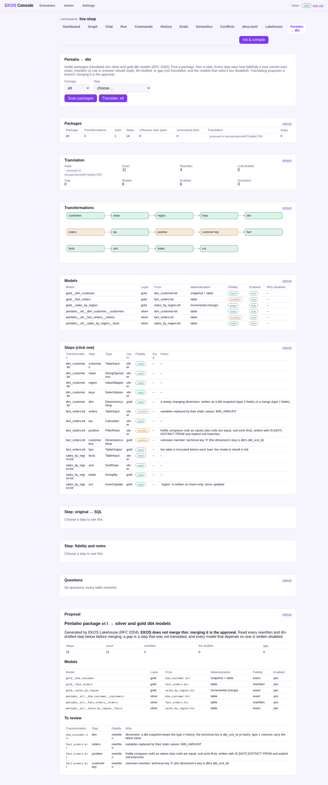

# Pentaho → silver and gold dbt models

EKOS Lakehouse translates Pentaho Data Integration (Kettle) packages into dbt-trino models in
your pipeline repository: **silver** models for the cleansing part of each transformation,
**gold** models for what it writes. Every step is labelled with how faithfully it was carried
over, and nothing is merged for you: translating proposes a branch, and merging it is the
approval.

Design: RFC 0200 (umbrella) and RFC 0201–0205, 0207 in the EKOS repository
(`ekos/docs/rfcs/`).

## 1. Point it at a package

A package is a directory with `.ktr` / `.kjb` files (and optionally repository exports,
`shared.xml`, `kettle.properties`, `plugins/`). Any `[[sources]]` directory holding Kettle files
is a package, named after the source. Or name packages explicitly:

```toml
[extensions.lakehouse]
source-database = "shop"          # Pentaho connections to this PostgreSQL database read the lakehouse

[extensions.lakehouse.pentaho-packages]
etl = "pentaho/etl"
```

Connection passwords never leave the files: Kettle's `Encrypted …` passwords and every password
element are removed before anything is read.

```bash
ekos-lakehouse lakehouse pentaho scan
```

lists each package's transformations, jobs, steps by category, step types EKOS does not know,
and links between files that do not resolve.

## 2. Translate

The deployed lakehouse plan must exist (`lakehouse generate`): Pentaho's tables resolve to the
silver models it already builds.

```bash
ekos-lakehouse lakehouse pentaho translate etl
```

- A Table input on the lakehouse source reads its silver models (`{{ ref('public__orders') }}`);
  its PostgreSQL is rewritten for Trino by a whitelist (anything else stops that branch, by name).
- A table one transformation writes and another reads becomes a `ref()` to the writer's model.
- Each source and its row-local steps become a silver model (`silver_pentaho`); each output
  becomes a gold model (`gold`): Table output → table (truncate) or append; Insert/update →
  incremental merge; Dimension lookup/update → a dbt snapshot plus a gold dimension; Abort → a test.
- Trino plans every model (`EXPLAIN`) before anything is proposed; a model it refuses is disabled.
- Everything goes on branch `ekos/pentaho/<package>/<id>` with `proposals/pentaho-<package>.md`.

`--out DIR` writes into a directory instead (a preview). `--no-explain` skips Trino.

## 3. Read the result

| Label | Meaning |
|---|---|
| exact | the same semantics in SQL |
| rewritten | a deterministic rule a reviewer should read (Kettle's null comparisons, empty string = null, Sunday = 1, …) |
| llm-drafted | a model drafted it and every check passed |
| gap | not translated; its original text is kept, and every model that needs it is disabled |

```bash
ekos-lakehouse lakehouse pentaho report --package etl
ekos-lakehouse lakehouse pentaho report --package etl --step "fact_orders.ktr:tax"   # original ↔ SQL
```

The web console's **Pentaho → dbt** tab shows the same: packages, the transformation graph
coloured by fidelity, models, steps (click one for its original text next to its SQL), questions
and the proposal. AI agents read it with the MCP tool `ekos_pentaho_translation`.



## 4. Code steps

Modified JavaScript Value and User Defined Java Class steps are executed symbolically: variables
become SQL expressions, `if`/`else` becomes `CASE`, dropping a row becomes a filter. Loops,
state across rows, `switch`, `try` and API calls are gaps that say which construct stopped them.

A model can draft those (RFC 0205), checked before it counts — it must read only the step's
input fields and only literals from the step's code:

```toml
[llm.tasks.translate]
provider = "ollama"          # local: no flag needed
model = "llama3"
```

```bash
ekos-lakehouse lakehouse pentaho translate etl                    # Ollama route
ekos-lakehouse lakehouse pentaho translate etl --allow-metered    # any paid route
```

Compiled plugin steps (`plugins/*.jar`) are decompiled only by the private EKOS binary build;
the public build reports them as gaps.

## Verify it against Pentaho

[pentaho-verify.md](pentaho-verify.md): run the original in PDI and the dbt model on the same
data and compare them in Trino — and tell us what you find.

## What is not translated

File and FTP inputs and outputs, web services, executors that run a transformation per row,
metadata injection, Delete, Combination lookup, and job entries other than running
transformations. They are listed, with their reasons, in the proposal.
