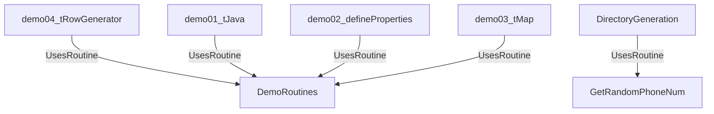

# Architecture

## Architecture Summary

_Executive Overview (RFC 0068 §14) — only fields EKOS can back with real compiled evidence are populated; fields the standard names but nothing here computes yet say so explicitly rather than being silently omitted or guessed at._

**Components:** 2225 compiled object(s) across 12 kind(s)

**Containers (crates):** 0

**Primary technologies:** _none compiled_

**Open questions:** 0

**Purpose:** _not yet computed — no real EKOS source for a project's stated purpose today (RFC 0068 §14)_

**Architecture style:** _not yet computed — requires reasoning EKOS doesn't perform yet_

**Major risks:** _No concentration risk detected — no object has 3 or more real compiled dependents yet (RFC 0094)_

**Architecture confidence:** _not meaningfully computed — no Crate/Claim/ArchitectureGap objects exist for this project (this dimension is Rust-workspace-specific today, RFC 0065 Phase 3 v1 scope)_

## System Context

_C4 System Context (RFC 0068 §15) — the compiled workspace as one system, and the real external technologies it depends on. One level broader than the Container view below; only technologies with a real compiled dependency edge are shown, not every `Technology` object that happens to exist._

_No external technology dependencies compiled._

## System Decomposition

_C4 Container-level decomposition (RFC 0068 §16/§68), one level inside System Context above — real Backend/Frontend/Database layers, grouped from each compiled `File`/`Table` object's own path or `source_system` (RFC 0056/0083), never guessed. A path can be routed to a specific layer via `[[architecture.system-decomposition.overrides]]` in `ekos.toml` when the convention gets a project's layout wrong._

_No Backend, Frontend, or Database layer data compiled yet._

## Components

- **File**: 758
- **Rollup**: 19 — see below, `## Subsystems`
- **TalendColumnLineage**: 253
- **TalendComponent**: 518
- **TalendContext**: 1
- **TalendDbConnection**: 1
- **TalendFinding**: 178
- **TalendJob**: 170
- **TalendProject**: 1
- **TalendRoutine**: 2
- **TalendSchema**: 8
- **TransformNode**: 316

## Subsystems

_Deterministic rollups (RFC 0044) — one per directory/project group with ≥2 member files, zero LLM. Each links to a detail page with real member counts and boundary relationships, so a subsystem can be understood without walking every file inside it._

- [talend-demo/.settings/mappings](entities/rollup/ta/talend-demo-settings-mappings.md) — 45 member file(s)
- [talend-demo/code/routines](entities/rollup/ta/talend-demo-code-routines.md) — 32 member file(s)
- [talend-demo/metadata/connections](entities/rollup/ta/talend-demo-metadata-connections.md) — 2 member file(s)
- [talend-demo/metadata/fileDelimited](entities/rollup/ta/talend-demo-metadata-filedelimited.md) — 8 member file(s)
- [talend-demo/metadata/fileXml](entities/rollup/ta/talend-demo-metadata-filexml.md) — 8 member file(s)
- [talend-demo/process/t01_Compo](entities/rollup/ta/talend-demo-process-t01-compo.md) — 465 member file(s)
- [talend-demo/process/t02_Concatening](entities/rollup/ta/talend-demo-process-t02-concatening.md) — 12 member file(s)
- [talend-demo/process/t03_DemoRoutines](entities/rollup/ta/talend-demo-process-t03-demoroutines.md) — 12 member file(s)
- [talend-demo/process/t04_Context](entities/rollup/ta/talend-demo-process-t04-context.md) — 12 member file(s)
- [talend-demo/sqlPatterns/DeltaLake](entities/rollup/ta/talend-demo-sqlpatterns-deltalake.md) — 14 member file(s)
- [talend-demo/sqlPatterns/Generic](entities/rollup/ta/talend-demo-sqlpatterns-generic.md) — 18 member file(s)
- [talend-demo/sqlPatterns/Hive](entities/rollup/ta/talend-demo-sqlpatterns-hive.md) — 14 member file(s)
- [talend-demo/sqlPatterns/MySQL](entities/rollup/ta/talend-demo-sqlpatterns-mysql.md) — 14 member file(s)
- [talend-demo/sqlPatterns/Netezza](entities/rollup/ta/talend-demo-sqlpatterns-netezza.md) — 14 member file(s)
- [talend-demo/sqlPatterns/Oracle](entities/rollup/ta/talend-demo-sqlpatterns-oracle.md) — 16 member file(s)
- [talend-demo/sqlPatterns/ParAccel](entities/rollup/ta/talend-demo-sqlpatterns-paraccel.md) — 14 member file(s)
- [talend-demo/sqlPatterns/Snowflake](entities/rollup/ta/talend-demo-sqlpatterns-snowflake.md) — 10 member file(s)
- [talend-demo/sqlPatterns/Teradata](entities/rollup/ta/talend-demo-sqlpatterns-teradata.md) — 18 member file(s)
- [talend-demo/sqlPatterns/Vertica](entities/rollup/ta/talend-demo-sqlpatterns-vertica.md) — 4 member file(s)

## Crate & Workspace Topology

_C4 mapping (RFC 0065 §23): each crate below is a C4 **Container** — the natural deployable/buildable unit in a Rust workspace — and each entry under Technologies is a C4 **External System** the workspace depends on but doesn't own._

_No Cargo-based crate manifests compiled for this workspace — showing each real compiled `Rollup` (RFC 0044) as this project's Container-level topology instead, since "crate" doesn't apply outside a Rust workspace._

- **[talend-demo/.settings/mappings](entities/rollup/ta/talend-demo-settings-mappings.md)** — 45 member file(s)
- **[talend-demo/code/routines](entities/rollup/ta/talend-demo-code-routines.md)** — 32 member file(s)
- **[talend-demo/metadata/connections](entities/rollup/ta/talend-demo-metadata-connections.md)** — 2 member file(s)
- **[talend-demo/metadata/fileDelimited](entities/rollup/ta/talend-demo-metadata-filedelimited.md)** — 8 member file(s)
- **[talend-demo/metadata/fileXml](entities/rollup/ta/talend-demo-metadata-filexml.md)** — 8 member file(s)
- **[talend-demo/process/t01_Compo](entities/rollup/ta/talend-demo-process-t01-compo.md)** — 465 member file(s)
- **[talend-demo/process/t02_Concatening](entities/rollup/ta/talend-demo-process-t02-concatening.md)** — 12 member file(s)
- **[talend-demo/process/t03_DemoRoutines](entities/rollup/ta/talend-demo-process-t03-demoroutines.md)** — 12 member file(s)
- **[talend-demo/process/t04_Context](entities/rollup/ta/talend-demo-process-t04-context.md)** — 12 member file(s)
- **[talend-demo/sqlPatterns/DeltaLake](entities/rollup/ta/talend-demo-sqlpatterns-deltalake.md)** — 14 member file(s)
- **[talend-demo/sqlPatterns/Generic](entities/rollup/ta/talend-demo-sqlpatterns-generic.md)** — 18 member file(s)
- **[talend-demo/sqlPatterns/Hive](entities/rollup/ta/talend-demo-sqlpatterns-hive.md)** — 14 member file(s)
- **[talend-demo/sqlPatterns/MySQL](entities/rollup/ta/talend-demo-sqlpatterns-mysql.md)** — 14 member file(s)
- **[talend-demo/sqlPatterns/Netezza](entities/rollup/ta/talend-demo-sqlpatterns-netezza.md)** — 14 member file(s)
- **[talend-demo/sqlPatterns/Oracle](entities/rollup/ta/talend-demo-sqlpatterns-oracle.md)** — 16 member file(s)
- **[talend-demo/sqlPatterns/ParAccel](entities/rollup/ta/talend-demo-sqlpatterns-paraccel.md)** — 14 member file(s)
- **[talend-demo/sqlPatterns/Snowflake](entities/rollup/ta/talend-demo-sqlpatterns-snowflake.md)** — 10 member file(s)
- **[talend-demo/sqlPatterns/Teradata](entities/rollup/ta/talend-demo-sqlpatterns-teradata.md)** — 18 member file(s)
- **[talend-demo/sqlPatterns/Vertica](entities/rollup/ta/talend-demo-sqlpatterns-vertica.md)** — 4 member file(s)

## Component View

_C4 Component (RFC 0068 §18) — one level inside a Container. Each `Crate` below whose manifest directory matches a compiled `Rollup` (RFC 0044) links through to that subsystem's real member-file breakdown; a crate with no matching rollup either has too few member files to summarize (RFC 0044's own ≥2-member threshold) or none were compiled — not fabricated either way._

_No Cargo-based crate manifests compiled for this workspace — showing each real compiled `Rollup` (RFC 0044) as this project's Container-level decomposition instead, since "crate" doesn't apply outside a Rust workspace._

- **[talend-demo/.settings/mappings](entities/rollup/ta/talend-demo-settings-mappings.md)** — 45 member file(s)
- **[talend-demo/code/routines](entities/rollup/ta/talend-demo-code-routines.md)** — 32 member file(s)
- **[talend-demo/metadata/connections](entities/rollup/ta/talend-demo-metadata-connections.md)** — 2 member file(s)
- **[talend-demo/metadata/fileDelimited](entities/rollup/ta/talend-demo-metadata-filedelimited.md)** — 8 member file(s)
- **[talend-demo/metadata/fileXml](entities/rollup/ta/talend-demo-metadata-filexml.md)** — 8 member file(s)
- **[talend-demo/process/t01_Compo](entities/rollup/ta/talend-demo-process-t01-compo.md)** — 465 member file(s)
- **[talend-demo/process/t02_Concatening](entities/rollup/ta/talend-demo-process-t02-concatening.md)** — 12 member file(s)
- **[talend-demo/process/t03_DemoRoutines](entities/rollup/ta/talend-demo-process-t03-demoroutines.md)** — 12 member file(s)
- **[talend-demo/process/t04_Context](entities/rollup/ta/talend-demo-process-t04-context.md)** — 12 member file(s)
- **[talend-demo/sqlPatterns/DeltaLake](entities/rollup/ta/talend-demo-sqlpatterns-deltalake.md)** — 14 member file(s)
- **[talend-demo/sqlPatterns/Generic](entities/rollup/ta/talend-demo-sqlpatterns-generic.md)** — 18 member file(s)
- **[talend-demo/sqlPatterns/Hive](entities/rollup/ta/talend-demo-sqlpatterns-hive.md)** — 14 member file(s)
- **[talend-demo/sqlPatterns/MySQL](entities/rollup/ta/talend-demo-sqlpatterns-mysql.md)** — 14 member file(s)
- **[talend-demo/sqlPatterns/Netezza](entities/rollup/ta/talend-demo-sqlpatterns-netezza.md)** — 14 member file(s)
- **[talend-demo/sqlPatterns/Oracle](entities/rollup/ta/talend-demo-sqlpatterns-oracle.md)** — 16 member file(s)
- **[talend-demo/sqlPatterns/ParAccel](entities/rollup/ta/talend-demo-sqlpatterns-paraccel.md)** — 14 member file(s)
- **[talend-demo/sqlPatterns/Snowflake](entities/rollup/ta/talend-demo-sqlpatterns-snowflake.md)** — 10 member file(s)
- **[talend-demo/sqlPatterns/Teradata](entities/rollup/ta/talend-demo-sqlpatterns-teradata.md)** — 18 member file(s)
- **[talend-demo/sqlPatterns/Vertica](entities/rollup/ta/talend-demo-sqlpatterns-vertica.md)** — 4 member file(s)

## Technology Inventory

_C4 External System-level dependencies (RFC 0068 §61's Technology Inventory), each linked to its own detail page where one was compiled._

_No technology dependencies compiled._

## Runtime View

_Basic Runtime View (RFC 0068 §20) — real behavior, not structure. `SequenceDiagrams.md` (generated alongside this page) already renders every real compiled call/data-flow sequence (RFC 0041's `Calls` graph, RFC 0027's Transformation IR); this section links through rather than duplicating it. Naming *which* of those are the system's important business scenarios (RFC 0068's own examples: "Create Order", "Process Payment") needs either an LLM read of real intent or human curation — neither happens in this deterministic view, so no scenario names are invented here._

See [SequenceDiagrams.md](SequenceDiagrams.md) for the real compiled sequences.

## Data Architecture

_RFC 0068 §22 ("A major EKOS capability") — real compiled data stores and real compiled transformations/lineage; domain grouping, ownership, lifecycle, and data quality each say explicitly why they're not computed yet rather than being guessed at._

### Data Stores

_No compiled data stores (Tables/Datasets)._

### Transformations & Lineage

See [SequenceDiagrams.md](SequenceDiagrams.md) for real compiled data-flow sequences (RFC 0027 Transformation IR). None of this workspace's `TransformNode` source/sink names matched exactly one compiled table (RFC 0075) — either no name overlaps a compiled `Table`, or every overlapping name is ambiguous across two or more tables, so nothing was linked rather than guessed at.

### Data Domains

_not yet computed — no compiled data stores to derive a domain from._

### Ownership

_not yet computed for data objects — `OwnedBy` edges are compiled from git history (`git_analyzer.rs`), but only from a commit event to the contributor who authored it, never onto a `File`/`Table`/`Dataset` object; there's no compiled per-file ownership signal today for a data store to link to, even setting aside that `Table`/`Dataset` objects also aren't yet linked to the `File` they were defined in. Two real gaps, not one: (1) `git_analyzer.rs` would need to derive a per-file top-contributor relationship, the way it already derives per-file `CoupledWith` coupling; (2) a data store would need the same kind of name/evidence-path linkage RFC 0075 just built for `TransformNode`s, but against `File` objects instead._

### Lifecycle

_not yet computed — blocked on the same missing `Table`→`File` link Ownership above is (a real last-modified/commit-recency signal already exists per file via git history, RFC 0020's coupling analysis touches the same commit data, but nothing connects a compiled data store to the file whose history that would be)._

### Data Quality

_not yet computed — no data-quality signal (completeness, freshness, validation-rule pass/fail) is extractable from static DDL/transformation-logic recovery at all; this needs runtime data profiling (row counts, null rates, constraint violations against actual data), which is explicitly RFC 0068 §63 Phase 3 scope (runtime telemetry), not yet built._

## Open Questions

_Explicit knowledge gaps (RFC 0065 §17) — not errors, and not silently dropped: each entry below is something a deterministic pass found it could not resolve, evidence-backed like everything else on this page. Unless resolved, they stay here rather than being guessed at._

_No open architecture questions compiled._

## CI/CD Pipelines

_No CI/CD pipeline definitions compiled._

## Entity Relationships

_No table foreign-key relationships compiled._

## Dependency Graph

### About

_178 `About` relationships compiled — diagram omitted, too large to render usefully. First 15 shown below; every object's own detail page (linked) lists its full relationship set._

- uncalled_job: tAddLocationFromIP → tAddLocationFromIP
- absolute_path: tExternalSortRow.tExternalSortRow_1.SORT_CMDPATH → tExternalSortRow
- absolute_path: tSystem.tSystem_1.DIRECTORY → tSystem
- uncalled_job: tAdvancedFileOutputXML → tAdvancedFileOutputXML
- uncalled_job: tReplace → tReplace
- absolute_path: tExternalSortRow.tExternalSortRow_1.FILENAME → tExternalSortRow
- uncalled_job: tPop → tPop
- uncalled_job: tFileInputLDIF → tFileInputLDIF
- uncalled_job: tPostgreSQLInput → tPostgreSQLInput
- uncalled_job: tDBInput → tDBInput
- absolute_path: built_inContext_prompt.tFileFetch_1.DIRECTORY → built_inContext_prompt
- uncalled_job: tServerAlive → tServerAlive
- uncalled_job: tMap_1 → tMap_1
- uncalled_job: tJavaFlex → tJavaFlex
- uncalled_job: tAdvancedFOXML → tAdvancedFOXML

### Calls

```mermaid
graph TD
    n20d8703f06e95d2989f5c8394b76c3a7["tMap_Reload_At_Each_Row_2"]
    n5d5c663060bf5b11a26545c68820442d["tMap_Reload_At_Each_Row_1"]
    n20d8703f06e95d2989f5c8394b76c3a7 -->|Calls| n5d5c663060bf5b11a26545c68820442d
    n9ab3475fd3ed58f7981ddda09ba5bbf6["jobAndContext"]
    n19e354d88f565f4baddc11bdfec4b3a9["jobChildren"]
    n9ab3475fd3ed58f7981ddda09ba5bbf6 -->|Calls| n19e354d88f565f4baddc11bdfec4b3a9
    na3934d717d8d54769daed4b193743e5e["tRunJobRow"]
    n11c9a190375d5dd9882e73ec0beead40["tBufferOutput"]
    na3934d717d8d54769daed4b193743e5e -->|Calls| n11c9a190375d5dd9882e73ec0beead40
    nd9633e84efed592f8d95963fe6a55811["tMysqlBulkExec"]
    n628a40bbdd0b586c84ce575546c4fb08["tMysqlOutputBulk"]
    nd9633e84efed592f8d95963fe6a55811 -->|Calls| n628a40bbdd0b586c84ce575546c4fb08
    n464ab564fdca54d29b2c38c0d86fddbc["jobParent"]
    n464ab564fdca54d29b2c38c0d86fddbc -->|Calls| n19e354d88f565f4baddc11bdfec4b3a9
    n7eeb8bc36a5558e48a75e4b66680e6d1["tBufferOutput2"]
    n7eeb8bc36a5558e48a75e4b66680e6d1 -->|Calls| n11c9a190375d5dd9882e73ec0beead40
    n4d2f5886d8595df59d7b66f655df88d0["ELTdemo"]
    n8ffe7283f04a57b0ac1d021377254ad8["createTables4ETL"]
    n4d2f5886d8595df59d7b66f655df88d0 -->|Calls| n8ffe7283f04a57b0ac1d021377254ad8
```

[Calls Dependency Graph diagram (SVG)](dependency-graph-calls.svg)

### ColumnFeeds

_29 `ColumnFeeds` relationships compiled — diagram omitted, too large to render usefully. First 15 shown below; every object's own detail page (linked) lists its full relationship set._

- customer.idcustomer → aggregation.Flag
- employee.salary → employee_scd.salary
- employee.position → employee_scd.position
- states.idstate → states.idstate
- employee.id → employee_scd.id
- customer.CustomerName → aggregation.CustomerName
- states.labelstate → scdstates.labelstate
- employee.name → employee_scd.name
- customer.idusstate → aggregation.idusstate
- employee.city → employee_scd.city
- employee.firstname → employee_scd.firstname
- employee.position → employee_scd.position
- states.labelstate → states.labelstate
- states.idstate → scdstates.idstate
- employee.address → employee_scd.address

### Contains

_1685 `Contains` relationships compiled — diagram omitted, too large to render usefully. First 15 shown below; every object's own detail page (linked) lists its full relationship set._

- LOCAL_PROJECT_DATA_INTEGRATION_DEMOS → details
- tFileOutputMSXML → tFileOutputMSXML.tFileInputDelimited_2
- [talend-demo/process/t01_Compo](entities/rollup/ta/talend-demo-process-t01-compo.md) → process/t01_Compo/Processing/tMap/tMap_4_0.1.item
- tRowGenerator → tRowGenerator.tLogRow_1
- [talend-demo/process/t01_Compo](entities/rollup/ta/talend-demo-process-t01-compo.md) → process/t01_Compo/System_/tRunJobRow/tRunJobRow_0.1.screenshot
- [talend-demo/process/t01_Compo](entities/rollup/ta/talend-demo-process-t01-compo.md) → process/t01_Compo/File/Management/tFileArchive_0.1.screenshot
- LOCAL_PROJECT_DATA_INTEGRATION_DEMOS → tCreateTemporaryFile
- tFileInputMSDelimited → tFileInputMSDelimited.tFileInputMSDelimited_1
- demo02_defineProperties → demo02_defineProperties.tFileFetch_1
- [talend-demo/process/t04_Context](entities/rollup/ta/talend-demo-process-t04-context.md) → process/t04_Context/built_inContext_prompt_0.1.screenshot
- tMap_3 → tMap_3.tLogRow_1
- [talend-demo/process/t01_Compo](entities/rollup/ta/talend-demo-process-t01-compo.md) → process/t01_Compo/File/Output/tFileOutputLDIF_0.1.properties
- tFileOutputMSXML.tFileOutputMSXML_1 → {{context.root.concat("talend_files_0.1/out/command_MS.xml")}}.Action_comm
- tFileOutputMSXML.tFileOutputMSXML_1 → {{context.root.concat("talend_files_0.1/out/command_MS.xml")}}.Telephone
- tExtractRegexFields → tExtractRegexFields.tExtractRegexFields_1

### RowLink

_248 `RowLink` relationships compiled — diagram omitted, too large to render usefully. First 15 shown below; every object's own detail page (linked) lists its full relationship set._

- tSocketInput.tSocketInput_1 → tSocketInput.tLogRow_1
- tRowGenerator.tRowGenerator_1 → tRowGenerator.tLogRow_1
- tMysqlOutputBulk.tRowGenerator_1 → tMysqlOutputBulk.tMysqlOutputBulk_1
- tFileInputPositional.tFileInputPositional_1 → tFileInputPositional.tLogRow_1
- tStatCatcher2.tRowGenerator_1 → tStatCatcher2.tUniqRow_1
- tExternalSortRow.tExternalSortRow_1 → tExternalSortRow.tLogRow_1
- tMysqlSP.tMysqlSP_1 → tMysqlSP.tLogRow_1
- tFileInputMSXML.tFileInputMSXML_1 → tFileInputMSXML.tLogRow_3
- Connection.tRowGenerator_1 → Connection.tMysqlOutput_1
- DirectoryService.tMap_1 → DirectoryService.tLogRow_1
- tPop.tFileInputMail_1 → tPop.tLogRow_1
- tSVNLogInput.tSVNLogInput_1 → tSVNLogInput.tLogRow_1
- tFileInputARFF.tFileInputARFF_1 → tFileInputARFF.tLogRow_1
- tMysqlSCD.tMysqlInput_2 → tMysqlSCD.tLogRow_1
- DirectoryService.tFuzzyMatch_2 → DirectoryService.tMap_1

### Triggers

_89 `Triggers` relationships compiled — diagram omitted, too large to render usefully. First 15 shown below; every object's own detail page (linked) lists its full relationship set._

- ComponentRow.tMysqlRow_1 → ComponentRow.tRowGenerator_1
- tMysqlBulkExec.tRunJob_1 → tMysqlBulkExec.tMysqlBulkExec_1
- tFileInputMSXML.tFileInputMSXML_1 → tFileInputMSXML.tFileInputXML_2
- tAssert.tAssert_1 → tAssert.tAssert_2
- generic_elt_step2.tSQLTemplateAggregate_1 → generic_elt_step2.tSQLTemplateCommit_1
- scd_step2.tMysqlInput_6 → scd_step2.tRowGenerator_1
- tCreateTemporaryFile.tFileInputDelimited_1 → tCreateTemporaryFile.tMsgBox_1
- OnSubjobError.tRowGenerator_1 → OnSubjobError.tMsgBox_1
- tFileFetch.tFileFetch_2 → tFileFetch.tFileInputDelimited_2
- tPreJob.tPostjob_1 → tPreJob.tSleep_2
- tMap_Reload_At_Each_Row_2.tMysqlConnection_1 → tMap_Reload_At_Each_Row_2.tMysqlInput_1
- tLogCatcher2.tWarn_1 → tLogCatcher2.tFileInputDelimited_1
- generic_elt_step2.tCreateTable_1 → generic_elt_step2.tMysqlConnection_1
- step2ModifyData.tMysqlInput_3 → step2ModifyData.tRowGenerator_1
- tChronometer.tChronometerStart_1 → tChronometer.tSleep_1

### UsesConnection

_57 `UsesConnection` relationships compiled — diagram omitted, too large to render usefully. First 15 shown below; every object's own detail page (linked) lists its full relationship set._

- createTables4ETL.tMysqlOutput_1 → demoMysql
- tMysqlSP.tMysqlRow_1 → demoMysql
- ComponentRow.tCreateTable_1 → demoMysql
- scd_step2.tCreateTable_1 → demoMysql
- scd_step2.tMysqlInput_1 → demoMysql
- step2.tMysqlOutput_1 → demoMysql
- tWaitForSqlData.tMysqlConnection_1 → demoMysql
- tMap_Reload_At_Each_Row_2.tMysqlInput_2 → demoMysql
- tMap_Reload_At_Each_Row_2.tMysqlInput_1 → demoMysql
- tWaitForSqlData.tCreateTable_1 → demoMysql
- tMysqlSCD.tMysqlSCD_1 → demoMysql
- scd_step2.tMysqlSCD_1 → demoMysql
- generic_elt_step1.tMysqlOutput_2 → demoMysql
- DirectoryService.tMysqlInput_1 → demoMysql
- createTables4ETL.tCreateTable_1 → demoMysql

### UsesRoutine

[UsesRoutine Dependency Graph diagram (SVG)](dependency-graph-usesroutine.svg)

