# Sequence Diagrams

## Data-Flow Sequences

_Rendered from Transformation IR `FeedsInto` edges — a data-flow sequence between compiled pipeline steps, not a code call sequence._

## process/t01_Compo/CustomCode/tJavaFlex_0.1.item

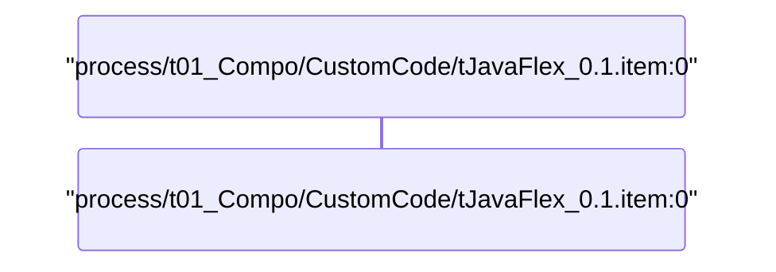

_(1 step — no `FeedsInto` edges compiled for this pipeline)_

## process/t01_Compo/CustomCode/tJavaRow_0.1.item

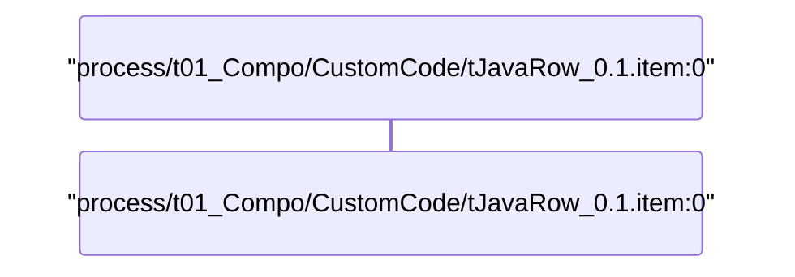

_(1 step — no `FeedsInto` edges compiled for this pipeline)_

## process/t01_Compo/CustomCode/tJava_0.1.item

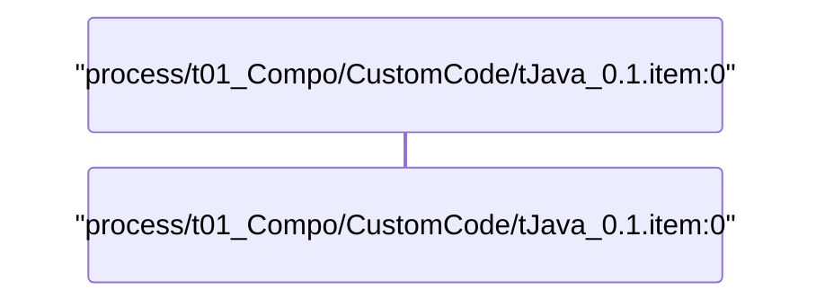

_(1 step — no `FeedsInto` edges compiled for this pipeline)_

## process/t01_Compo/DataQuality/tAddCRC_0.1.item

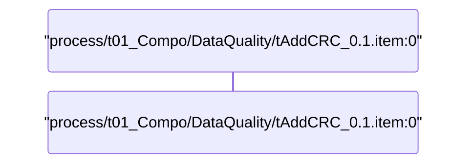

_(1 step — no `FeedsInto` edges compiled for this pipeline)_

## process/t01_Compo/DataQuality/tAddCRC_0.2.item

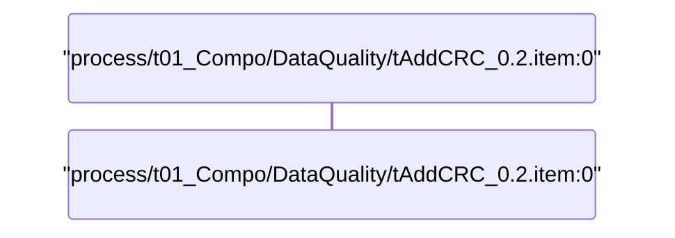

_(1 step — no `FeedsInto` edges compiled for this pipeline)_

## process/t01_Compo/DataQuality/tFuzzyMatch/DirectoryGeneration_0.1.item

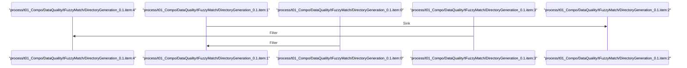

## process/t01_Compo/DataQuality/tFuzzyMatch/DirectoryService_0.1.item

```mermaid
sequenceDiagram
    participant n235d91afcb115c59a885e87daa7f9aa8 as "process/t01_Compo/DataQuality/tFuzzyMatch/DirectoryService_0.1.item:0"
    participant n96a15f8a87d351508342d12216134129 as "process/t01_Compo/DataQuality/tFuzzyMatch/DirectoryService_0.1.item:5"
    participant n582e1e26326c59f0b601f42ef838783b as "process/t01_Compo/DataQuality/tFuzzyMatch/DirectoryService_0.1.item:9"
    participant n4d22646bfe7356bca50a1e0d7608685d as "process/t01_Compo/DataQuality/tFuzzyMatch/DirectoryService_0.1.item:10"
    participant n6b18f166c9865608924a91e81503c985 as "process/t01_Compo/DataQuality/tFuzzyMatch/DirectoryService_0.1.item:7"
    participant n9233d43c012c56938fb616c3ab6210a4 as "process/t01_Compo/DataQuality/tFuzzyMatch/DirectoryService_0.1.item:2"
    participant n58f9ad4eac215050b63436a77e5d8b63 as "process/t01_Compo/DataQuality/tFuzzyMatch/DirectoryService_0.1.item:1"
    participant n2102fbdf0dd958d8ad6905f9d9aa03cc as "process/t01_Compo/DataQuality/tFuzzyMatch/DirectoryService_0.1.item:4"
    participant n3e03ff3dc9d950cc99b5112a9724be70 as "process/t01_Compo/DataQuality/tFuzzyMatch/DirectoryService_0.1.item:6"
    participant na67fc7f7d25d5f80967119784b1d8a94 as "process/t01_Compo/DataQuality/tFuzzyMatch/DirectoryService_0.1.item:3"
    participant n86ec74acc085543298a064ab2ce208e5 as "process/t01_Compo/DataQuality/tFuzzyMatch/DirectoryService_0.1.item:8"
    n96a15f8a87d351508342d12216134129->>n6b18f166c9865608924a91e81503c985: Calculate
    n96a15f8a87d351508342d12216134129->>n3e03ff3dc9d950cc99b5112a9724be70: Calculate
    n96a15f8a87d351508342d12216134129->>n582e1e26326c59f0b601f42ef838783b: Calculate
    n4d22646bfe7356bca50a1e0d7608685d->>n96a15f8a87d351508342d12216134129: Join
    n96a15f8a87d351508342d12216134129->>n86ec74acc085543298a064ab2ce208e5: Calculate
```

## process/t01_Compo/DataQuality/tFuzzyMatch_0.1.item

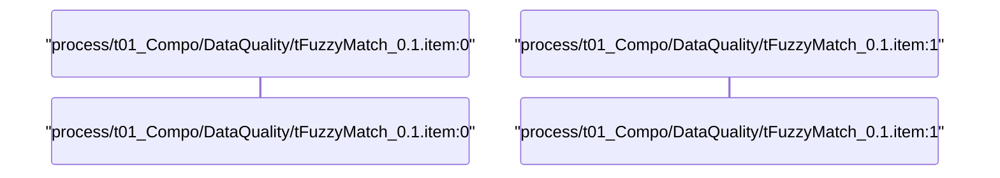

_(2 steps — no `FeedsInto` edges compiled for this pipeline)_

## process/t01_Compo/DataQuality/tIntervalMatch_0.1.item

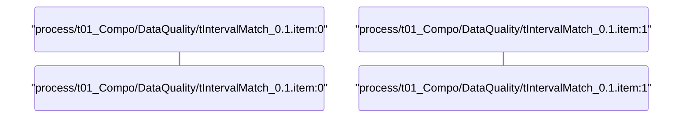

_(2 steps — no `FeedsInto` edges compiled for this pipeline)_

## process/t01_Compo/DataQuality/tReplaceList_0.1.item

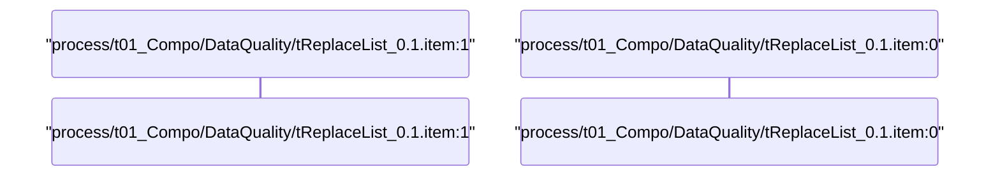

_(2 steps — no `FeedsInto` edges compiled for this pipeline)_

## process/t01_Compo/DataQuality/tSchemaComplianceCheck_0.1.item

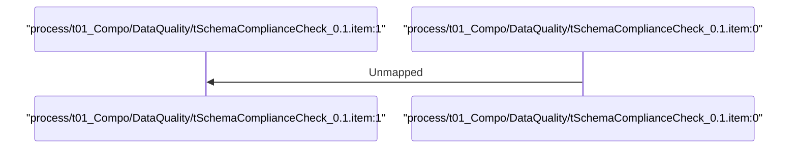

## process/t01_Compo/DataQuality/tUniqRow_0.1.item

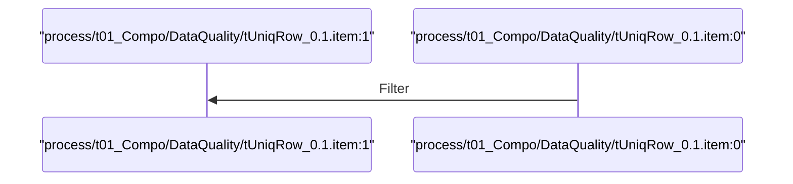

## process/t01_Compo/Databases/Bulk/tMysqlBulkExec_0.1.item

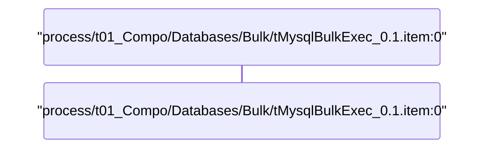

_(1 step — no `FeedsInto` edges compiled for this pipeline)_

## process/t01_Compo/Databases/Bulk/tMysqlOutputBulkExec_0.1.item

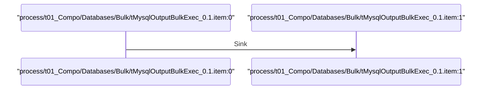

## process/t01_Compo/Databases/Bulk/tMysqlOutputBulk_0.1.item

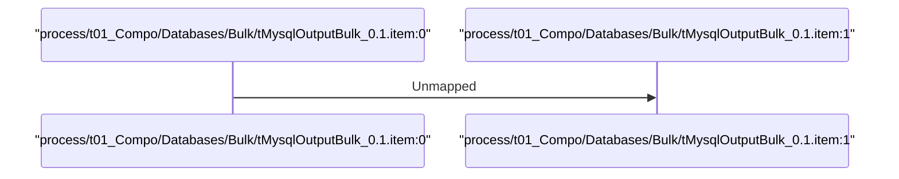

## process/t01_Compo/Databases/ComponentRow_0.1.item

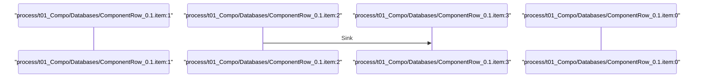

## process/t01_Compo/Databases/Connection_0.1.item

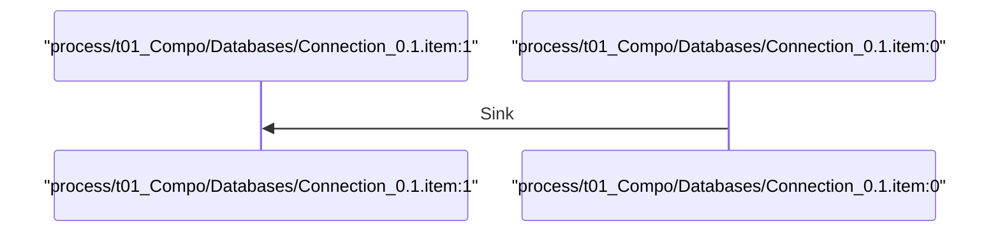

## process/t01_Compo/Databases/InOut/AS400/tAS400Output_0.1.item

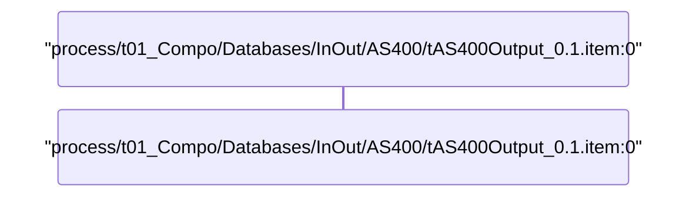

_(1 step — no `FeedsInto` edges compiled for this pipeline)_

## process/t01_Compo/Databases/InOut/Access/tAccessInput_0.1.item

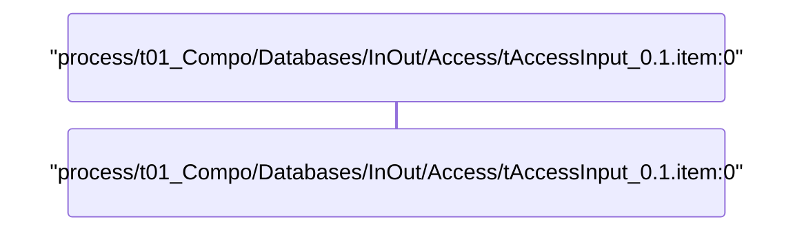

_(1 step — no `FeedsInto` edges compiled for this pipeline)_

## process/t01_Compo/Databases/InOut/Access/tAccessOutput_0.1.item

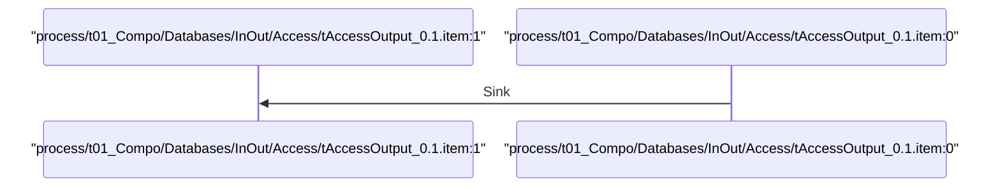

## process/t01_Compo/Databases/InOut/DB2/tDB2Input_0.1.item

```mermaid
sequenceDiagram
    participant n8524471449f45e789c841fc1a40f4dde as "process/t01_Compo/Databases/InOut/DB2/tDB2Input_0.1.item:0"
```

_(1 step — no `FeedsInto` edges compiled for this pipeline)_

## process/t01_Compo/Databases/InOut/DB2/tDB2Output_0.1.item

```mermaid
sequenceDiagram
    participant n9cfb0a507ffc52e8b3238298c7c3c58a as "process/t01_Compo/Databases/InOut/DB2/tDB2Output_0.1.item:0"
    participant n23c53897537455829a27e74d7ad4c489 as "process/t01_Compo/Databases/InOut/DB2/tDB2Output_0.1.item:1"
    n9cfb0a507ffc52e8b3238298c7c3c58a->>n23c53897537455829a27e74d7ad4c489: Sink
```

## process/t01_Compo/Databases/InOut/DBGeneric/tDBInput_0.1.item

```mermaid
sequenceDiagram
    participant n6b9e45221ba1552ea18733781c207c42 as "process/t01_Compo/Databases/InOut/DBGeneric/tDBInput_0.1.item:0"
```

_(1 step — no `FeedsInto` edges compiled for this pipeline)_

## process/t01_Compo/Databases/InOut/DBGeneric/tDBOutput_0.1.item

```mermaid
sequenceDiagram
    participant n5ab6acf93e2650f690fc7df1802502f9 as "process/t01_Compo/Databases/InOut/DBGeneric/tDBOutput_0.1.item:1"
    participant ncb45ac247cf353bf87a9d486afde953b as "process/t01_Compo/Databases/InOut/DBGeneric/tDBOutput_0.1.item:0"
    ncb45ac247cf353bf87a9d486afde953b->>n5ab6acf93e2650f690fc7df1802502f9: Sink
```

## process/t01_Compo/Databases/InOut/MSSQLServer/tMSSqlInput_0.1.item

```mermaid
sequenceDiagram
    participant n6ce18eef71d85c10b527e4b8ae707809 as "process/t01_Compo/Databases/InOut/MSSQLServer/tMSSqlInput_0.1.item:0"
```

_(1 step — no `FeedsInto` edges compiled for this pipeline)_

## process/t01_Compo/Databases/InOut/MSSQLServer/tMSSqlOutput_0.1.item

```mermaid
sequenceDiagram
    participant n539e16ac365e53e59a0811f943444e92 as "process/t01_Compo/Databases/InOut/MSSQLServer/tMSSqlOutput_0.1.item:0"
    participant nd566387afb085fafaba52dcf10d4b391 as "process/t01_Compo/Databases/InOut/MSSQLServer/tMSSqlOutput_0.1.item:1"
    n539e16ac365e53e59a0811f943444e92->>nd566387afb085fafaba52dcf10d4b391: Sink
```

## process/t01_Compo/Databases/InOut/MySQL/tMysqlInput_0.1.item

```mermaid
sequenceDiagram
    participant nc3642e5bf3a2573aacc66fe3732655b6 as "process/t01_Compo/Databases/InOut/MySQL/tMysqlInput_0.1.item:0"
```

_(1 step — no `FeedsInto` edges compiled for this pipeline)_

## process/t01_Compo/Databases/InOut/MySQL/tMysqlOutput_0.1.item

```mermaid
sequenceDiagram
    participant nfeab9ecf1d0259a6883c7ff669c0953a as "process/t01_Compo/Databases/InOut/MySQL/tMysqlOutput_0.1.item:1"
    participant n98843095a2215e14b5502897d7ba17ba as "process/t01_Compo/Databases/InOut/MySQL/tMysqlOutput_0.1.item:0"
    n98843095a2215e14b5502897d7ba17ba->>nfeab9ecf1d0259a6883c7ff669c0953a: Sink
```

## process/t01_Compo/Databases/InOut/Oracle/tOracleInput_0.1.item

```mermaid
sequenceDiagram
    participant n934afc4850b65e2eb35ba226f0e5648c as "process/t01_Compo/Databases/InOut/Oracle/tOracleInput_0.1.item:0"
```

_(1 step — no `FeedsInto` edges compiled for this pipeline)_

## process/t01_Compo/Databases/InOut/Oracle/tOracleOutput_0.1.item

```mermaid
sequenceDiagram
    participant n840e87bc9df259fb865efbd1e6215be0 as "process/t01_Compo/Databases/InOut/Oracle/tOracleOutput_0.1.item:0"
    participant ne794c9c41e0852109f70c8dc451e467d as "process/t01_Compo/Databases/InOut/Oracle/tOracleOutput_0.1.item:1"
    n840e87bc9df259fb865efbd1e6215be0->>ne794c9c41e0852109f70c8dc451e467d: Sink
```

## process/t01_Compo/Databases/InOut/PostgreSQL/tPostgreSQLInput_0.1.item

```mermaid
sequenceDiagram
    participant n0a3144b49cc055298c914d7cc783e882 as "process/t01_Compo/Databases/InOut/PostgreSQL/tPostgreSQLInput_0.1.item:0"
```

_(1 step — no `FeedsInto` edges compiled for this pipeline)_

## process/t01_Compo/Databases/InOut/PostgreSQL/tPostgreSQLOutput_0.1.item

```mermaid
sequenceDiagram
    participant n6d8c3c44cdd754e18f312319495cbd18 as "process/t01_Compo/Databases/InOut/PostgreSQL/tPostgreSQLOutput_0.1.item:1"
    participant n856e8d8a67db52c68892d58e5da31d4d as "process/t01_Compo/Databases/InOut/PostgreSQL/tPostgreSQLOutput_0.1.item:0"
    n856e8d8a67db52c68892d58e5da31d4d->>n6d8c3c44cdd754e18f312319495cbd18: Sink
```

## process/t01_Compo/Databases/InOut/SQLite/tSQLiteInput_0.1.item

```mermaid
sequenceDiagram
    participant n79217bcee5fb557fbe64e1eafaf16251 as "process/t01_Compo/Databases/InOut/SQLite/tSQLiteInput_0.1.item:0"
```

_(1 step — no `FeedsInto` edges compiled for this pipeline)_

## process/t01_Compo/Databases/InOut/SQLite/tSQLiteOutput_0.1.item

```mermaid
sequenceDiagram
    participant nb5743f66f7465a20b0a19e7e7981fffe as "process/t01_Compo/Databases/InOut/SQLite/tSQLiteOutput_0.1.item:1"
    participant n8e05cc9f2c2f5c44b8a3ce0e283b46d2 as "process/t01_Compo/Databases/InOut/SQLite/tSQLiteOutput_0.1.item:0"
    n8e05cc9f2c2f5c44b8a3ce0e283b46d2->>nb5743f66f7465a20b0a19e7e7981fffe: Sink
```

## process/t01_Compo/Databases/InOut/Sybase/tSybaseInput_0.1.item

```mermaid
sequenceDiagram
    participant n27299c4e89d4598f9597afe6864b6c53 as "process/t01_Compo/Databases/InOut/Sybase/tSybaseInput_0.1.item:0"
```

_(1 step — no `FeedsInto` edges compiled for this pipeline)_

## process/t01_Compo/Databases/InOut/Sybase/tSybaseOutput_0.1.item

```mermaid
sequenceDiagram
    participant naf26fd0f42b2508a9877378d1d4e17e5 as "process/t01_Compo/Databases/InOut/Sybase/tSybaseOutput_0.1.item:0"
    participant nbba4c34edf2952e89780c00e60746422 as "process/t01_Compo/Databases/InOut/Sybase/tSybaseOutput_0.1.item:1"
    naf26fd0f42b2508a9877378d1d4e17e5->>nbba4c34edf2952e89780c00e60746422: Sink
```

## process/t01_Compo/Databases/SCD/scd_step1_0.1.item

```mermaid
sequenceDiagram
    participant n96e817a41d0b5feabfa9eb1af8814773 as "process/t01_Compo/Databases/SCD/scd_step1_0.1.item:0"
    participant ne627801526375e28a6068ccaf033db18 as "process/t01_Compo/Databases/SCD/scd_step1_0.1.item:1"
    n96e817a41d0b5feabfa9eb1af8814773->>ne627801526375e28a6068ccaf033db18: Sink
```

## process/t01_Compo/Databases/SCD/scd_step2_0.1.item

```mermaid
sequenceDiagram
    participant nda3237ded1905be8ba49e599781ee32a as "process/t01_Compo/Databases/SCD/scd_step2_0.1.item:10"
    participant n9fa44e82f463567e914ebc558a8d24b2 as "process/t01_Compo/Databases/SCD/scd_step2_0.1.item:1"
    participant n967e9107c1e65a0ea5061f8ffe09812a as "process/t01_Compo/Databases/SCD/scd_step2_0.1.item:8"
    participant n2f8cb3aa03825de7aea4ae54987ed2b8 as "process/t01_Compo/Databases/SCD/scd_step2_0.1.item:11"
    participant nd32a260772ba58f8a6e58f02e924b744 as "process/t01_Compo/Databases/SCD/scd_step2_0.1.item:12"
    participant nb758269b5d4a508fbf6b97522a71d04e as "process/t01_Compo/Databases/SCD/scd_step2_0.1.item:17"
    participant nec159061932d5673a001a34e8763c844 as "process/t01_Compo/Databases/SCD/scd_step2_0.1.item:4"
    participant n4eb2890692b0507faf2714be1d434031 as "process/t01_Compo/Databases/SCD/scd_step2_0.1.item:2"
    participant nd706bf144a955eaf830b3b9e042fd0bd as "process/t01_Compo/Databases/SCD/scd_step2_0.1.item:23"
    participant n0aa2d290526d5e32a92d88c2af4d35f3 as "process/t01_Compo/Databases/SCD/scd_step2_0.1.item:18"
    participant nd9a6f25d0e0a54a791d748b7253a5d5e as "process/t01_Compo/Databases/SCD/scd_step2_0.1.item:16"
    participant nd05b7f1feeb6583498b2599a3494fdc0 as "process/t01_Compo/Databases/SCD/scd_step2_0.1.item:9"
    participant n74b25899dc3757fda40075b6ce73c1c1 as "process/t01_Compo/Databases/SCD/scd_step2_0.1.item:3"
    participant n8e774849daa55d338024b4313a391645 as "process/t01_Compo/Databases/SCD/scd_step2_0.1.item:19"
    participant n69ac7d6275fa5fe6baf0cbc6844c52aa as "process/t01_Compo/Databases/SCD/scd_step2_0.1.item:14"
    participant n40fc351e13fa5757a5402393cd5dd709 as "process/t01_Compo/Databases/SCD/scd_step2_0.1.item:7"
    participant n18329492ab8b5a9a86fedf1465a124e5 as "process/t01_Compo/Databases/SCD/scd_step2_0.1.item:20"
    participant nbfec7a7aa977560796e23ddc1445a5ab as "process/t01_Compo/Databases/SCD/scd_step2_0.1.item:13"
    participant n6c8cf93b3af956c4a30c4a027799c5ba as "process/t01_Compo/Databases/SCD/scd_step2_0.1.item:0"
    participant nf39a290aad455b05bceb29d23803d4bd as "process/t01_Compo/Databases/SCD/scd_step2_0.1.item:21"
    participant nca07a584585f5b77908c0fab6ed0079d as "process/t01_Compo/Databases/SCD/scd_step2_0.1.item:22"
    participant n033a9ef3816b5f6b9ad8dc109597e49a as "process/t01_Compo/Databases/SCD/scd_step2_0.1.item:6"
    participant na38e4d5b5cf359fcbf7c41f72a67b3a2 as "process/t01_Compo/Databases/SCD/scd_step2_0.1.item:15"
    participant na04caf1d60cf59d5bb7659aa68507571 as "process/t01_Compo/Databases/SCD/scd_step2_0.1.item:5"
    n4eb2890692b0507faf2714be1d434031->>n967e9107c1e65a0ea5061f8ffe09812a: Sink
    na04caf1d60cf59d5bb7659aa68507571->>n967e9107c1e65a0ea5061f8ffe09812a: Sink
    nbfec7a7aa977560796e23ddc1445a5ab->>n18329492ab8b5a9a86fedf1465a124e5: Sink
    n6c8cf93b3af956c4a30c4a027799c5ba->>n9fa44e82f463567e914ebc558a8d24b2: Calculate
    n6c8cf93b3af956c4a30c4a027799c5ba->>n40fc351e13fa5757a5402393cd5dd709: Calculate
    nd32a260772ba58f8a6e58f02e924b744->>nb758269b5d4a508fbf6b97522a71d04e: Calculate
    n6c8cf93b3af956c4a30c4a027799c5ba->>na04caf1d60cf59d5bb7659aa68507571: Calculate
    n74b25899dc3757fda40075b6ce73c1c1->>n967e9107c1e65a0ea5061f8ffe09812a: Sink
    nd32a260772ba58f8a6e58f02e924b744->>n0aa2d290526d5e32a92d88c2af4d35f3: Calculate
    n8e774849daa55d338024b4313a391645->>n18329492ab8b5a9a86fedf1465a124e5: Sink
    n6c8cf93b3af956c4a30c4a027799c5ba->>n74b25899dc3757fda40075b6ce73c1c1: Calculate
    nec159061932d5673a001a34e8763c844->>n967e9107c1e65a0ea5061f8ffe09812a: Sink
    n69ac7d6275fa5fe6baf0cbc6844c52aa->>n18329492ab8b5a9a86fedf1465a124e5: Sink
    nd32a260772ba58f8a6e58f02e924b744->>nd9a6f25d0e0a54a791d748b7253a5d5e: Calculate
    nda3237ded1905be8ba49e599781ee32a->>n2f8cb3aa03825de7aea4ae54987ed2b8: Sink
    nd32a260772ba58f8a6e58f02e924b744->>n69ac7d6275fa5fe6baf0cbc6844c52aa: Calculate
    nd32a260772ba58f8a6e58f02e924b744->>n8e774849daa55d338024b4313a391645: Calculate
    nb758269b5d4a508fbf6b97522a71d04e->>n18329492ab8b5a9a86fedf1465a124e5: Sink
    nd32a260772ba58f8a6e58f02e924b744->>nbfec7a7aa977560796e23ddc1445a5ab: Calculate
    n6c8cf93b3af956c4a30c4a027799c5ba->>nec159061932d5673a001a34e8763c844: Calculate
    n9fa44e82f463567e914ebc558a8d24b2->>n967e9107c1e65a0ea5061f8ffe09812a: Sink
    nd32a260772ba58f8a6e58f02e924b744->>na38e4d5b5cf359fcbf7c41f72a67b3a2: Calculate
    n0aa2d290526d5e32a92d88c2af4d35f3->>n18329492ab8b5a9a86fedf1465a124e5: Sink
    n6c8cf93b3af956c4a30c4a027799c5ba->>n4eb2890692b0507faf2714be1d434031: Calculate
    na38e4d5b5cf359fcbf7c41f72a67b3a2->>n18329492ab8b5a9a86fedf1465a124e5: Sink
    n6c8cf93b3af956c4a30c4a027799c5ba->>n033a9ef3816b5f6b9ad8dc109597e49a: Calculate
    n033a9ef3816b5f6b9ad8dc109597e49a->>n967e9107c1e65a0ea5061f8ffe09812a: Sink
    n40fc351e13fa5757a5402393cd5dd709->>n967e9107c1e65a0ea5061f8ffe09812a: Sink
    nd9a6f25d0e0a54a791d748b7253a5d5e->>n18329492ab8b5a9a86fedf1465a124e5: Sink
```

## process/t01_Compo/Databases/SCD/step1CreateTable_0.1.item

```mermaid
sequenceDiagram
    participant ndde7a0bfb39854008e4ba0ef382f0d11 as "process/t01_Compo/Databases/SCD/step1CreateTable_0.1.item:1"
    participant nff452014ab3b52708bab269c52be8859 as "process/t01_Compo/Databases/SCD/step1CreateTable_0.1.item:0"
    nff452014ab3b52708bab269c52be8859->>ndde7a0bfb39854008e4ba0ef382f0d11: Sink
```

## process/t01_Compo/Databases/SCD/step2ModifyData_0.1.item

```mermaid
sequenceDiagram
    participant n6198c32e275f597a93c7610ce31120c6 as "process/t01_Compo/Databases/SCD/step2ModifyData_0.1.item:4"
    participant n66d83ce03a5c584cb0d52467d8f71e9f as "process/t01_Compo/Databases/SCD/step2ModifyData_0.1.item:0"
    participant n422e5073856c518580fae0109c00be72 as "process/t01_Compo/Databases/SCD/step2ModifyData_0.1.item:5"
    participant n4e5ba16d553f59d5908a90d2dc3f3b30 as "process/t01_Compo/Databases/SCD/step2ModifyData_0.1.item:7"
    participant n788738fa1dd05579bf5c604e1c00f910 as "process/t01_Compo/Databases/SCD/step2ModifyData_0.1.item:2"
    participant n2970e18cf53859fa89c86bb73e3ec386 as "process/t01_Compo/Databases/SCD/step2ModifyData_0.1.item:8"
    participant n3b83def1478e59a1bc91232aa954880a as "process/t01_Compo/Databases/SCD/step2ModifyData_0.1.item:6"
    participant n370d2e3b3cb05cb9a22dfabc94c6e2c7 as "process/t01_Compo/Databases/SCD/step2ModifyData_0.1.item:3"
    participant n1d60e2e4141d52ee92f7631386c33b62 as "process/t01_Compo/Databases/SCD/step2ModifyData_0.1.item:1"
    n788738fa1dd05579bf5c604e1c00f910->>n370d2e3b3cb05cb9a22dfabc94c6e2c7: Calculate
    n6198c32e275f597a93c7610ce31120c6->>n422e5073856c518580fae0109c00be72: Sink
    n370d2e3b3cb05cb9a22dfabc94c6e2c7->>n422e5073856c518580fae0109c00be72: Sink
    n788738fa1dd05579bf5c604e1c00f910->>n6198c32e275f597a93c7610ce31120c6: Calculate
    n66d83ce03a5c584cb0d52467d8f71e9f->>n1d60e2e4141d52ee92f7631386c33b62: Sink
    n3b83def1478e59a1bc91232aa954880a->>n4e5ba16d553f59d5908a90d2dc3f3b30: Sink
```

## process/t01_Compo/Databases/SCD/tMysqlSCD_0.1.item

```mermaid
sequenceDiagram
    participant n42c4952dbc735510899597575d9144ab as "process/t01_Compo/Databases/SCD/tMysqlSCD_0.1.item:2"
    participant n3938b51eb7605c12af0514e7e8c5c8dc as "process/t01_Compo/Databases/SCD/tMysqlSCD_0.1.item:0"
    participant nd4345f046dc35ea9b21733352f96a25c as "process/t01_Compo/Databases/SCD/tMysqlSCD_0.1.item:4"
    participant nf708fba08f985258af5ab1cc14b4395a as "process/t01_Compo/Databases/SCD/tMysqlSCD_0.1.item:5"
    participant n47b47cc91cbb57dbbe9116ce7865075b as "process/t01_Compo/Databases/SCD/tMysqlSCD_0.1.item:1"
    participant nf3ce906476f15aedbc1c839890d1a9ab as "process/t01_Compo/Databases/SCD/tMysqlSCD_0.1.item:3"
    n3938b51eb7605c12af0514e7e8c5c8dc->>n47b47cc91cbb57dbbe9116ce7865075b: Calculate
    n3938b51eb7605c12af0514e7e8c5c8dc->>n42c4952dbc735510899597575d9144ab: Calculate
    nf3ce906476f15aedbc1c839890d1a9ab->>nd4345f046dc35ea9b21733352f96a25c: Sink
    n3938b51eb7605c12af0514e7e8c5c8dc->>nf3ce906476f15aedbc1c839890d1a9ab: Calculate
    n47b47cc91cbb57dbbe9116ce7865075b->>nd4345f046dc35ea9b21733352f96a25c: Sink
    n42c4952dbc735510899597575d9144ab->>nd4345f046dc35ea9b21733352f96a25c: Sink
```

## process/t01_Compo/Databases/SP/tMysqlSP_0.1.item

```mermaid
sequenceDiagram
    participant ncb1ee19627475c30b0841b56130ba178 as "process/t01_Compo/Databases/SP/tMysqlSP_0.1.item:1"
    participant nb31b994ed5b25a89b2f75a8d766f164f as "process/t01_Compo/Databases/SP/tMysqlSP_0.1.item:2"
    participant n59aca457383f595bb36de86ef43918a7 as "process/t01_Compo/Databases/SP/tMysqlSP_0.1.item:0"
    ncb1ee19627475c30b0841b56130ba178->>nb31b994ed5b25a89b2f75a8d766f164f: Sink
```

## process/t01_Compo/ELT/ELTdemo_0.1.item

```mermaid
sequenceDiagram
    participant neca4a32c630f5d7e85e88422d0fe1f7d as "process/t01_Compo/ELT/ELTdemo_0.1.item:6"
    participant n9b0199f0887151feabd14ea3e6aef08c as "process/t01_Compo/ELT/ELTdemo_0.1.item:2"
    participant n8cc1cd90b08253a0bd3e77b411352c6a as "process/t01_Compo/ELT/ELTdemo_0.1.item:1"
    participant nd419e92d980c5e6c86485ff337015d6e as "process/t01_Compo/ELT/ELTdemo_0.1.item:4"
    participant n6eb7548207f85875af227da8d93bc553 as "process/t01_Compo/ELT/ELTdemo_0.1.item:5"
    participant n12231409d0d359e2a2f9a3d2ede03070 as "process/t01_Compo/ELT/ELTdemo_0.1.item:0"
    participant nbd00681fab3c53299c0bdc1f74c736c8 as "process/t01_Compo/ELT/ELTdemo_0.1.item:3"
    n6eb7548207f85875af227da8d93bc553->>n8cc1cd90b08253a0bd3e77b411352c6a: Sink
    n9b0199f0887151feabd14ea3e6aef08c->>n6eb7548207f85875af227da8d93bc553: Calculate
    n9b0199f0887151feabd14ea3e6aef08c->>nbd00681fab3c53299c0bdc1f74c736c8: Calculate
    n9b0199f0887151feabd14ea3e6aef08c->>nd419e92d980c5e6c86485ff337015d6e: Calculate
    neca4a32c630f5d7e85e88422d0fe1f7d->>n8cc1cd90b08253a0bd3e77b411352c6a: Sink
    nbd00681fab3c53299c0bdc1f74c736c8->>n8cc1cd90b08253a0bd3e77b411352c6a: Sink
    n12231409d0d359e2a2f9a3d2ede03070->>n9b0199f0887151feabd14ea3e6aef08c: Join
    nd419e92d980c5e6c86485ff337015d6e->>n8cc1cd90b08253a0bd3e77b411352c6a: Sink
    n9b0199f0887151feabd14ea3e6aef08c->>neca4a32c630f5d7e85e88422d0fe1f7d: Calculate
```

## process/t01_Compo/ELT/Generic/generic_elt_step1_0.1.item

```mermaid
sequenceDiagram
    participant ne1812c51d25c595f96035e6aae0cd97b as "process/t01_Compo/ELT/Generic/generic_elt_step1_0.1.item:2"
    participant nf9ecc913808e578eb2cc16e45b7a5424 as "process/t01_Compo/ELT/Generic/generic_elt_step1_0.1.item:0"
    participant n2c7e505d3462536ea61812a6f4d772e1 as "process/t01_Compo/ELT/Generic/generic_elt_step1_0.1.item:1"
    participant n91b0c6c5705052218daa895c6bb1b07d as "process/t01_Compo/ELT/Generic/generic_elt_step1_0.1.item:3"
    ne1812c51d25c595f96035e6aae0cd97b->>n91b0c6c5705052218daa895c6bb1b07d: Sink
    nf9ecc913808e578eb2cc16e45b7a5424->>n2c7e505d3462536ea61812a6f4d772e1: Sink
```

## process/t01_Compo/ELT/Generic/generic_elt_step2_0.1.item

```mermaid
sequenceDiagram
    participant nce266b97f7bc54f6b1340c5e30404e6d as "process/t01_Compo/ELT/Generic/generic_elt_step2_0.1.item:1"
    participant n5b59413f2d555bf790c32a703dc94c9f as "process/t01_Compo/ELT/Generic/generic_elt_step2_0.1.item:4"
    participant n011dfeae7e4659b5b51e0487d1fe9d40 as "process/t01_Compo/ELT/Generic/generic_elt_step2_0.1.item:0"
    participant n07e675021d0a597191b3c5e7fab94cb6 as "process/t01_Compo/ELT/Generic/generic_elt_step2_0.1.item:6"
    participant n4d3c458270445f9c8df76cf9da0b24d5 as "process/t01_Compo/ELT/Generic/generic_elt_step2_0.1.item:2"
    participant ndc7a4f3311dd577dbc0849aca4960956 as "process/t01_Compo/ELT/Generic/generic_elt_step2_0.1.item:3"
    participant nd3ded0122069562f8d7a3337d37f44b8 as "process/t01_Compo/ELT/Generic/generic_elt_step2_0.1.item:5"
    participant n876de9cc424951d3b7c4d9b9a86342e4 as "process/t01_Compo/ELT/Generic/generic_elt_step2_0.1.item:7"
    nd3ded0122069562f8d7a3337d37f44b8->>n07e675021d0a597191b3c5e7fab94cb6: Sink
    nce266b97f7bc54f6b1340c5e30404e6d->>nd3ded0122069562f8d7a3337d37f44b8: Calculate
    nce266b97f7bc54f6b1340c5e30404e6d->>n4d3c458270445f9c8df76cf9da0b24d5: Calculate
    nce266b97f7bc54f6b1340c5e30404e6d->>n5b59413f2d555bf790c32a703dc94c9f: Calculate
    nce266b97f7bc54f6b1340c5e30404e6d->>ndc7a4f3311dd577dbc0849aca4960956: Calculate
    ndc7a4f3311dd577dbc0849aca4960956->>n07e675021d0a597191b3c5e7fab94cb6: Sink
    n011dfeae7e4659b5b51e0487d1fe9d40->>nce266b97f7bc54f6b1340c5e30404e6d: Join
    n876de9cc424951d3b7c4d9b9a86342e4->>nce266b97f7bc54f6b1340c5e30404e6d: Join
    n4d3c458270445f9c8df76cf9da0b24d5->>n07e675021d0a597191b3c5e7fab94cb6: Sink
    n5b59413f2d555bf790c32a703dc94c9f->>n07e675021d0a597191b3c5e7fab94cb6: Sink
```

## process/t01_Compo/ELT/createTables4ETL_0.1.item

```mermaid
sequenceDiagram
    participant n110dc908d5d05aabac8672c3ea6c555f as "process/t01_Compo/ELT/createTables4ETL_0.1.item:0"
    participant naad537a0531f59628e081293666c6449 as "process/t01_Compo/ELT/createTables4ETL_0.1.item:2"
    participant n1815cb1049a25ad5a730643f42782a20 as "process/t01_Compo/ELT/createTables4ETL_0.1.item:1"
    n110dc908d5d05aabac8672c3ea6c555f->>n1815cb1049a25ad5a730643f42782a20: Filter
    n1815cb1049a25ad5a730643f42782a20->>naad537a0531f59628e081293666c6449: Sink
```

## process/t01_Compo/File/Input/tFileInputARFF_0.1.item

```mermaid
sequenceDiagram
    participant n5394bc8c423a51308b9dd3c35e63e774 as "process/t01_Compo/File/Input/tFileInputARFF_0.1.item:0"
```

_(1 step — no `FeedsInto` edges compiled for this pipeline)_

## process/t01_Compo/File/Input/tFileInputDelimitedCSV_0.1.item

```mermaid
sequenceDiagram
    participant n84df8b6105a75bd18c72639561ba4654 as "process/t01_Compo/File/Input/tFileInputDelimitedCSV_0.1.item:0"
```

_(1 step — no `FeedsInto` edges compiled for this pipeline)_

## process/t01_Compo/File/Input/tFileInputDelimited_0.1.item

```mermaid
sequenceDiagram
    participant nfcc2e781e5e157aa953dacf2d5ea1252 as "process/t01_Compo/File/Input/tFileInputDelimited_0.1.item:0"
```

_(1 step — no `FeedsInto` edges compiled for this pipeline)_

## process/t01_Compo/File/Input/tFileInputExcel_0.1.item

```mermaid
sequenceDiagram
    participant n6c1fe1cbfb525046b7f07cd08cb65cc8 as "process/t01_Compo/File/Input/tFileInputExcel_0.1.item:0"
```

_(1 step — no `FeedsInto` edges compiled for this pipeline)_

## process/t01_Compo/File/Input/tFileInputLDIF_0.1.item

```mermaid
sequenceDiagram
    participant n6cc941fe52c15fc888cd281599189c66 as "process/t01_Compo/File/Input/tFileInputLDIF_0.1.item:0"
```

_(1 step — no `FeedsInto` edges compiled for this pipeline)_

## process/t01_Compo/File/Input/tFileInputMSDelimited_0.1.item

```mermaid
sequenceDiagram
    participant n1676cfa7592f5503a5c951742b39bfe7 as "process/t01_Compo/File/Input/tFileInputMSDelimited_0.1.item:0"
```

_(1 step — no `FeedsInto` edges compiled for this pipeline)_

## process/t01_Compo/File/Input/tFileInputMSPositional_0.1.item

```mermaid
sequenceDiagram
    participant n11ed549706575baa9706826ae95ee81c as "process/t01_Compo/File/Input/tFileInputMSPositional_0.1.item:0"
```

_(1 step — no `FeedsInto` edges compiled for this pipeline)_

## process/t01_Compo/File/Input/tFileInputMSXML_0.1.item

```mermaid
sequenceDiagram
    participant nfa8f4b7e706c5e43b4d460d04dfff74a as "process/t01_Compo/File/Input/tFileInputMSXML_0.1.item:1"
    participant nd1ee473e9564545f91406793cdcabf8b as "process/t01_Compo/File/Input/tFileInputMSXML_0.1.item:0"
    participant n9b2085564dab5c14896ee1966e160c2c as "process/t01_Compo/File/Input/tFileInputMSXML_0.1.item:2"
```

_(3 steps — no `FeedsInto` edges compiled for this pipeline)_

## process/t01_Compo/File/Input/tFileInputMail_0.1.item

```mermaid
sequenceDiagram
    participant n34ca6accf51f5147a142ce9bc091ce50 as "process/t01_Compo/File/Input/tFileInputMail_0.1.item:0"
```

_(1 step — no `FeedsInto` edges compiled for this pipeline)_

## process/t01_Compo/File/Input/tFileInputPositional_0.1.item

```mermaid
sequenceDiagram
    participant n4e347f58f2bc5e01ace3e929d855e644 as "process/t01_Compo/File/Input/tFileInputPositional_0.1.item:0"
```

_(1 step — no `FeedsInto` edges compiled for this pipeline)_

## process/t01_Compo/File/Input/tFileInputXML_0.1.item

```mermaid
sequenceDiagram
    participant n0dcff57a48715de6a08f69b2a7439df5 as "process/t01_Compo/File/Input/tFileInputXML_0.1.item:0"
```

_(1 step — no `FeedsInto` edges compiled for this pipeline)_

## process/t01_Compo/File/Input/tFileRegex_0.1.item

```mermaid
sequenceDiagram
    participant nce193d84910b510d8e4cec7b938cd15c as "process/t01_Compo/File/Input/tFileRegex_0.1.item:0"
```

_(1 step — no `FeedsInto` edges compiled for this pipeline)_

## process/t01_Compo/File/Management/tCreateTemporaryFile_0.1.item

```mermaid
sequenceDiagram
    participant nff3e8c1abf935012971c3259e72aeaad as "process/t01_Compo/File/Management/tCreateTemporaryFile_0.1.item:2"
    participant n2b3dba199ced5b84b4165bf4833a1b99 as "process/t01_Compo/File/Management/tCreateTemporaryFile_0.1.item:0"
    participant na518c17a28e054078815d6c5421e6ec8 as "process/t01_Compo/File/Management/tCreateTemporaryFile_0.1.item:1"
    n2b3dba199ced5b84b4165bf4833a1b99->>na518c17a28e054078815d6c5421e6ec8: Sink
```

## process/t01_Compo/File/Output/tAdvancedFileOutputXML_0.1.item

```mermaid
sequenceDiagram
    participant ne6f52938d80258e89f8bb06032a35b97 as "process/t01_Compo/File/Output/tAdvancedFileOutputXML_0.1.item:0"
```

_(1 step — no `FeedsInto` edges compiled for this pipeline)_

## process/t01_Compo/File/Output/tFileOutputDelimitedCSV_0.1.item

```mermaid
sequenceDiagram
    participant n3f914768af31512e92cfc22d902105c6 as "process/t01_Compo/File/Output/tFileOutputDelimitedCSV_0.1.item:1"
    participant nceafc9794eea5e41be28644e8e42039b as "process/t01_Compo/File/Output/tFileOutputDelimitedCSV_0.1.item:0"
    nceafc9794eea5e41be28644e8e42039b->>n3f914768af31512e92cfc22d902105c6: Sink
```

## process/t01_Compo/File/Output/tFileOutputDelimited_0.1.item

```mermaid
sequenceDiagram
    participant nd8f359743a8e5dca80c7d6a3ff30d1b3 as "process/t01_Compo/File/Output/tFileOutputDelimited_0.1.item:1"
    participant n5de0e47df53b5f0baa655b7e47a5ee00 as "process/t01_Compo/File/Output/tFileOutputDelimited_0.1.item:0"
    n5de0e47df53b5f0baa655b7e47a5ee00->>nd8f359743a8e5dca80c7d6a3ff30d1b3: Sink
```

## process/t01_Compo/File/Output/tFileOutputExcel_0.1.item

```mermaid
sequenceDiagram
    participant n2ed4e7a5a17b5cbf9139a091bf283e54 as "process/t01_Compo/File/Output/tFileOutputExcel_0.1.item:0"
    participant n2efa4900e47b5b2db39d9fae45600a74 as "process/t01_Compo/File/Output/tFileOutputExcel_0.1.item:1"
    n2ed4e7a5a17b5cbf9139a091bf283e54->>n2efa4900e47b5b2db39d9fae45600a74: Sink
```

## process/t01_Compo/File/Output/tFileOutputLDIF_0.1.item

```mermaid
sequenceDiagram
    participant n1bad29ad8f8a515e9ff6c8dfc7ca97e1 as "process/t01_Compo/File/Output/tFileOutputLDIF_0.1.item:0"
    participant n43288e8784555a6199d5de178bac9ee9 as "process/t01_Compo/File/Output/tFileOutputLDIF_0.1.item:1"
    n1bad29ad8f8a515e9ff6c8dfc7ca97e1->>n43288e8784555a6199d5de178bac9ee9: Sink
```

## process/t01_Compo/File/Output/tFileOutputMSDelimited_0.1.item

```mermaid
sequenceDiagram
    participant n1fb25bedb8c9542b9e396ffeef15acd5 as "process/t01_Compo/File/Output/tFileOutputMSDelimited_0.1.item:1"
    participant n6ccb111857b45476b58172bcd07ae341 as "process/t01_Compo/File/Output/tFileOutputMSDelimited_0.1.item:2"
    participant nddc55d92365458a49442ca15ad802415 as "process/t01_Compo/File/Output/tFileOutputMSDelimited_0.1.item:0"
    nddc55d92365458a49442ca15ad802415->>n1fb25bedb8c9542b9e396ffeef15acd5: Sink
    n6ccb111857b45476b58172bcd07ae341->>n1fb25bedb8c9542b9e396ffeef15acd5: Sink
```

## process/t01_Compo/File/Output/tFileOutputMSPositional_0.1.item

```mermaid
sequenceDiagram
    participant n9f80f6c0f2c8584680b325d8056f9ffa as "process/t01_Compo/File/Output/tFileOutputMSPositional_0.1.item:2"
    participant n5429760d83235eb2a6d5fda3139af04d as "process/t01_Compo/File/Output/tFileOutputMSPositional_0.1.item:0"
    participant n6bec36602879596e8304d311cbe18e35 as "process/t01_Compo/File/Output/tFileOutputMSPositional_0.1.item:1"
    n9f80f6c0f2c8584680b325d8056f9ffa->>n6bec36602879596e8304d311cbe18e35: Unmapped
    n5429760d83235eb2a6d5fda3139af04d->>n6bec36602879596e8304d311cbe18e35: Unmapped
```

## process/t01_Compo/File/Output/tFileOutputMSXML_0.1.item

```mermaid
sequenceDiagram
    participant nfac58ab3856954ef8fa0b31bcf634b9f as "process/t01_Compo/File/Output/tFileOutputMSXML_0.1.item:0"
    participant n2f96e37afc9d500abe6af2533a6643ba as "process/t01_Compo/File/Output/tFileOutputMSXML_0.1.item:1"
    participant n5e630028f446500ca7079a494e72d086 as "process/t01_Compo/File/Output/tFileOutputMSXML_0.1.item:2"
    nfac58ab3856954ef8fa0b31bcf634b9f->>n2f96e37afc9d500abe6af2533a6643ba: Sink
    n5e630028f446500ca7079a494e72d086->>n2f96e37afc9d500abe6af2533a6643ba: Sink
```

## process/t01_Compo/File/Output/tFileOutputPositional_0.1.item

```mermaid
sequenceDiagram
    participant nd3340904f92b5308be2a99dc13ceb29b as "process/t01_Compo/File/Output/tFileOutputPositional_0.1.item:0"
    participant n68c63918e5d854aeb52bbea7178e7a05 as "process/t01_Compo/File/Output/tFileOutputPositional_0.1.item:1"
    nd3340904f92b5308be2a99dc13ceb29b->>n68c63918e5d854aeb52bbea7178e7a05: Sink
```

## process/t01_Compo/File/Output/tFileOutputXML_0.1.item

```mermaid
sequenceDiagram
    participant n32bb1197ce5953b48fd29568788cb868 as "process/t01_Compo/File/Output/tFileOutputXML_0.1.item:1"
    participant nb82eda51c1fa573ab8cd65a4795670c9 as "process/t01_Compo/File/Output/tFileOutputXML_0.1.item:0"
    nb82eda51c1fa573ab8cd65a4795670c9->>n32bb1197ce5953b48fd29568788cb868: Sink
```

## process/t01_Compo/Internet/tFileFetch_0.1.item

```mermaid
sequenceDiagram
    participant n5beb64cc70fd5ca8b9904fd445a30e9c as "process/t01_Compo/Internet/tFileFetch_0.1.item:0"
```

_(1 step — no `FeedsInto` edges compiled for this pipeline)_

## process/t01_Compo/Internet/tMomOutput_0.1.item

```mermaid
sequenceDiagram
    participant na8c7d286413254dd95313ab491776356 as "process/t01_Compo/Internet/tMomOutput_0.1.item:0"
```

_(1 step — no `FeedsInto` edges compiled for this pipeline)_

## process/t01_Compo/Internet/tPop_0.1.item

```mermaid
sequenceDiagram
    participant nb24e9290ca96565bb73edee70271c2ce as "process/t01_Compo/Internet/tPop_0.1.item:0"
```

_(1 step — no `FeedsInto` edges compiled for this pipeline)_

## process/t01_Compo/Internet/tSocketOutput_0.1.item

```mermaid
sequenceDiagram
    participant nca369065ace156c4b881bee9419d088b as "process/t01_Compo/Internet/tSocketOutput_0.1.item:0"
```

_(1 step — no `FeedsInto` edges compiled for this pipeline)_

## process/t01_Compo/LogError/tFlowMeter1_0.1.item

```mermaid
sequenceDiagram
    participant n2dfe36aa31fe5f6fab5cc5cc0a65434c as "process/t01_Compo/LogError/tFlowMeter1_0.1.item:0"
    participant n1e6d69eea7dc54e89dbb082d75223795 as "process/t01_Compo/LogError/tFlowMeter1_0.1.item:1"
```

_(2 steps — no `FeedsInto` edges compiled for this pipeline)_

## process/t01_Compo/LogError/tFlowMeter2_0.1.item

```mermaid
sequenceDiagram
    participant n2717cd016a135a06937ad9be238b4b7e as "process/t01_Compo/LogError/tFlowMeter2_0.1.item:0"
    participant n81c6d53f136f507c98b235c85f8e195c as "process/t01_Compo/LogError/tFlowMeter2_0.1.item:1"
```

_(2 steps — no `FeedsInto` edges compiled for this pipeline)_

## process/t01_Compo/LogError/tLogCatcher1_0.1.item

```mermaid
sequenceDiagram
    participant n0779b119e07c56d5b19b0dc63059f459 as "process/t01_Compo/LogError/tLogCatcher1_0.1.item:0"
    participant n421e7026b7dd57288a31a0e04ce9864c as "process/t01_Compo/LogError/tLogCatcher1_0.1.item:1"
    n0779b119e07c56d5b19b0dc63059f459->>n421e7026b7dd57288a31a0e04ce9864c: Sink
```

## process/t01_Compo/LogError/tLogCatcher2_0.1.item

```mermaid
sequenceDiagram
    participant n79eed40b9162562889e8bdfb60ee042d as "process/t01_Compo/LogError/tLogCatcher2_0.1.item:0"
    participant ndc1d0a35782655f6b9033d5ec215ffa6 as "process/t01_Compo/LogError/tLogCatcher2_0.1.item:1"
    n79eed40b9162562889e8bdfb60ee042d->>ndc1d0a35782655f6b9033d5ec215ffa6: Sink
```

## process/t01_Compo/LogError/tStatCatcher1_0.1.item

```mermaid
sequenceDiagram
    participant n23289a5987725356954181ec0588a346 as "process/t01_Compo/LogError/tStatCatcher1_0.1.item:1"
    participant n0aeb25bf3341523c890ebefcaa03a818 as "process/t01_Compo/LogError/tStatCatcher1_0.1.item:2"
    participant n2d5ca1bf003554b3a7a36e71977b4141 as "process/t01_Compo/LogError/tStatCatcher1_0.1.item:0"
    n2d5ca1bf003554b3a7a36e71977b4141->>n23289a5987725356954181ec0588a346: Filter
    n23289a5987725356954181ec0588a346->>n0aeb25bf3341523c890ebefcaa03a818: Sink
```

## process/t01_Compo/LogError/tStatCatcher2_0.1.item

```mermaid
sequenceDiagram
    participant n32a431be58155d37b9b5deb68b1d3228 as "process/t01_Compo/LogError/tStatCatcher2_0.1.item:0"
    participant n4f9ef193f9435c84812b046c6cf91b3e as "process/t01_Compo/LogError/tStatCatcher2_0.1.item:1"
    participant n811eb472619a59b98a699b71abb85452 as "process/t01_Compo/LogError/tStatCatcher2_0.1.item:2"
    n4f9ef193f9435c84812b046c6cf91b3e->>n811eb472619a59b98a699b71abb85452: Sink
    n32a431be58155d37b9b5deb68b1d3228->>n4f9ef193f9435c84812b046c6cf91b3e: Filter
```

## process/t01_Compo/Misc/tAddLocationFromIP_0.1.item

```mermaid
sequenceDiagram
    participant na7375c98095b53ecbba954b78153a7e4 as "process/t01_Compo/Misc/tAddLocationFromIP_0.1.item:0"
    participant n257cf32f462657b4aed6d62112d2e2d5 as "process/t01_Compo/Misc/tAddLocationFromIP_0.1.item:1"
```

_(2 steps — no `FeedsInto` edges compiled for this pipeline)_

## process/t01_Compo/Misc/tContextLoad_0.1.item

```mermaid
sequenceDiagram
    participant n5baa34401f2d588c9e420d830c67f154 as "process/t01_Compo/Misc/tContextLoad_0.1.item:0"
```

_(1 step — no `FeedsInto` edges compiled for this pipeline)_

## process/t01_Compo/Misc/tFixedFlowInput_0.1.item

```mermaid
sequenceDiagram
    participant n89d5cdd3bd6d51649bd5d8585303390d as "process/t01_Compo/Misc/tFixedFlowInput_0.1.item:0"
```

_(1 step — no `FeedsInto` edges compiled for this pipeline)_

## process/t01_Compo/Misc/tFlowToIterate_0.1.item

```mermaid
sequenceDiagram
    participant nb5fa44fc2e4b5e14b63151c0c8415ca6 as "process/t01_Compo/Misc/tFlowToIterate_0.1.item:1"
    participant nffa4b2f200295c42a8dfbc06e642ee1d as "process/t01_Compo/Misc/tFlowToIterate_0.1.item:0"
```

_(2 steps — no `FeedsInto` edges compiled for this pipeline)_

## process/t01_Compo/Misc/tRowGenerator_0.1.item

```mermaid
sequenceDiagram
    participant n309211927d725dd3b38b125051734b2a as "process/t01_Compo/Misc/tRowGenerator_0.1.item:0"
```

_(1 step — no `FeedsInto` edges compiled for this pipeline)_

## process/t01_Compo/Orchestration/tPreJob_0.1.item

```mermaid
sequenceDiagram
    participant n23dd113acfd95ff69a86dadf0f581fe6 as "process/t01_Compo/Orchestration/tPreJob_0.1.item:0"
```

_(1 step — no `FeedsInto` edges compiled for this pipeline)_

## process/t01_Compo/Orchestration/tUnite_0.1.item

```mermaid
sequenceDiagram
    participant ne9148205b5db54ae93d696193736facf as "process/t01_Compo/Orchestration/tUnite_0.1.item:0"
    participant n101f45aaa55d5266b87da715d559d0f5 as "process/t01_Compo/Orchestration/tUnite_0.1.item:1"
    participant n65da91ed0ab056a78de91c6dbda2e722 as "process/t01_Compo/Orchestration/tUnite_0.1.item:2"
    ne9148205b5db54ae93d696193736facf->>n101f45aaa55d5266b87da715d559d0f5: Unmapped
    n65da91ed0ab056a78de91c6dbda2e722->>n101f45aaa55d5266b87da715d559d0f5: Unmapped
```

## process/t01_Compo/Orchestration/tWaitForSQL/step2_0.1.item

```mermaid
sequenceDiagram
    participant n81f40c034c2557629a1a760b04000131 as "process/t01_Compo/Orchestration/tWaitForSQL/step2_0.1.item:0"
    participant n366c948408505438a73bfad071caaffe as "process/t01_Compo/Orchestration/tWaitForSQL/step2_0.1.item:1"
    n81f40c034c2557629a1a760b04000131->>n366c948408505438a73bfad071caaffe: Sink
```

## process/t01_Compo/Processing/Fields/tExtractDelimitedFields_0.1.item

```mermaid
sequenceDiagram
    participant nb37c6b40045d5852bb0bbef01dc2260a as "process/t01_Compo/Processing/Fields/tExtractDelimitedFields_0.1.item:1"
    participant nfbf1f9d691f15418a7220b6ed941d293 as "process/t01_Compo/Processing/Fields/tExtractDelimitedFields_0.1.item:0"
    nfbf1f9d691f15418a7220b6ed941d293->>nb37c6b40045d5852bb0bbef01dc2260a: Unmapped
```

## process/t01_Compo/Processing/Fields/tExtractPositionalFields_0.1.item

```mermaid
sequenceDiagram
    participant nd6826c6ecae150d0805c89e561cebfbd as "process/t01_Compo/Processing/Fields/tExtractPositionalFields_0.1.item:0"
```

_(1 step — no `FeedsInto` edges compiled for this pipeline)_

## process/t01_Compo/Processing/Fields/tExtractRegexFields_0.1.item

```mermaid
sequenceDiagram
    participant nfa1745a0b1d458c0b22d278f05d4c724 as "process/t01_Compo/Processing/Fields/tExtractRegexFields_0.1.item:0"
    participant n45cf83a75edf54fe98517c601df7b34d as "process/t01_Compo/Processing/Fields/tExtractRegexFields_0.1.item:1"
    nfa1745a0b1d458c0b22d278f05d4c724->>n45cf83a75edf54fe98517c601df7b34d: Unmapped
```

## process/t01_Compo/Processing/tAggregateRow_0.1.item

```mermaid
sequenceDiagram
    participant n6a63f616665f5f5b9a25fa8e2be12d2c as "process/t01_Compo/Processing/tAggregateRow_0.1.item:0"
    participant n442d1b63d3ba5292b31eede76bb1d8b1 as "process/t01_Compo/Processing/tAggregateRow_0.1.item:1"
    n6a63f616665f5f5b9a25fa8e2be12d2c->>n442d1b63d3ba5292b31eede76bb1d8b1: Aggregate
```

## process/t01_Compo/Processing/tAggregateSortedRow_0.1.item

```mermaid
sequenceDiagram
    participant ne7284dd182685aa084fcc9e3a55651b5 as "process/t01_Compo/Processing/tAggregateSortedRow_0.1.item:2"
    participant n4b21e48a36055c9d87c3e502c63d4caa as "process/t01_Compo/Processing/tAggregateSortedRow_0.1.item:1"
    participant n969c5c58ad7c5a018c55620c1e60dcbf as "process/t01_Compo/Processing/tAggregateSortedRow_0.1.item:0"
    n4b21e48a36055c9d87c3e502c63d4caa->>ne7284dd182685aa084fcc9e3a55651b5: Aggregate
    n969c5c58ad7c5a018c55620c1e60dcbf->>n4b21e48a36055c9d87c3e502c63d4caa: Unmapped
```

## process/t01_Compo/Processing/tBufferOutput_0.1.item

```mermaid
sequenceDiagram
    participant n4b0240547fd2582ebb313d3d2da3762a as "process/t01_Compo/Processing/tBufferOutput_0.1.item:0"
    participant nd144039af40553f1b869ed78990c8c7d as "process/t01_Compo/Processing/tBufferOutput_0.1.item:1"
    n4b0240547fd2582ebb313d3d2da3762a->>nd144039af40553f1b869ed78990c8c7d: Sink
```

## process/t01_Compo/Processing/tDenormalize_0.1.item

```mermaid
sequenceDiagram
    participant n3dd12dc5d0be59a5b6519eadcd8eed4a as "process/t01_Compo/Processing/tDenormalize_0.1.item:0"
    participant n8d0b5c467bbd569e98c17c633178e2a2 as "process/t01_Compo/Processing/tDenormalize_0.1.item:1"
    n3dd12dc5d0be59a5b6519eadcd8eed4a->>n8d0b5c467bbd569e98c17c633178e2a2: Unmapped
```

## process/t01_Compo/Processing/tExternalSortRow_0.1.item

```mermaid
sequenceDiagram
    participant nae9faed6340258ad9fd2806c1b546b55 as "process/t01_Compo/Processing/tExternalSortRow_0.1.item:0"
```

_(1 step — no `FeedsInto` edges compiled for this pipeline)_

## process/t01_Compo/Processing/tFilterColumns_0.1.item

```mermaid
sequenceDiagram
    participant nb5693d43493c5d569277a5f56818b833 as "process/t01_Compo/Processing/tFilterColumns_0.1.item:0"
    participant n10ec3bc2f79e57b9a8d7f70d29fa94b6 as "process/t01_Compo/Processing/tFilterColumns_0.1.item:1"
    nb5693d43493c5d569277a5f56818b833->>n10ec3bc2f79e57b9a8d7f70d29fa94b6: Unmapped
```

## process/t01_Compo/Processing/tFilterRows_0.1.item

```mermaid
sequenceDiagram
    participant nb1ad4a9afb1652f981facb63b7f61b3f as "process/t01_Compo/Processing/tFilterRows_0.1.item:1"
    participant n019d58b210dd587dbd7b20549d598399 as "process/t01_Compo/Processing/tFilterRows_0.1.item:0"
    n019d58b210dd587dbd7b20549d598399->>nb1ad4a9afb1652f981facb63b7f61b3f: Filter
```

## process/t01_Compo/Processing/tJoin_0.1.item

```mermaid
sequenceDiagram
    participant na4e7abbfdf125a81929de3c2220b637d as "process/t01_Compo/Processing/tJoin_0.1.item:0"
    participant nc982cea13f9e51c2b195f7df8983169b as "process/t01_Compo/Processing/tJoin_0.1.item:2"
    participant n80133275998a530e98fbc6ab672ace81 as "process/t01_Compo/Processing/tJoin_0.1.item:1"
    na4e7abbfdf125a81929de3c2220b637d->>nc982cea13f9e51c2b195f7df8983169b: Unmapped
    n80133275998a530e98fbc6ab672ace81->>nc982cea13f9e51c2b195f7df8983169b: Unmapped
```

## process/t01_Compo/Processing/tMap/Reload_At_Each_Row/tMap_Reload_At_Each_Row_1_0.1.item

```mermaid
sequenceDiagram
    participant nf8fb3920c2965a0385a89ab7c6d89ff2 as "process/t01_Compo/Processing/tMap/Reload_At_Each_Row/tMap_Reload_At_Each_Row_1_0.1.item:2"
    participant na8af44e7cd6b5beeb51d29c281df7f25 as "process/t01_Compo/Processing/tMap/Reload_At_Each_Row/tMap_Reload_At_Each_Row_1_0.1.item:1"
    participant ncb6fd62ff4ed51f0b06c393c034493ac as "process/t01_Compo/Processing/tMap/Reload_At_Each_Row/tMap_Reload_At_Each_Row_1_0.1.item:0"
    participant n3a7ede8c3c9c599885eb1571667141ac as "process/t01_Compo/Processing/tMap/Reload_At_Each_Row/tMap_Reload_At_Each_Row_1_0.1.item:3"
    nf8fb3920c2965a0385a89ab7c6d89ff2->>n3a7ede8c3c9c599885eb1571667141ac: Sink
    ncb6fd62ff4ed51f0b06c393c034493ac->>na8af44e7cd6b5beeb51d29c281df7f25: Sink
```

## process/t01_Compo/Processing/tMap/Reload_At_Each_Row/tMap_Reload_At_Each_Row_2_0.1.item

```mermaid
sequenceDiagram
    participant n8b68ab2814725b56b9ce49c4c8012199 as "process/t01_Compo/Processing/tMap/Reload_At_Each_Row/tMap_Reload_At_Each_Row_2_0.1.item:5"
    participant n71e6060c0bbe5f8cb0c7ad082a50ee17 as "process/t01_Compo/Processing/tMap/Reload_At_Each_Row/tMap_Reload_At_Each_Row_2_0.1.item:3"
    participant na457bfcb09ec5de99321daab48f48c8a as "process/t01_Compo/Processing/tMap/Reload_At_Each_Row/tMap_Reload_At_Each_Row_2_0.1.item:4"
    participant nb20bef6e09c05801b7036437c3065ca3 as "process/t01_Compo/Processing/tMap/Reload_At_Each_Row/tMap_Reload_At_Each_Row_2_0.1.item:1"
    participant naeabf64c345d5783bb9a0ffe4edfba38 as "process/t01_Compo/Processing/tMap/Reload_At_Each_Row/tMap_Reload_At_Each_Row_2_0.1.item:0"
    participant ndd5cf1611ab75c408fcd7625fbdfe9d1 as "process/t01_Compo/Processing/tMap/Reload_At_Each_Row/tMap_Reload_At_Each_Row_2_0.1.item:6"
    participant nd8cdde70e3df52d187ee378680b04669 as "process/t01_Compo/Processing/tMap/Reload_At_Each_Row/tMap_Reload_At_Each_Row_2_0.1.item:2"
    naeabf64c345d5783bb9a0ffe4edfba38->>nb20bef6e09c05801b7036437c3065ca3: Join
    nb20bef6e09c05801b7036437c3065ca3->>n8b68ab2814725b56b9ce49c4c8012199: Calculate
    ndd5cf1611ab75c408fcd7625fbdfe9d1->>nb20bef6e09c05801b7036437c3065ca3: Join
    nb20bef6e09c05801b7036437c3065ca3->>nd8cdde70e3df52d187ee378680b04669: Calculate
    nb20bef6e09c05801b7036437c3065ca3->>na457bfcb09ec5de99321daab48f48c8a: Calculate
    nb20bef6e09c05801b7036437c3065ca3->>n71e6060c0bbe5f8cb0c7ad082a50ee17: Calculate
```

## process/t01_Compo/Processing/tMap/tMapParse_0.1.item

```mermaid
sequenceDiagram
    participant n2fd70b7029305f1fb6e6eb0884f075bd as "process/t01_Compo/Processing/tMap/tMapParse_0.1.item:2"
    participant n6aa5f94617035f1280cc455914ea515b as "process/t01_Compo/Processing/tMap/tMapParse_0.1.item:0"
    participant n813ae8156f6c58e58db8ca08b552a6ca as "process/t01_Compo/Processing/tMap/tMapParse_0.1.item:4"
    participant n8014ce69ba2f54c8a9590361aa483c23 as "process/t01_Compo/Processing/tMap/tMapParse_0.1.item:3"
    participant n56b8ada3cebd5656bf88e5c990a8d36c as "process/t01_Compo/Processing/tMap/tMapParse_0.1.item:1"
    n6aa5f94617035f1280cc455914ea515b->>n2fd70b7029305f1fb6e6eb0884f075bd: Join
    n2fd70b7029305f1fb6e6eb0884f075bd->>n813ae8156f6c58e58db8ca08b552a6ca: Calculate
    n56b8ada3cebd5656bf88e5c990a8d36c->>n2fd70b7029305f1fb6e6eb0884f075bd: Join
    n2fd70b7029305f1fb6e6eb0884f075bd->>n8014ce69ba2f54c8a9590361aa483c23: Calculate
```

## process/t01_Compo/Processing/tMap/tMap_1_0.1.item

```mermaid
sequenceDiagram
    participant n4aa3ef79e94453428321f83ac89a7eec as "process/t01_Compo/Processing/tMap/tMap_1_0.1.item:2"
    participant nfd25ab0d9e525260a2c03d538708a93c as "process/t01_Compo/Processing/tMap/tMap_1_0.1.item:1"
    participant n2d9137ece08d5630992d58abdee2b305 as "process/t01_Compo/Processing/tMap/tMap_1_0.1.item:0"
    n2d9137ece08d5630992d58abdee2b305->>n4aa3ef79e94453428321f83ac89a7eec: Calculate
    n2d9137ece08d5630992d58abdee2b305->>nfd25ab0d9e525260a2c03d538708a93c: Calculate
```

## process/t01_Compo/Processing/tMap/tMap_2_0.1.item

```mermaid
sequenceDiagram
    participant n5759cb4c7d615218bd6f35475a5fbbff as "process/t01_Compo/Processing/tMap/tMap_2_0.1.item:1"
    participant n13b8e00001ed5f3fa514a122d1813e65 as "process/t01_Compo/Processing/tMap/tMap_2_0.1.item:3"
    participant n6e01709450515c2188f4239f3b5259da as "process/t01_Compo/Processing/tMap/tMap_2_0.1.item:5"
    participant nd20cfab24703597d856e5d6f5868dd91 as "process/t01_Compo/Processing/tMap/tMap_2_0.1.item:2"
    participant n46e1670ff85e59298d070ff3a43b4dc6 as "process/t01_Compo/Processing/tMap/tMap_2_0.1.item:4"
    participant n56356794571d539d95c50842bab8e827 as "process/t01_Compo/Processing/tMap/tMap_2_0.1.item:0"
    n56356794571d539d95c50842bab8e827->>n46e1670ff85e59298d070ff3a43b4dc6: Calculate
    n56356794571d539d95c50842bab8e827->>n13b8e00001ed5f3fa514a122d1813e65: Calculate
    n56356794571d539d95c50842bab8e827->>n6e01709450515c2188f4239f3b5259da: Calculate
    n56356794571d539d95c50842bab8e827->>n5759cb4c7d615218bd6f35475a5fbbff: Calculate
    n56356794571d539d95c50842bab8e827->>nd20cfab24703597d856e5d6f5868dd91: Calculate
```

## process/t01_Compo/Processing/tMap/tMap_3_0.1.item

```mermaid
sequenceDiagram
    participant na8fcd29fdef059c69b851c02a8b78991 as "process/t01_Compo/Processing/tMap/tMap_3_0.1.item:7"
    participant n32087e6e45a2569aa261e2961ef53145 as "process/t01_Compo/Processing/tMap/tMap_3_0.1.item:6"
    participant nb983a0e7657d5e2fa741851d92841985 as "process/t01_Compo/Processing/tMap/tMap_3_0.1.item:8"
    participant n06bbeca0e91f54fd92a3ffb1708cfb05 as "process/t01_Compo/Processing/tMap/tMap_3_0.1.item:1"
    participant n46d1d46a7b1a5e558146687c4b82b408 as "process/t01_Compo/Processing/tMap/tMap_3_0.1.item:11"
    participant n78ce5a40ed7557faa61c94509312b66f as "process/t01_Compo/Processing/tMap/tMap_3_0.1.item:0"
    participant naabd0ff5599e5035b94401e97983ebac as "process/t01_Compo/Processing/tMap/tMap_3_0.1.item:4"
    participant n0609a668bff855389025ed314010913b as "process/t01_Compo/Processing/tMap/tMap_3_0.1.item:5"
    participant n37d7be67af7d512e812aa1993bd230c2 as "process/t01_Compo/Processing/tMap/tMap_3_0.1.item:9"
    participant n9b3038c0161c504c84f4e16cf641cb43 as "process/t01_Compo/Processing/tMap/tMap_3_0.1.item:2"
    participant nb2aa34de2129599f9b70c6a073c07c66 as "process/t01_Compo/Processing/tMap/tMap_3_0.1.item:3"
    participant na9135fe9a8555500a8163633845b9d6f as "process/t01_Compo/Processing/tMap/tMap_3_0.1.item:10"
    n06bbeca0e91f54fd92a3ffb1708cfb05->>n0609a668bff855389025ed314010913b: Calculate
    n06bbeca0e91f54fd92a3ffb1708cfb05->>n32087e6e45a2569aa261e2961ef53145: Calculate
    n06bbeca0e91f54fd92a3ffb1708cfb05->>naabd0ff5599e5035b94401e97983ebac: Calculate
    n78ce5a40ed7557faa61c94509312b66f->>na8fcd29fdef059c69b851c02a8b78991: Calculate
    n06bbeca0e91f54fd92a3ffb1708cfb05->>n9b3038c0161c504c84f4e16cf641cb43: Calculate
    n78ce5a40ed7557faa61c94509312b66f->>nb983a0e7657d5e2fa741851d92841985: Calculate
    n06bbeca0e91f54fd92a3ffb1708cfb05->>nb2aa34de2129599f9b70c6a073c07c66: Calculate
    n78ce5a40ed7557faa61c94509312b66f->>n06bbeca0e91f54fd92a3ffb1708cfb05: Filter
    n78ce5a40ed7557faa61c94509312b66f->>n37d7be67af7d512e812aa1993bd230c2: Calculate
    n78ce5a40ed7557faa61c94509312b66f->>na9135fe9a8555500a8163633845b9d6f: Calculate
    n78ce5a40ed7557faa61c94509312b66f->>n46d1d46a7b1a5e558146687c4b82b408: Calculate
```

## process/t01_Compo/Processing/tMap/tMap_4_0.1.item

```mermaid
sequenceDiagram
    participant n02ce646894c95cccbf124ce41a708b37 as "process/t01_Compo/Processing/tMap/tMap_4_0.1.item:5"
    participant n3df884e12dc95df4b0e16cfc03c59c2b as "process/t01_Compo/Processing/tMap/tMap_4_0.1.item:13"
    participant n5bf5ef8b89ae5a4d82f6b4936d498e62 as "process/t01_Compo/Processing/tMap/tMap_4_0.1.item:8"
    participant n4303ae08cfad5ec8911059b5897f05e4 as "process/t01_Compo/Processing/tMap/tMap_4_0.1.item:0"
    participant nb84e274a786054ba9826bdd58188e8fd as "process/t01_Compo/Processing/tMap/tMap_4_0.1.item:10"
    participant n37db42bb52465cd1a01c236d8eacd40c as "process/t01_Compo/Processing/tMap/tMap_4_0.1.item:3"
    participant n735f238fad6958609784170c49990b14 as "process/t01_Compo/Processing/tMap/tMap_4_0.1.item:6"
    participant n8a6ed5f538ac5f51818593218fbb5bc2 as "process/t01_Compo/Processing/tMap/tMap_4_0.1.item:4"
    participant n5b4df4a8fad35a09a31968b731291228 as "process/t01_Compo/Processing/tMap/tMap_4_0.1.item:12"
    participant na87b0b9c07be57ce9c0851a74bb33f81 as "process/t01_Compo/Processing/tMap/tMap_4_0.1.item:1"
    participant na42fae226f6a5ddd9f6ed029826bc57f as "process/t01_Compo/Processing/tMap/tMap_4_0.1.item:2"
    participant n50fbc46fd5385e10912c460fa0068b42 as "process/t01_Compo/Processing/tMap/tMap_4_0.1.item:11"
    participant n87c37d4e25d359498ecea1deb46f7b3a as "process/t01_Compo/Processing/tMap/tMap_4_0.1.item:9"
    participant n69de3130b3fa57bdbb2f3dc799d35148 as "process/t01_Compo/Processing/tMap/tMap_4_0.1.item:7"
    na87b0b9c07be57ce9c0851a74bb33f81->>n87c37d4e25d359498ecea1deb46f7b3a: Calculate
    na87b0b9c07be57ce9c0851a74bb33f81->>n50fbc46fd5385e10912c460fa0068b42: Calculate
    na87b0b9c07be57ce9c0851a74bb33f81->>n5b4df4a8fad35a09a31968b731291228: Calculate
    n3df884e12dc95df4b0e16cfc03c59c2b->>na87b0b9c07be57ce9c0851a74bb33f81: Join
    na87b0b9c07be57ce9c0851a74bb33f81->>n02ce646894c95cccbf124ce41a708b37: Calculate
    na87b0b9c07be57ce9c0851a74bb33f81->>n5bf5ef8b89ae5a4d82f6b4936d498e62: Calculate
    na87b0b9c07be57ce9c0851a74bb33f81->>n8a6ed5f538ac5f51818593218fbb5bc2: Calculate
    na87b0b9c07be57ce9c0851a74bb33f81->>n69de3130b3fa57bdbb2f3dc799d35148: Calculate
    n4303ae08cfad5ec8911059b5897f05e4->>na87b0b9c07be57ce9c0851a74bb33f81: Join
    na87b0b9c07be57ce9c0851a74bb33f81->>nb84e274a786054ba9826bdd58188e8fd: Calculate
    na87b0b9c07be57ce9c0851a74bb33f81->>na42fae226f6a5ddd9f6ed029826bc57f: Calculate
    na87b0b9c07be57ce9c0851a74bb33f81->>n735f238fad6958609784170c49990b14: Calculate
    na87b0b9c07be57ce9c0851a74bb33f81->>n37db42bb52465cd1a01c236d8eacd40c: Calculate
```

## process/t01_Compo/Processing/tNormalize_0.1.item

```mermaid
sequenceDiagram
    participant n6d130fcfd634580c82219770b80768e5 as "process/t01_Compo/Processing/tNormalize_0.1.item:1"
    participant nd6f75de663ba5a1ca084569b346439e8 as "process/t01_Compo/Processing/tNormalize_0.1.item:0"
    nd6f75de663ba5a1ca084569b346439e8->>n6d130fcfd634580c82219770b80768e5: Unmapped
```

## process/t01_Compo/Processing/tReplace_0.1.item

```mermaid
sequenceDiagram
    participant n06bde0ca78e056bdb5bc68fa558826fe as "process/t01_Compo/Processing/tReplace_0.1.item:1"
    participant n888e33cdd17a5f819af0c2d47759c585 as "process/t01_Compo/Processing/tReplace_0.1.item:0"
    n888e33cdd17a5f819af0c2d47759c585->>n06bde0ca78e056bdb5bc68fa558826fe: Unmapped
```

## process/t01_Compo/Processing/tReplicate_0.1.item

```mermaid
sequenceDiagram
    participant nbd760fb591be5ae78e779ee166995652 as "process/t01_Compo/Processing/tReplicate_0.1.item:0"
    participant n48bd19d0f20c5c04be2d237d401f37f5 as "process/t01_Compo/Processing/tReplicate_0.1.item:1"
    nbd760fb591be5ae78e779ee166995652->>n48bd19d0f20c5c04be2d237d401f37f5: Unmapped
```

## process/t01_Compo/Processing/tSampleRow_0.1.item

```mermaid
sequenceDiagram
    participant n2c692b9706d3533eb57aa7671bb05588 as "process/t01_Compo/Processing/tSampleRow_0.1.item:1"
    participant n98180c2127ba5441b3571ec0ef1697ab as "process/t01_Compo/Processing/tSampleRow_0.1.item:0"
    n98180c2127ba5441b3571ec0ef1697ab->>n2c692b9706d3533eb57aa7671bb05588: Unmapped
```

## process/t01_Compo/Processing/tSortRow_0.1.item

```mermaid
sequenceDiagram
    participant n1669caf70b055040bfaf52e3824a7005 as "process/t01_Compo/Processing/tSortRow_0.1.item:0"
    participant nb3208b2e8a5d5405a45af2ef4f987e02 as "process/t01_Compo/Processing/tSortRow_0.1.item:1"
    n1669caf70b055040bfaf52e3824a7005->>nb3208b2e8a5d5405a45af2ef4f987e02: Unmapped
```

## process/t01_Compo/System_/tRunJobRow/jobSample_0.1.item

```mermaid
sequenceDiagram
    participant n6088b83b586e500a9f0b17403c7618a3 as "process/t01_Compo/System_/tRunJobRow/jobSample_0.1.item:1"
    participant nec5c5ba2c66d5385888f7a1e5639ba3a as "process/t01_Compo/System_/tRunJobRow/jobSample_0.1.item:0"
    nec5c5ba2c66d5385888f7a1e5639ba3a->>n6088b83b586e500a9f0b17403c7618a3: Sink
```

## process/t01_Compo/XML/tAdvancedFOXML_0.1.item

```mermaid
sequenceDiagram
    participant nf739eb087a6355229e0e029c6a35ce6c as "process/t01_Compo/XML/tAdvancedFOXML_0.1.item:0"
```

_(1 step — no `FeedsInto` edges compiled for this pipeline)_

## process/t01_Compo/XML/xmlSample2_0.1.item

```mermaid
sequenceDiagram
    participant na953fa7a1efd5e5e9f8f0e0f3df79d07 as "process/t01_Compo/XML/xmlSample2_0.1.item:2"
    participant n82f52de503035f00bbe5769fbf9e9185 as "process/t01_Compo/XML/xmlSample2_0.1.item:8"
    participant n8732c9c928005f21bfd70cd549a22c19 as "process/t01_Compo/XML/xmlSample2_0.1.item:1"
    participant nd1b562a49a0552d68e74e9d8405f5b5f as "process/t01_Compo/XML/xmlSample2_0.1.item:5"
    participant n1519690314355e928756120ccc0eff03 as "process/t01_Compo/XML/xmlSample2_0.1.item:3"
    participant n613e0edee30d57d9b02de856769ddcbc as "process/t01_Compo/XML/xmlSample2_0.1.item:4"
    participant n4c9752c2f0935e45bdb4112ac5f6c53d as "process/t01_Compo/XML/xmlSample2_0.1.item:0"
    participant n7d4d950eb669529182a359b775102d1a as "process/t01_Compo/XML/xmlSample2_0.1.item:7"
    participant n2408c11fd29052cd895ecaeb14b581b3 as "process/t01_Compo/XML/xmlSample2_0.1.item:6"
    participant ne082272ec23b558ab4c28d69208b9bcf as "process/t01_Compo/XML/xmlSample2_0.1.item:9"
    n4c9752c2f0935e45bdb4112ac5f6c53d->>n8732c9c928005f21bfd70cd549a22c19: Join
    n8732c9c928005f21bfd70cd549a22c19->>n82f52de503035f00bbe5769fbf9e9185: Calculate
    n8732c9c928005f21bfd70cd549a22c19->>n613e0edee30d57d9b02de856769ddcbc: Calculate
    n8732c9c928005f21bfd70cd549a22c19->>na953fa7a1efd5e5e9f8f0e0f3df79d07: Calculate
    n8732c9c928005f21bfd70cd549a22c19->>nd1b562a49a0552d68e74e9d8405f5b5f: Calculate
    ne082272ec23b558ab4c28d69208b9bcf->>n8732c9c928005f21bfd70cd549a22c19: Join
    n8732c9c928005f21bfd70cd549a22c19->>n2408c11fd29052cd895ecaeb14b581b3: Calculate
    n8732c9c928005f21bfd70cd549a22c19->>n7d4d950eb669529182a359b775102d1a: Calculate
    n8732c9c928005f21bfd70cd549a22c19->>n1519690314355e928756120ccc0eff03: Calculate
```

## process/t02_Concatening/OnSubjobError_0.1.item

```mermaid
sequenceDiagram
    participant n2cd7a126e44e551e92e50125e378de94 as "process/t02_Concatening/OnSubjobError_0.1.item:1"
    participant n21e3b233fa0e5d53aa997fc8c487865c as "process/t02_Concatening/OnSubjobError_0.1.item:0"
    n21e3b233fa0e5d53aa997fc8c487865c->>n2cd7a126e44e551e92e50125e378de94: Sink
```

## process/t02_Concatening/link_if_0.1.item

```mermaid
sequenceDiagram
    participant n032b645c864c5c4ab90ea67d5ecf81c3 as "process/t02_Concatening/link_if_0.1.item:0"
```

_(1 step — no `FeedsInto` edges compiled for this pipeline)_

## process/t02_Concatening/link_with_tDie_tWarn_0.1.item

```mermaid
sequenceDiagram
    participant n733a6ffedec05e228b3051b4a981a681 as "process/t02_Concatening/link_with_tDie_tWarn_0.1.item:0"
```

_(1 step — no `FeedsInto` edges compiled for this pipeline)_

## process/t02_Concatening/onComponentError_0.1.item

```mermaid
sequenceDiagram
    participant n582177a208095a5d9475bf833c21a586 as "process/t02_Concatening/onComponentError_0.1.item:0"
```

_(1 step — no `FeedsInto` edges compiled for this pipeline)_

## process/t03_DemoRoutines/demo03_tMap_0.1.item

```mermaid
sequenceDiagram
    participant n3ff6224cbaac58479e2b9aa8ac6628b4 as "process/t03_DemoRoutines/demo03_tMap_0.1.item:1"
    participant n7b85fb506c2f5e63b8a96e42e7f41917 as "process/t03_DemoRoutines/demo03_tMap_0.1.item:4"
    participant n7e4cbb8945ea5a4292558b3401d77ff2 as "process/t03_DemoRoutines/demo03_tMap_0.1.item:0"
    participant n23bcd2906bcb50a88236e1078ee72087 as "process/t03_DemoRoutines/demo03_tMap_0.1.item:3"
    participant n441a88c8726a5492a7a3ae6d7956a74e as "process/t03_DemoRoutines/demo03_tMap_0.1.item:2"
    n3ff6224cbaac58479e2b9aa8ac6628b4->>n7b85fb506c2f5e63b8a96e42e7f41917: Calculate
    n3ff6224cbaac58479e2b9aa8ac6628b4->>n441a88c8726a5492a7a3ae6d7956a74e: Calculate
    n3ff6224cbaac58479e2b9aa8ac6628b4->>n23bcd2906bcb50a88236e1078ee72087: Calculate
    n7e4cbb8945ea5a4292558b3401d77ff2->>n3ff6224cbaac58479e2b9aa8ac6628b4: Filter
```

## process/t03_DemoRoutines/demo04_tRowGenerator_0.1.item

```mermaid
sequenceDiagram
    participant n9a7ef77927b85e3c9ecfb7f84da7ad07 as "process/t03_DemoRoutines/demo04_tRowGenerator_0.1.item:0"
```

_(1 step — no `FeedsInto` edges compiled for this pipeline)_

## process/t04_Context/tContextLoad_and_file_0.1.item

```mermaid
sequenceDiagram
    participant n9c68bf1826735e9b8002d9f119ef0c60 as "process/t04_Context/tContextLoad_and_file_0.1.item:0"
```

_(1 step — no `FeedsInto` edges compiled for this pipeline)_

## Call Sequences

_Rendered from real `Calls` edges (function/method call graph, RFC 0041) — grouped by the caller's containing module. A genuine code call sequence, distinct from the data-flow sequences above._

### (file unknown)

```mermaid
sequenceDiagram
    participant n20d8703f06e95d2989f5c8394b76c3a7 as "unknown"
    participant n5d5c663060bf5b11a26545c68820442d as "unknown"
    participant n9ab3475fd3ed58f7981ddda09ba5bbf6 as "unknown"
    participant n19e354d88f565f4baddc11bdfec4b3a9 as "unknown"
    participant na3934d717d8d54769daed4b193743e5e as "unknown"
    participant n11c9a190375d5dd9882e73ec0beead40 as "unknown"
    participant nd9633e84efed592f8d95963fe6a55811 as "unknown"
    participant n628a40bbdd0b586c84ce575546c4fb08 as "unknown"
    participant n464ab564fdca54d29b2c38c0d86fddbc as "unknown"
    participant n7eeb8bc36a5558e48a75e4b66680e6d1 as "unknown"
    participant n4d2f5886d8595df59d7b66f655df88d0 as "unknown"
    participant n8ffe7283f04a57b0ac1d021377254ad8 as "unknown"
    n20d8703f06e95d2989f5c8394b76c3a7->>n5d5c663060bf5b11a26545c68820442d: calls
    n9ab3475fd3ed58f7981ddda09ba5bbf6->>n19e354d88f565f4baddc11bdfec4b3a9: calls
    na3934d717d8d54769daed4b193743e5e->>n11c9a190375d5dd9882e73ec0beead40: calls
    nd9633e84efed592f8d95963fe6a55811->>n628a40bbdd0b586c84ce575546c4fb08: calls
    n464ab564fdca54d29b2c38c0d86fddbc->>n19e354d88f565f4baddc11bdfec4b3a9: calls
    n7eeb8bc36a5558e48a75e4b66680e6d1->>n11c9a190375d5dd9882e73ec0beead40: calls
    n4d2f5886d8595df59d7b66f655df88d0->>n8ffe7283f04a57b0ac1d021377254ad8: calls
```

