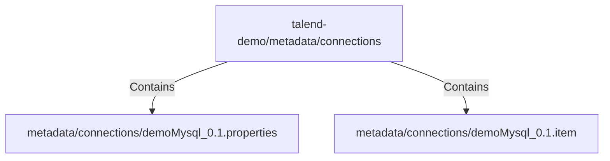

# talend-demo/metadata/connections (Rollup)

## Definition

_Not documented in source._

## Properties

| Key | Value |
|---|---|
| `boundary_relationships` | {} |
| `components` | {"File":2} |
| `group_key` | project:talend-demo/dir:metadata/connections |
| `member_count` | 2 |

## Relationships

### Contains

- → metadata/connections/demoMysql_0.1.properties (`4d46490d-f028-576b-a99a-3e977b64bb3d`) — evidence: metadata/connections/demoMysql_0.1.properties is a member of project:talend-demo/dir:metadata/connections
- → metadata/connections/demoMysql_0.1.item (`443c1b8a-2d76-5c36-84b6-c7a76aacc80c`) — evidence: metadata/connections/demoMysql_0.1.item is a member of project:talend-demo/dir:metadata/connections

## Diagram

## Evidence

- `5913093b-e488-5e9e-a264-3d9c6e592be1` — metadata/connections/demoMysql_0.1.properties is a member of project:talend-demo/dir:metadata/connections (confidence: 1.00)
- `6880a248-445f-5d5d-9a08-9a0e3f817765` — metadata/connections/demoMysql_0.1.item is a member of project:talend-demo/dir:metadata/connections (confidence: 1.00)
