# talend-demo/metadata/fileDelimited (Rollup)

## Definition

_Not documented in source._

## Properties

| Key | Value |
|---|---|
| `boundary_relationships` | {} |
| `components` | {"File":8} |
| `group_key` | project:talend-demo/dir:metadata/fileDelimited |
| `member_count` | 8 |

## Relationships

### Contains

- → metadata/fileDelimited/details_0.1.properties (`7706b8ce-8cce-5818-afa9-36cd9060fa21`) — evidence: metadata/fileDelimited/details_0.1.properties is a member of project:talend-demo/dir:metadata/fileDelimited
- → metadata/fileDelimited/state_0.1.properties (`8b41e0d2-5bb7-5be4-bbfb-8d37a3c81eed`) — evidence: metadata/fileDelimited/state_0.1.properties is a member of project:talend-demo/dir:metadata/fileDelimited
- → metadata/fileDelimited/state_0.1.item (`18fffa86-3601-585c-b20b-cdd5002cc26f`) — evidence: metadata/fileDelimited/state_0.1.item is a member of project:talend-demo/dir:metadata/fileDelimited
- → metadata/fileDelimited/entete_0.1.properties (`e9fd7f9d-c89e-5bf0-8384-902901b74938`) — evidence: metadata/fileDelimited/entete_0.1.properties is a member of project:talend-demo/dir:metadata/fileDelimited
- → metadata/fileDelimited/details_0.1.item (`9d98f6aa-5e3f-5d75-b9d2-c897491bdd30`) — evidence: metadata/fileDelimited/details_0.1.item is a member of project:talend-demo/dir:metadata/fileDelimited
- → metadata/fileDelimited/customer_0.1.properties (`be89f8a7-1e16-5323-94d2-893b24326f10`) — evidence: metadata/fileDelimited/customer_0.1.properties is a member of project:talend-demo/dir:metadata/fileDelimited
- → metadata/fileDelimited/entete_0.1.item (`4a82874a-1fac-56f8-92aa-d7fe8beec86a`) — evidence: metadata/fileDelimited/entete_0.1.item is a member of project:talend-demo/dir:metadata/fileDelimited
- → metadata/fileDelimited/customer_0.1.item (`94e91d9b-a4cf-5a2a-9615-c04538547568`) — evidence: metadata/fileDelimited/customer_0.1.item is a member of project:talend-demo/dir:metadata/fileDelimited

## Diagram

```mermaid
graph TD
    na061b3536bac524f98b34f95ebcc7cdf["talend-demo/metadata/fileDelimited"]
    n7706b8ce8cce5818afa936cd9060fa21["metadata/fileDelimited/details_0.1.properties"]
    na061b3536bac524f98b34f95ebcc7cdf -->|Contains| n7706b8ce8cce5818afa936cd9060fa21
    n8b41e0d25bb75be4bbfb8d37a3c81eed["metadata/fileDelimited/state_0.1.properties"]
    na061b3536bac524f98b34f95ebcc7cdf -->|Contains| n8b41e0d25bb75be4bbfb8d37a3c81eed
    n18fffa863601585cb20bcdd5002cc26f["metadata/fileDelimited/state_0.1.item"]
    na061b3536bac524f98b34f95ebcc7cdf -->|Contains| n18fffa863601585cb20bcdd5002cc26f
    ne9fd7f9dc89e5bf08384902901b74938["metadata/fileDelimited/entete_0.1.properties"]
    na061b3536bac524f98b34f95ebcc7cdf -->|Contains| ne9fd7f9dc89e5bf08384902901b74938
    n9d98f6aa5e3f5d75b9d2c897491bdd30["metadata/fileDelimited/details_0.1.item"]
    na061b3536bac524f98b34f95ebcc7cdf -->|Contains| n9d98f6aa5e3f5d75b9d2c897491bdd30
    nbe89f8a71e16532394d2893b24326f10["metadata/fileDelimited/customer_0.1.properties"]
    na061b3536bac524f98b34f95ebcc7cdf -->|Contains| nbe89f8a71e16532394d2893b24326f10
    n4a82874a1fac56f892aad7fe8beec86a["metadata/fileDelimited/entete_0.1.item"]
    na061b3536bac524f98b34f95ebcc7cdf -->|Contains| n4a82874a1fac56f892aad7fe8beec86a
    n94e91d9ba4cf5a2a9615c04538547568["metadata/fileDelimited/customer_0.1.item"]
    na061b3536bac524f98b34f95ebcc7cdf -->|Contains| n94e91d9ba4cf5a2a9615c04538547568
```

## Evidence

- `16f46ca1-f860-58d6-9db9-11fcd44f6726` — metadata/fileDelimited/customer_0.1.item is a member of project:talend-demo/dir:metadata/fileDelimited (confidence: 1.00)
- `2cd13bb5-0a9d-5db2-b0d5-75d6a374c8e9` — metadata/fileDelimited/entete_0.1.properties is a member of project:talend-demo/dir:metadata/fileDelimited (confidence: 1.00)
- `904d3363-2d33-5015-b4ff-8c308e16a9cd` — metadata/fileDelimited/details_0.1.properties is a member of project:talend-demo/dir:metadata/fileDelimited (confidence: 1.00)
- `b2637631-1015-59ed-98c9-f222ed70a072` — metadata/fileDelimited/entete_0.1.item is a member of project:talend-demo/dir:metadata/fileDelimited (confidence: 1.00)
- `b3e9d42a-2bf4-5486-bb2b-a7dbec2c8d0e` — metadata/fileDelimited/customer_0.1.properties is a member of project:talend-demo/dir:metadata/fileDelimited (confidence: 1.00)
- `f2a8032f-7f39-581b-a592-f12023635a27` — metadata/fileDelimited/state_0.1.properties is a member of project:talend-demo/dir:metadata/fileDelimited (confidence: 1.00)
- `c2f0a067-90af-5140-a5e3-86dada8d232e` — metadata/fileDelimited/state_0.1.item is a member of project:talend-demo/dir:metadata/fileDelimited (confidence: 1.00)
- `cc12c146-7537-57f0-beb3-f487b1e05429` — metadata/fileDelimited/details_0.1.item is a member of project:talend-demo/dir:metadata/fileDelimited (confidence: 1.00)
