# talend-demo/metadata/fileXml (Rollup)

## Definition

_Not documented in source._

## Properties

| Key | Value |
|---|---|
| `boundary_relationships` | {} |
| `components` | {"File":8} |
| `group_key` | project:talend-demo/dir:metadata/fileXml |
| `member_count` | 8 |

## Relationships

### Contains

- → metadata/fileXml/book_0.1.properties (`1e461b9c-4c91-5101-9a80-29d592d05be9`) — evidence: metadata/fileXml/book_0.1.properties is a member of project:talend-demo/dir:metadata/fileXml
- → metadata/fileXml/Sample_Book_0.1.properties (`85120e6c-27b6-59d8-8a1e-c5ebe50324f8`) — evidence: metadata/fileXml/Sample_Book_0.1.properties is a member of project:talend-demo/dir:metadata/fileXml
- → metadata/fileXml/Sample_Book_0.1.item (`c7757659-5734-579f-baab-b6942fdc1130`) — evidence: metadata/fileXml/Sample_Book_0.1.item is a member of project:talend-demo/dir:metadata/fileXml
- → metadata/fileXml/customer_0.1.item (`ea8549c3-965b-521f-8136-468d030c2440`) — evidence: metadata/fileXml/customer_0.1.item is a member of project:talend-demo/dir:metadata/fileXml
- → metadata/fileXml/Sample_Customer_0.1.item (`17217524-880b-5cd7-a15a-266d944a5309`) — evidence: metadata/fileXml/Sample_Customer_0.1.item is a member of project:talend-demo/dir:metadata/fileXml
- → metadata/fileXml/book_0.1.item (`813ea280-e74a-5b50-86c6-c8623c54ad66`) — evidence: metadata/fileXml/book_0.1.item is a member of project:talend-demo/dir:metadata/fileXml
- → metadata/fileXml/customer_0.1.properties (`667a0854-979f-55aa-9ce9-87f8cc5469ea`) — evidence: metadata/fileXml/customer_0.1.properties is a member of project:talend-demo/dir:metadata/fileXml
- → metadata/fileXml/Sample_Customer_0.1.properties (`ce3f0886-d02c-56a6-9b7e-e7951ea1dae0`) — evidence: metadata/fileXml/Sample_Customer_0.1.properties is a member of project:talend-demo/dir:metadata/fileXml

## Diagram

```mermaid
graph TD
    nf819abc6c5535d4b860f19b6e6593722["talend-demo/metadata/fileXml"]
    n1e461b9c4c9151019a8029d592d05be9["metadata/fileXml/book_0.1.properties"]
    nf819abc6c5535d4b860f19b6e6593722 -->|Contains| n1e461b9c4c9151019a8029d592d05be9
    n85120e6c27b659d88a1ec5ebe50324f8["metadata/fileXml/Sample_Book_0.1.properties"]
    nf819abc6c5535d4b860f19b6e6593722 -->|Contains| n85120e6c27b659d88a1ec5ebe50324f8
    nc77576595734579fbaabb6942fdc1130["metadata/fileXml/Sample_Book_0.1.item"]
    nf819abc6c5535d4b860f19b6e6593722 -->|Contains| nc77576595734579fbaabb6942fdc1130
    nea8549c3965b521f8136468d030c2440["metadata/fileXml/customer_0.1.item"]
    nf819abc6c5535d4b860f19b6e6593722 -->|Contains| nea8549c3965b521f8136468d030c2440
    n17217524880b5cd7a15a266d944a5309["metadata/fileXml/Sample_Customer_0.1.item"]
    nf819abc6c5535d4b860f19b6e6593722 -->|Contains| n17217524880b5cd7a15a266d944a5309
    n813ea280e74a5b5086c6c8623c54ad66["metadata/fileXml/book_0.1.item"]
    nf819abc6c5535d4b860f19b6e6593722 -->|Contains| n813ea280e74a5b5086c6c8623c54ad66
    n667a0854979f55aa9ce987f8cc5469ea["metadata/fileXml/customer_0.1.properties"]
    nf819abc6c5535d4b860f19b6e6593722 -->|Contains| n667a0854979f55aa9ce987f8cc5469ea
    nce3f0886d02c56a69b7ee7951ea1dae0["metadata/fileXml/Sample_Customer_0.1.properties"]
    nf819abc6c5535d4b860f19b6e6593722 -->|Contains| nce3f0886d02c56a69b7ee7951ea1dae0
```

## Evidence

- `1e9f48f5-7743-5755-a700-345061dc3f95` — metadata/fileXml/Sample_Book_0.1.properties is a member of project:talend-demo/dir:metadata/fileXml (confidence: 1.00)
- `3102764d-8cc5-5d48-9980-f34f5ae7516c` — metadata/fileXml/customer_0.1.item is a member of project:talend-demo/dir:metadata/fileXml (confidence: 1.00)
- `517e5a18-11cd-5c73-8f91-18574de0d86e` — metadata/fileXml/Sample_Customer_0.1.item is a member of project:talend-demo/dir:metadata/fileXml (confidence: 1.00)
- `6577fffe-9b5d-5944-bd8f-4c8fa3cee52f` — metadata/fileXml/Sample_Book_0.1.item is a member of project:talend-demo/dir:metadata/fileXml (confidence: 1.00)
- `6580a74e-030a-5ee3-b28e-d6e1d06250f7` — metadata/fileXml/book_0.1.item is a member of project:talend-demo/dir:metadata/fileXml (confidence: 1.00)
- `9383d123-61e4-550d-b326-1ce7a8bc0db1` — metadata/fileXml/book_0.1.properties is a member of project:talend-demo/dir:metadata/fileXml (confidence: 1.00)
- `6f6dc60d-62a0-5409-931d-ee98fcc49241` — metadata/fileXml/customer_0.1.properties is a member of project:talend-demo/dir:metadata/fileXml (confidence: 1.00)
- `841f5b78-0df6-566f-b497-adb29c4827c7` — metadata/fileXml/Sample_Customer_0.1.properties is a member of project:talend-demo/dir:metadata/fileXml (confidence: 1.00)
