# talend-demo/process/t02_Concatening (Rollup)

## Definition

_Not documented in source._

## Properties

| Key | Value |
|---|---|
| `boundary_relationships` | {} |
| `components` | {"File":12} |
| `group_key` | project:talend-demo/dir:process/t02_Concatening |
| `member_count` | 12 |

## Relationships

### Contains

- → process/t02_Concatening/link_if_0.1.properties (`ee753eb2-9d8f-5ed1-9982-c534705fa96c`) — evidence: process/t02_Concatening/link_if_0.1.properties is a member of project:talend-demo/dir:process/t02_Concatening
- → process/t02_Concatening/link_if_0.1.screenshot (`5701a37e-be4d-59b2-8488-da1f0c96d3b2`) — evidence: process/t02_Concatening/link_if_0.1.screenshot is a member of project:talend-demo/dir:process/t02_Concatening
- → process/t02_Concatening/link_with_tDie_tWarn_0.1.item (`2229f4d5-5b3e-5900-bad3-564d0367c898`) — evidence: process/t02_Concatening/link_with_tDie_tWarn_0.1.item is a member of project:talend-demo/dir:process/t02_Concatening
- → process/t02_Concatening/link_if_0.1.item (`51c7788e-bad7-5dcc-a979-2352c81fa48b`) — evidence: process/t02_Concatening/link_if_0.1.item is a member of project:talend-demo/dir:process/t02_Concatening
- → process/t02_Concatening/link_with_tDie_tWarn_0.1.properties (`ac98a5a6-e4df-567d-a5b8-f69d4eeb1a1e`) — evidence: process/t02_Concatening/link_with_tDie_tWarn_0.1.properties is a member of project:talend-demo/dir:process/t02_Concatening
- → process/t02_Concatening/OnSubjobError_0.1.screenshot (`a7835a68-1841-5d43-afeb-679d071cec37`) — evidence: process/t02_Concatening/OnSubjobError_0.1.screenshot is a member of project:talend-demo/dir:process/t02_Concatening
- → process/t02_Concatening/link_with_tDie_tWarn_0.1.screenshot (`e911c360-2589-5104-b4ee-e64479df7a5c`) — evidence: process/t02_Concatening/link_with_tDie_tWarn_0.1.screenshot is a member of project:talend-demo/dir:process/t02_Concatening
- → process/t02_Concatening/OnSubjobError_0.1.properties (`f2fc919d-19fe-5d62-8577-10ebc8a25977`) — evidence: process/t02_Concatening/OnSubjobError_0.1.properties is a member of project:talend-demo/dir:process/t02_Concatening
- → process/t02_Concatening/onComponentError_0.1.screenshot (`50b06a3c-92c7-5750-9365-a926d440064d`) — evidence: process/t02_Concatening/onComponentError_0.1.screenshot is a member of project:talend-demo/dir:process/t02_Concatening
- → process/t02_Concatening/OnSubjobError_0.1.item (`eabde1a9-4edc-535c-b7f3-2f0211ffb711`) — evidence: process/t02_Concatening/OnSubjobError_0.1.item is a member of project:talend-demo/dir:process/t02_Concatening
- → process/t02_Concatening/onComponentError_0.1.properties (`6d74aa7d-ce0c-5710-a921-9760f95a75ee`) — evidence: process/t02_Concatening/onComponentError_0.1.properties is a member of project:talend-demo/dir:process/t02_Concatening
- → process/t02_Concatening/onComponentError_0.1.item (`c5b2732f-1d46-5aac-ae51-ed1ebd009ec6`) — evidence: process/t02_Concatening/onComponentError_0.1.item is a member of project:talend-demo/dir:process/t02_Concatening

## Diagram

```mermaid
graph TD
    n9e1420556a015300b694089e0aa1ea91["talend-demo/process/t02_Concatening"]
    nee753eb29d8f5ed19982c534705fa96c["process/t02_Concatening/link_if_0.1.properties"]
    n9e1420556a015300b694089e0aa1ea91 -->|Contains| nee753eb29d8f5ed19982c534705fa96c
    n5701a37ebe4d59b28488da1f0c96d3b2["process/t02_Concatening/link_if_0.1.screenshot"]
    n9e1420556a015300b694089e0aa1ea91 -->|Contains| n5701a37ebe4d59b28488da1f0c96d3b2
    n2229f4d55b3e5900bad3564d0367c898["process/t02_Concatening/link_with_tDie_tWarn_0.1.item"]
    n9e1420556a015300b694089e0aa1ea91 -->|Contains| n2229f4d55b3e5900bad3564d0367c898
    n51c7788ebad75dcca9792352c81fa48b["process/t02_Concatening/link_if_0.1.item"]
    n9e1420556a015300b694089e0aa1ea91 -->|Contains| n51c7788ebad75dcca9792352c81fa48b
    nac98a5a6e4df567da5b8f69d4eeb1a1e["process/t02_Concatening/link_with_tDie_tWarn_0.1.properties"]
    n9e1420556a015300b694089e0aa1ea91 -->|Contains| nac98a5a6e4df567da5b8f69d4eeb1a1e
    na7835a6818415d43afeb679d071cec37["process/t02_Concatening/OnSubjobError_0.1.screenshot"]
    n9e1420556a015300b694089e0aa1ea91 -->|Contains| na7835a6818415d43afeb679d071cec37
    ne911c36025895104b4eee64479df7a5c["process/t02_Concatening/link_with_tDie_tWarn_0.1.screenshot"]
    n9e1420556a015300b694089e0aa1ea91 -->|Contains| ne911c36025895104b4eee64479df7a5c
    nf2fc919d19fe5d62857710ebc8a25977["process/t02_Concatening/OnSubjobError_0.1.properties"]
    n9e1420556a015300b694089e0aa1ea91 -->|Contains| nf2fc919d19fe5d62857710ebc8a25977
    n50b06a3c92c757509365a926d440064d["process/t02_Concatening/onComponentError_0.1.screenshot"]
    n9e1420556a015300b694089e0aa1ea91 -->|Contains| n50b06a3c92c757509365a926d440064d
    neabde1a94edc535cb7f32f0211ffb711["process/t02_Concatening/OnSubjobError_0.1.item"]
    n9e1420556a015300b694089e0aa1ea91 -->|Contains| neabde1a94edc535cb7f32f0211ffb711
    n6d74aa7dce0c5710a9219760f95a75ee["process/t02_Concatening/onComponentError_0.1.properties"]
    n9e1420556a015300b694089e0aa1ea91 -->|Contains| n6d74aa7dce0c5710a9219760f95a75ee
    nc5b2732f1d465aacae51ed1ebd009ec6["process/t02_Concatening/onComponentError_0.1.item"]
    n9e1420556a015300b694089e0aa1ea91 -->|Contains| nc5b2732f1d465aacae51ed1ebd009ec6
```

## Evidence

- `0424a42a-c751-56c0-9a59-12ca3f8050d6` — process/t02_Concatening/OnSubjobError_0.1.properties is a member of project:talend-demo/dir:process/t02_Concatening (confidence: 1.00)
- `8e4ef23b-102c-5314-9bfd-fce6d620db00` — process/t02_Concatening/link_with_tDie_tWarn_0.1.screenshot is a member of project:talend-demo/dir:process/t02_Concatening (confidence: 1.00)
- `9478c514-706e-5f97-a03a-9e16a0ef0384` — process/t02_Concatening/onComponentError_0.1.screenshot is a member of project:talend-demo/dir:process/t02_Concatening (confidence: 1.00)
- `aacadcad-854e-534b-8525-a1839106bcb8` — process/t02_Concatening/link_with_tDie_tWarn_0.1.item is a member of project:talend-demo/dir:process/t02_Concatening (confidence: 1.00)
- `ca6cf23b-ce21-5c2f-b995-e5c0833fbac9` — process/t02_Concatening/onComponentError_0.1.properties is a member of project:talend-demo/dir:process/t02_Concatening (confidence: 1.00)
- `dcee30fa-fdd9-566a-8a6c-2cb782d3de1b` — process/t02_Concatening/link_if_0.1.properties is a member of project:talend-demo/dir:process/t02_Concatening (confidence: 1.00)
- `f2e288cc-c68d-5c3d-a60f-d10d0c2d80fa` — process/t02_Concatening/link_if_0.1.screenshot is a member of project:talend-demo/dir:process/t02_Concatening (confidence: 1.00)
- `fa4a315c-8770-5cd0-ab91-453949298a0f` — process/t02_Concatening/link_if_0.1.item is a member of project:talend-demo/dir:process/t02_Concatening (confidence: 1.00)
- `f50cfa4d-3bf3-5302-9f40-fc8ae414401c` — process/t02_Concatening/link_with_tDie_tWarn_0.1.properties is a member of project:talend-demo/dir:process/t02_Concatening (confidence: 1.00)
- `cc8692ea-d256-5904-8ff0-b1a0548dc3c5` — process/t02_Concatening/OnSubjobError_0.1.screenshot is a member of project:talend-demo/dir:process/t02_Concatening (confidence: 1.00)
- `e6f2930d-9cc8-56b1-9c21-c076cee30d40` — process/t02_Concatening/OnSubjobError_0.1.item is a member of project:talend-demo/dir:process/t02_Concatening (confidence: 1.00)
- `d4838ba3-df18-5a71-a90b-57018fa177ba` — process/t02_Concatening/onComponentError_0.1.item is a member of project:talend-demo/dir:process/t02_Concatening (confidence: 1.00)
