# talend-demo/process/t04_Context (Rollup)

## Definition

_Not documented in source._

## Properties

| Key | Value |
|---|---|
| `boundary_relationships` | {} |
| `components` | {"File":12} |
| `group_key` | project:talend-demo/dir:process/t04_Context |
| `member_count` | 12 |

## Relationships

### Contains

- → process/t04_Context/built_inContext_prompt_0.1.screenshot (`e36df6d0-a57d-5a9e-8f95-593b0e75d9f8`) — evidence: process/t04_Context/built_inContext_prompt_0.1.screenshot is a member of project:talend-demo/dir:process/t04_Context
- → process/t04_Context/repositoryContext_0.1.screenshot (`8ef56866-0ca9-505e-af7c-23b59ed656db`) — evidence: process/t04_Context/repositoryContext_0.1.screenshot is a member of project:talend-demo/dir:process/t04_Context
- → process/t04_Context/repositoryContext_0.1.properties (`7ad1a212-e891-53ca-803b-0e8353b5bb81`) — evidence: process/t04_Context/repositoryContext_0.1.properties is a member of project:talend-demo/dir:process/t04_Context
- → process/t04_Context/built_inContext_1_0.1.item (`f12c5283-f759-554d-8930-37a88e0f418f`) — evidence: process/t04_Context/built_inContext_1_0.1.item is a member of project:talend-demo/dir:process/t04_Context
- → process/t04_Context/repositoryContext_0.1.item (`6c46d104-89dc-502c-a756-72acf46dd596`) — evidence: process/t04_Context/repositoryContext_0.1.item is a member of project:talend-demo/dir:process/t04_Context
- → process/t04_Context/tContextLoad_and_file_0.1.screenshot (`263b814a-9fe4-5b32-a468-611dcf35db8e`) — evidence: process/t04_Context/tContextLoad_and_file_0.1.screenshot is a member of project:talend-demo/dir:process/t04_Context
- → process/t04_Context/built_inContext_prompt_0.1.properties (`9fa25e0d-4680-5d9e-aba1-fbf0236c6a02`) — evidence: process/t04_Context/built_inContext_prompt_0.1.properties is a member of project:talend-demo/dir:process/t04_Context
- → process/t04_Context/built_inContext_prompt_0.1.item (`453ff08f-119d-5048-b755-08106f66e784`) — evidence: process/t04_Context/built_inContext_prompt_0.1.item is a member of project:talend-demo/dir:process/t04_Context
- → process/t04_Context/tContextLoad_and_file_0.1.properties (`67fe31c8-c785-5d9b-b69e-f7f0f30c5675`) — evidence: process/t04_Context/tContextLoad_and_file_0.1.properties is a member of project:talend-demo/dir:process/t04_Context
- → process/t04_Context/tContextLoad_and_file_0.1.item (`df418f95-6b48-5191-bf9e-f0a698aa37b1`) — evidence: process/t04_Context/tContextLoad_and_file_0.1.item is a member of project:talend-demo/dir:process/t04_Context
- → process/t04_Context/built_inContext_1_0.1.screenshot (`73e519f7-ea1c-59ec-861a-0df9a2af7108`) — evidence: process/t04_Context/built_inContext_1_0.1.screenshot is a member of project:talend-demo/dir:process/t04_Context
- → process/t04_Context/built_inContext_1_0.1.properties (`db47bce0-b9f6-5394-a19c-47063dff845c`) — evidence: process/t04_Context/built_inContext_1_0.1.properties is a member of project:talend-demo/dir:process/t04_Context

## Diagram

```mermaid
graph TD
    n992870d9cf9d5eaea413c28125bce09b["talend-demo/process/t04_Context"]
    ne36df6d0a57d5a9e8f95593b0e75d9f8["process/t04_Context/built_inContext_prompt_0.1.screenshot"]
    n992870d9cf9d5eaea413c28125bce09b -->|Contains| ne36df6d0a57d5a9e8f95593b0e75d9f8
    n8ef568660ca9505eaf7c23b59ed656db["process/t04_Context/repositoryContext_0.1.screenshot"]
    n992870d9cf9d5eaea413c28125bce09b -->|Contains| n8ef568660ca9505eaf7c23b59ed656db
    n7ad1a212e89153ca803b0e8353b5bb81["process/t04_Context/repositoryContext_0.1.properties"]
    n992870d9cf9d5eaea413c28125bce09b -->|Contains| n7ad1a212e89153ca803b0e8353b5bb81
    nf12c5283f759554d893037a88e0f418f["process/t04_Context/built_inContext_1_0.1.item"]
    n992870d9cf9d5eaea413c28125bce09b -->|Contains| nf12c5283f759554d893037a88e0f418f
    n6c46d10489dc502ca75672acf46dd596["process/t04_Context/repositoryContext_0.1.item"]
    n992870d9cf9d5eaea413c28125bce09b -->|Contains| n6c46d10489dc502ca75672acf46dd596
    n263b814a9fe45b32a468611dcf35db8e["process/t04_Context/tContextLoad_and_file_0.1.screenshot"]
    n992870d9cf9d5eaea413c28125bce09b -->|Contains| n263b814a9fe45b32a468611dcf35db8e
    n9fa25e0d46805d9eaba1fbf0236c6a02["process/t04_Context/built_inContext_prompt_0.1.properties"]
    n992870d9cf9d5eaea413c28125bce09b -->|Contains| n9fa25e0d46805d9eaba1fbf0236c6a02
    n453ff08f119d5048b75508106f66e784["process/t04_Context/built_inContext_prompt_0.1.item"]
    n992870d9cf9d5eaea413c28125bce09b -->|Contains| n453ff08f119d5048b75508106f66e784
    n67fe31c8c7855d9bb69ef7f0f30c5675["process/t04_Context/tContextLoad_and_file_0.1.properties"]
    n992870d9cf9d5eaea413c28125bce09b -->|Contains| n67fe31c8c7855d9bb69ef7f0f30c5675
    ndf418f956b485191bf9ef0a698aa37b1["process/t04_Context/tContextLoad_and_file_0.1.item"]
    n992870d9cf9d5eaea413c28125bce09b -->|Contains| ndf418f956b485191bf9ef0a698aa37b1
    n73e519f7ea1c59ec861a0df9a2af7108["process/t04_Context/built_inContext_1_0.1.screenshot"]
    n992870d9cf9d5eaea413c28125bce09b -->|Contains| n73e519f7ea1c59ec861a0df9a2af7108
    ndb47bce0b9f65394a19c47063dff845c["process/t04_Context/built_inContext_1_0.1.properties"]
    n992870d9cf9d5eaea413c28125bce09b -->|Contains| ndb47bce0b9f65394a19c47063dff845c
```

## Evidence

- `120b04b0-df7b-510b-bf4a-58a8a441895f` — process/t04_Context/tContextLoad_and_file_0.1.properties is a member of project:talend-demo/dir:process/t04_Context (confidence: 1.00)
- `19496bad-3510-54bc-aab2-f072a9a12e6d` — process/t04_Context/built_inContext_prompt_0.1.properties is a member of project:talend-demo/dir:process/t04_Context (confidence: 1.00)
- `2b649724-3159-5967-b856-a36f69f91836` — process/t04_Context/repositoryContext_0.1.properties is a member of project:talend-demo/dir:process/t04_Context (confidence: 1.00)
- `389f851c-89da-5151-9dee-1ecfc1a96f46` — process/t04_Context/repositoryContext_0.1.item is a member of project:talend-demo/dir:process/t04_Context (confidence: 1.00)
- `6fa74307-fdbb-574a-8f44-d8c2a34c4169` — process/t04_Context/built_inContext_1_0.1.screenshot is a member of project:talend-demo/dir:process/t04_Context (confidence: 1.00)
- `d9b22bdc-ea2f-5c60-bacf-8e8abda5c7b1` — process/t04_Context/built_inContext_prompt_0.1.screenshot is a member of project:talend-demo/dir:process/t04_Context (confidence: 1.00)
- `90a1b4f6-18f8-5333-994a-e970a74c3159` — process/t04_Context/repositoryContext_0.1.screenshot is a member of project:talend-demo/dir:process/t04_Context (confidence: 1.00)
- `73da2847-b521-52f9-9d82-3acc2a50eece` — process/t04_Context/built_inContext_1_0.1.item is a member of project:talend-demo/dir:process/t04_Context (confidence: 1.00)
- `e16bcd1e-f3b8-56fa-8cea-e15c9d654aae` — process/t04_Context/tContextLoad_and_file_0.1.screenshot is a member of project:talend-demo/dir:process/t04_Context (confidence: 1.00)
- `9b9d5ca6-b778-51cf-890d-e68d07eb1ddc` — process/t04_Context/built_inContext_prompt_0.1.item is a member of project:talend-demo/dir:process/t04_Context (confidence: 1.00)
- `76d574cc-685e-56d8-855f-ffe23ed41158` — process/t04_Context/tContextLoad_and_file_0.1.item is a member of project:talend-demo/dir:process/t04_Context (confidence: 1.00)
- `9575b1c5-397f-504e-aaa7-b9f3c727c6b0` — process/t04_Context/built_inContext_1_0.1.properties is a member of project:talend-demo/dir:process/t04_Context (confidence: 1.00)
