# talend-demo/sqlPatterns/DeltaLake (Rollup)

## Definition

_Not documented in source._

## Properties

| Key | Value |
|---|---|
| `boundary_relationships` | {} |
| `components` | {"File":14} |
| `group_key` | project:talend-demo/dir:sqlPatterns/DeltaLake |
| `member_count` | 14 |

## Relationships

### Contains

- → sqlPatterns/DeltaLake/system/DeltaLakeFilterRows_0.1.item (`d4e0d44f-bc0e-5d59-ae0e-d3b3c721fa1d`) — evidence: sqlPatterns/DeltaLake/system/DeltaLakeFilterRows_0.1.item is a member of project:talend-demo/dir:sqlPatterns/DeltaLake
- → sqlPatterns/DeltaLake/system/DeltaLakeDropTable_0.1.item (`7542c5c6-f828-531a-9f42-f6a7fb426a30`) — evidence: sqlPatterns/DeltaLake/system/DeltaLakeDropTable_0.1.item is a member of project:talend-demo/dir:sqlPatterns/DeltaLake
- → sqlPatterns/DeltaLake/system/DeltaLakeAggregate_0.1.properties (`6c214910-3f0d-5440-b1a5-33c09641fdf6`) — evidence: sqlPatterns/DeltaLake/system/DeltaLakeAggregate_0.1.properties is a member of project:talend-demo/dir:sqlPatterns/DeltaLake
- → sqlPatterns/DeltaLake/system/DeltaLakeFilterRows_0.1.properties (`b62a9c4c-530b-53c3-8b36-d0b74a534e35`) — evidence: sqlPatterns/DeltaLake/system/DeltaLakeFilterRows_0.1.properties is a member of project:talend-demo/dir:sqlPatterns/DeltaLake
- → sqlPatterns/DeltaLake/system/DeltaLakeMerge_0.1.properties (`18f5e127-5284-5ad6-87b2-cef027851063`) — evidence: sqlPatterns/DeltaLake/system/DeltaLakeMerge_0.1.properties is a member of project:talend-demo/dir:sqlPatterns/DeltaLake
- → sqlPatterns/DeltaLake/system/DeltaLakeAggregate_0.1.item (`159beafb-51be-5ba0-8e36-4318bdbdb3ed`) — evidence: sqlPatterns/DeltaLake/system/DeltaLakeAggregate_0.1.item is a member of project:talend-demo/dir:sqlPatterns/DeltaLake
- → sqlPatterns/DeltaLake/system/DeltaLakeDropTable_0.1.properties (`8bd8a689-46ea-5943-b474-3965ca10424d`) — evidence: sqlPatterns/DeltaLake/system/DeltaLakeDropTable_0.1.properties is a member of project:talend-demo/dir:sqlPatterns/DeltaLake
- → sqlPatterns/DeltaLake/system/DeltaLakeCreateDeltaTable_0.1.item (`6549e3d7-4e96-595e-961e-7564d48724ba`) — evidence: sqlPatterns/DeltaLake/system/DeltaLakeCreateDeltaTable_0.1.item is a member of project:talend-demo/dir:sqlPatterns/DeltaLake
- → sqlPatterns/DeltaLake/system/DeltaLakeFilterColumns_0.1.item (`2aba6e52-df9e-50ab-8713-404f18d385d7`) — evidence: sqlPatterns/DeltaLake/system/DeltaLakeFilterColumns_0.1.item is a member of project:talend-demo/dir:sqlPatterns/DeltaLake
- → sqlPatterns/DeltaLake/system/DeltaLakeMerge_0.1.item (`a2090614-4f50-58bb-b31c-5c1efc6a652e`) — evidence: sqlPatterns/DeltaLake/system/DeltaLakeMerge_0.1.item is a member of project:talend-demo/dir:sqlPatterns/DeltaLake
- → sqlPatterns/DeltaLake/system/DeltaLakeCreateDeltaTable_0.1.properties (`9df303dc-0e18-5977-8812-08dfe7fdff69`) — evidence: sqlPatterns/DeltaLake/system/DeltaLakeCreateDeltaTable_0.1.properties is a member of project:talend-demo/dir:sqlPatterns/DeltaLake
- → sqlPatterns/DeltaLake/system/DeltaLakeFilterColumns_0.1.properties (`14b4e33d-4c08-5139-8a1d-dd58661b23ca`) — evidence: sqlPatterns/DeltaLake/system/DeltaLakeFilterColumns_0.1.properties is a member of project:talend-demo/dir:sqlPatterns/DeltaLake
- → sqlPatterns/DeltaLake/system/DeltaLakeCreateTable_0.1.properties (`c336365c-ee20-52bd-928f-e9e640fa2296`) — evidence: sqlPatterns/DeltaLake/system/DeltaLakeCreateTable_0.1.properties is a member of project:talend-demo/dir:sqlPatterns/DeltaLake
- → sqlPatterns/DeltaLake/system/DeltaLakeCreateTable_0.1.item (`c49c8085-8e55-508a-a1bd-333921f93894`) — evidence: sqlPatterns/DeltaLake/system/DeltaLakeCreateTable_0.1.item is a member of project:talend-demo/dir:sqlPatterns/DeltaLake

## Diagram

```mermaid
graph TD
    n8712b1a5897a5c8da1f0d3966c3fdff0["talend-demo/sqlPatterns/DeltaLake"]
    nd4e0d44fbc0e5d59ae0ed3b3c721fa1d["sqlPatterns/DeltaLake/system/DeltaLakeFilterRows_0.1.item"]
    n8712b1a5897a5c8da1f0d3966c3fdff0 -->|Contains| nd4e0d44fbc0e5d59ae0ed3b3c721fa1d
    n7542c5c6f828531a9f42f6a7fb426a30["sqlPatterns/DeltaLake/system/DeltaLakeDropTable_0.1.item"]
    n8712b1a5897a5c8da1f0d3966c3fdff0 -->|Contains| n7542c5c6f828531a9f42f6a7fb426a30
    n6c2149103f0d5440b1a533c09641fdf6["sqlPatterns/DeltaLake/system/DeltaLakeAggregate_0.1.properties"]
    n8712b1a5897a5c8da1f0d3966c3fdff0 -->|Contains| n6c2149103f0d5440b1a533c09641fdf6
    nb62a9c4c530b53c38b36d0b74a534e35["sqlPatterns/DeltaLake/system/DeltaLakeFilterRows_0.1.properties"]
    n8712b1a5897a5c8da1f0d3966c3fdff0 -->|Contains| nb62a9c4c530b53c38b36d0b74a534e35
    n18f5e12752845ad687b2cef027851063["sqlPatterns/DeltaLake/system/DeltaLakeMerge_0.1.properties"]
    n8712b1a5897a5c8da1f0d3966c3fdff0 -->|Contains| n18f5e12752845ad687b2cef027851063
    n159beafb51be5ba08e364318bdbdb3ed["sqlPatterns/DeltaLake/system/DeltaLakeAggregate_0.1.item"]
    n8712b1a5897a5c8da1f0d3966c3fdff0 -->|Contains| n159beafb51be5ba08e364318bdbdb3ed
    n8bd8a68946ea5943b4743965ca10424d["sqlPatterns/DeltaLake/system/DeltaLakeDropTable_0.1.properties"]
    n8712b1a5897a5c8da1f0d3966c3fdff0 -->|Contains| n8bd8a68946ea5943b4743965ca10424d
    n6549e3d74e96595e961e7564d48724ba["sqlPatterns/DeltaLake/system/DeltaLakeCreateDeltaTable_0.1.item"]
    n8712b1a5897a5c8da1f0d3966c3fdff0 -->|Contains| n6549e3d74e96595e961e7564d48724ba
    n2aba6e52df9e50ab8713404f18d385d7["sqlPatterns/DeltaLake/system/DeltaLakeFilterColumns_0.1.item"]
    n8712b1a5897a5c8da1f0d3966c3fdff0 -->|Contains| n2aba6e52df9e50ab8713404f18d385d7
    na20906144f5058bbb31c5c1efc6a652e["sqlPatterns/DeltaLake/system/DeltaLakeMerge_0.1.item"]
    n8712b1a5897a5c8da1f0d3966c3fdff0 -->|Contains| na20906144f5058bbb31c5c1efc6a652e
    n9df303dc0e185977881208dfe7fdff69["sqlPatterns/DeltaLake/system/DeltaLakeCreateDeltaTable_0.1.properties"]
    n8712b1a5897a5c8da1f0d3966c3fdff0 -->|Contains| n9df303dc0e185977881208dfe7fdff69
    n14b4e33d4c0851398a1ddd58661b23ca["sqlPatterns/DeltaLake/system/DeltaLakeFilterColumns_0.1.properties"]
    n8712b1a5897a5c8da1f0d3966c3fdff0 -->|Contains| n14b4e33d4c0851398a1ddd58661b23ca
    nc336365cee2052bd928fe9e640fa2296["sqlPatterns/DeltaLake/system/DeltaLakeCreateTable_0.1.properties"]
    n8712b1a5897a5c8da1f0d3966c3fdff0 -->|Contains| nc336365cee2052bd928fe9e640fa2296
    nc49c80858e55508aa1bd333921f93894["sqlPatterns/DeltaLake/system/DeltaLakeCreateTable_0.1.item"]
    n8712b1a5897a5c8da1f0d3966c3fdff0 -->|Contains| nc49c80858e55508aa1bd333921f93894
```

## Evidence

- `00238a59-b1b0-5dd6-bc65-4ce96769c036` — sqlPatterns/DeltaLake/system/DeltaLakeDropTable_0.1.item is a member of project:talend-demo/dir:sqlPatterns/DeltaLake (confidence: 1.00)
- `0f71ddb5-85ed-5edd-bb92-9ae49dfaa4b2` — sqlPatterns/DeltaLake/system/DeltaLakeFilterColumns_0.1.properties is a member of project:talend-demo/dir:sqlPatterns/DeltaLake (confidence: 1.00)
- `3e57c083-7c2f-542f-8572-95b2e10b8b5f` — sqlPatterns/DeltaLake/system/DeltaLakeDropTable_0.1.properties is a member of project:talend-demo/dir:sqlPatterns/DeltaLake (confidence: 1.00)
- `412c4149-86c8-5d6a-ae3f-c9d89a24f714` — sqlPatterns/DeltaLake/system/DeltaLakeCreateDeltaTable_0.1.item is a member of project:talend-demo/dir:sqlPatterns/DeltaLake (confidence: 1.00)
- `4d9e4d3c-d998-5738-838a-545cb4cb906e` — sqlPatterns/DeltaLake/system/DeltaLakeFilterRows_0.1.properties is a member of project:talend-demo/dir:sqlPatterns/DeltaLake (confidence: 1.00)
- `b6221ca2-df48-55ae-b58f-495445ba0aad` — sqlPatterns/DeltaLake/system/DeltaLakeFilterRows_0.1.item is a member of project:talend-demo/dir:sqlPatterns/DeltaLake (confidence: 1.00)
- `a3ba59b5-2e2b-5a1b-872a-cd98c337a049` — sqlPatterns/DeltaLake/system/DeltaLakeAggregate_0.1.properties is a member of project:talend-demo/dir:sqlPatterns/DeltaLake (confidence: 1.00)
- `65943d1c-4b7a-5725-b46f-7c6e7d76d668` — sqlPatterns/DeltaLake/system/DeltaLakeMerge_0.1.properties is a member of project:talend-demo/dir:sqlPatterns/DeltaLake (confidence: 1.00)
- `c96d0b2a-1fbe-55ff-9dd1-bd6c5920d4df` — sqlPatterns/DeltaLake/system/DeltaLakeAggregate_0.1.item is a member of project:talend-demo/dir:sqlPatterns/DeltaLake (confidence: 1.00)
- `72037a64-6ec7-5b1a-982a-ffdb5cdcf36a` — sqlPatterns/DeltaLake/system/DeltaLakeFilterColumns_0.1.item is a member of project:talend-demo/dir:sqlPatterns/DeltaLake (confidence: 1.00)
- `c6f36cf1-bedb-53a8-8c01-310261f7df5d` — sqlPatterns/DeltaLake/system/DeltaLakeMerge_0.1.item is a member of project:talend-demo/dir:sqlPatterns/DeltaLake (confidence: 1.00)
- `96261d6a-a265-5735-8af4-cd185ea151d4` — sqlPatterns/DeltaLake/system/DeltaLakeCreateDeltaTable_0.1.properties is a member of project:talend-demo/dir:sqlPatterns/DeltaLake (confidence: 1.00)
- `5ef1f1fe-0f30-5bf6-81ab-bbedd60ad428` — sqlPatterns/DeltaLake/system/DeltaLakeCreateTable_0.1.properties is a member of project:talend-demo/dir:sqlPatterns/DeltaLake (confidence: 1.00)
- `cac08ce4-603d-5a31-aff3-fc611f420e03` — sqlPatterns/DeltaLake/system/DeltaLakeCreateTable_0.1.item is a member of project:talend-demo/dir:sqlPatterns/DeltaLake (confidence: 1.00)
