# talend-demo/sqlPatterns/Generic (Rollup)

## Definition

_Not documented in source._

## Properties

| Key | Value |
|---|---|
| `boundary_relationships` | {} |
| `components` | {"File":18} |
| `group_key` | project:talend-demo/dir:sqlPatterns/Generic |
| `member_count` | 18 |

## Relationships

### Contains

- → sqlPatterns/Generic/system/Aggregate_0.1.item (`edafb7e7-c487-5a94-912e-8eafcdd9ad0b`) — evidence: sqlPatterns/Generic/system/Aggregate_0.1.item is a member of project:talend-demo/dir:sqlPatterns/Generic
- → sqlPatterns/Generic/system/MergeUpdate_0.1.item (`a02b718f-5e1c-588a-b877-7d812954edab`) — evidence: sqlPatterns/Generic/system/MergeUpdate_0.1.item is a member of project:talend-demo/dir:sqlPatterns/Generic
- → sqlPatterns/Generic/system/Commit_0.1.properties (`3ac3999f-5381-51a0-a3aa-c17741113a14`) — evidence: sqlPatterns/Generic/system/Commit_0.1.properties is a member of project:talend-demo/dir:sqlPatterns/Generic
- → sqlPatterns/Generic/system/DropTargetTable_0.1.item (`0ab7de9d-f478-500f-9ee2-b8d33ccb06e9`) — evidence: sqlPatterns/Generic/system/DropTargetTable_0.1.item is a member of project:talend-demo/dir:sqlPatterns/Generic
- → sqlPatterns/Generic/system/MergeUpdate_0.1.properties (`5c22e688-1999-57fd-91ae-501831b34875`) — evidence: sqlPatterns/Generic/system/MergeUpdate_0.1.properties is a member of project:talend-demo/dir:sqlPatterns/Generic
- → sqlPatterns/Generic/system/MergeInsert_0.1.properties (`f2818e37-b4a7-517a-b137-039c93e13d44`) — evidence: sqlPatterns/Generic/system/MergeInsert_0.1.properties is a member of project:talend-demo/dir:sqlPatterns/Generic
- → sqlPatterns/Generic/system/FilterRow_0.1.properties (`83edccfb-7796-5130-ae92-4afbb111c304`) — evidence: sqlPatterns/Generic/system/FilterRow_0.1.properties is a member of project:talend-demo/dir:sqlPatterns/Generic
- → sqlPatterns/Generic/system/Rollback_0.1.properties (`bedf05dd-9fed-5bb8-aae7-2f521988a3e8`) — evidence: sqlPatterns/Generic/system/Rollback_0.1.properties is a member of project:talend-demo/dir:sqlPatterns/Generic
- → sqlPatterns/Generic/system/Commit_0.1.item (`629afaa0-3eac-5e81-bcd7-83fe35661112`) — evidence: sqlPatterns/Generic/system/Commit_0.1.item is a member of project:talend-demo/dir:sqlPatterns/Generic
- → sqlPatterns/Generic/system/Rollback_0.1.item (`11491148-22ae-57a4-88ba-3ed3d4c0be80`) — evidence: sqlPatterns/Generic/system/Rollback_0.1.item is a member of project:talend-demo/dir:sqlPatterns/Generic
- → sqlPatterns/Generic/system/FilterRow_0.1.item (`27eb255e-3029-5b5a-a9d0-88aab34d47d2`) — evidence: sqlPatterns/Generic/system/FilterRow_0.1.item is a member of project:talend-demo/dir:sqlPatterns/Generic
- → sqlPatterns/Generic/system/MergeInsert_0.1.item (`5ad4fa46-791b-5708-a348-26961dcd0ed3`) — evidence: sqlPatterns/Generic/system/MergeInsert_0.1.item is a member of project:talend-demo/dir:sqlPatterns/Generic
- → sqlPatterns/Generic/system/Aggregate_0.1.properties (`cae0e8cd-7775-54f1-aa71-b01b56f423d3`) — evidence: sqlPatterns/Generic/system/Aggregate_0.1.properties is a member of project:talend-demo/dir:sqlPatterns/Generic
- → sqlPatterns/Generic/system/DropSourceTable_0.1.item (`c5958f34-e119-5529-b0c5-0bb80d2c0968`) — evidence: sqlPatterns/Generic/system/DropSourceTable_0.1.item is a member of project:talend-demo/dir:sqlPatterns/Generic
- → sqlPatterns/Generic/system/FilterColumns_0.1.properties (`9c0615e7-0920-5eb0-b770-15a5542822a3`) — evidence: sqlPatterns/Generic/system/FilterColumns_0.1.properties is a member of project:talend-demo/dir:sqlPatterns/Generic
- → sqlPatterns/Generic/system/DropSourceTable_0.1.properties (`1451997e-57cf-5272-aa18-1a13e2a5a6fc`) — evidence: sqlPatterns/Generic/system/DropSourceTable_0.1.properties is a member of project:talend-demo/dir:sqlPatterns/Generic
- → sqlPatterns/Generic/system/DropTargetTable_0.1.properties (`e60c00b3-3036-5f47-b7d6-453ffce1f0e3`) — evidence: sqlPatterns/Generic/system/DropTargetTable_0.1.properties is a member of project:talend-demo/dir:sqlPatterns/Generic
- → sqlPatterns/Generic/system/FilterColumns_0.1.item (`3dea20b6-af32-5534-8ee9-ec8c9554f599`) — evidence: sqlPatterns/Generic/system/FilterColumns_0.1.item is a member of project:talend-demo/dir:sqlPatterns/Generic

## Diagram

```mermaid
graph TD
    n2e63e374b6155b77aaa4d96c505b2971["talend-demo/sqlPatterns/Generic"]
    nedafb7e7c4875a94912e8eafcdd9ad0b["sqlPatterns/Generic/system/Aggregate_0.1.item"]
    n2e63e374b6155b77aaa4d96c505b2971 -->|Contains| nedafb7e7c4875a94912e8eafcdd9ad0b
    na02b718f5e1c588ab8777d812954edab["sqlPatterns/Generic/system/MergeUpdate_0.1.item"]
    n2e63e374b6155b77aaa4d96c505b2971 -->|Contains| na02b718f5e1c588ab8777d812954edab
    n3ac3999f538151a0a3aac17741113a14["sqlPatterns/Generic/system/Commit_0.1.properties"]
    n2e63e374b6155b77aaa4d96c505b2971 -->|Contains| n3ac3999f538151a0a3aac17741113a14
    n0ab7de9df478500f9ee2b8d33ccb06e9["sqlPatterns/Generic/system/DropTargetTable_0.1.item"]
    n2e63e374b6155b77aaa4d96c505b2971 -->|Contains| n0ab7de9df478500f9ee2b8d33ccb06e9
    n5c22e688199957fd91ae501831b34875["sqlPatterns/Generic/system/MergeUpdate_0.1.properties"]
    n2e63e374b6155b77aaa4d96c505b2971 -->|Contains| n5c22e688199957fd91ae501831b34875
    nf2818e37b4a7517ab137039c93e13d44["sqlPatterns/Generic/system/MergeInsert_0.1.properties"]
    n2e63e374b6155b77aaa4d96c505b2971 -->|Contains| nf2818e37b4a7517ab137039c93e13d44
    n83edccfb77965130ae924afbb111c304["sqlPatterns/Generic/system/FilterRow_0.1.properties"]
    n2e63e374b6155b77aaa4d96c505b2971 -->|Contains| n83edccfb77965130ae924afbb111c304
    nbedf05dd9fed5bb8aae72f521988a3e8["sqlPatterns/Generic/system/Rollback_0.1.properties"]
    n2e63e374b6155b77aaa4d96c505b2971 -->|Contains| nbedf05dd9fed5bb8aae72f521988a3e8
    n629afaa03eac5e81bcd783fe35661112["sqlPatterns/Generic/system/Commit_0.1.item"]
    n2e63e374b6155b77aaa4d96c505b2971 -->|Contains| n629afaa03eac5e81bcd783fe35661112
    n1149114822ae57a488ba3ed3d4c0be80["sqlPatterns/Generic/system/Rollback_0.1.item"]
    n2e63e374b6155b77aaa4d96c505b2971 -->|Contains| n1149114822ae57a488ba3ed3d4c0be80
    n27eb255e30295b5aa9d088aab34d47d2["sqlPatterns/Generic/system/FilterRow_0.1.item"]
    n2e63e374b6155b77aaa4d96c505b2971 -->|Contains| n27eb255e30295b5aa9d088aab34d47d2
    n5ad4fa46791b5708a34826961dcd0ed3["sqlPatterns/Generic/system/MergeInsert_0.1.item"]
    n2e63e374b6155b77aaa4d96c505b2971 -->|Contains| n5ad4fa46791b5708a34826961dcd0ed3
    ncae0e8cd777554f1aa71b01b56f423d3["sqlPatterns/Generic/system/Aggregate_0.1.properties"]
    n2e63e374b6155b77aaa4d96c505b2971 -->|Contains| ncae0e8cd777554f1aa71b01b56f423d3
    nc5958f34e1195529b0c50bb80d2c0968["sqlPatterns/Generic/system/DropSourceTable_0.1.item"]
    n2e63e374b6155b77aaa4d96c505b2971 -->|Contains| nc5958f34e1195529b0c50bb80d2c0968
    n9c0615e709205eb0b77015a5542822a3["sqlPatterns/Generic/system/FilterColumns_0.1.properties"]
    n2e63e374b6155b77aaa4d96c505b2971 -->|Contains| n9c0615e709205eb0b77015a5542822a3
    n1451997e57cf5272aa181a13e2a5a6fc["sqlPatterns/Generic/system/DropSourceTable_0.1.properties"]
    n2e63e374b6155b77aaa4d96c505b2971 -->|Contains| n1451997e57cf5272aa181a13e2a5a6fc
    ne60c00b330365f47b7d6453ffce1f0e3["sqlPatterns/Generic/system/DropTargetTable_0.1.properties"]
    n2e63e374b6155b77aaa4d96c505b2971 -->|Contains| ne60c00b330365f47b7d6453ffce1f0e3
    n3dea20b6af3255348ee9ec8c9554f599["sqlPatterns/Generic/system/FilterColumns_0.1.item"]
    n2e63e374b6155b77aaa4d96c505b2971 -->|Contains| n3dea20b6af3255348ee9ec8c9554f599
```

## Evidence

- `16dd00e7-84dd-5f24-b6de-7965af6ba05b` — sqlPatterns/Generic/system/Rollback_0.1.item is a member of project:talend-demo/dir:sqlPatterns/Generic (confidence: 1.00)
- `29b92e23-3fbf-5127-a1e1-b1adaed4bc7d` — sqlPatterns/Generic/system/Aggregate_0.1.properties is a member of project:talend-demo/dir:sqlPatterns/Generic (confidence: 1.00)
- `32e4a865-df82-5df8-ab12-52b72518738c` — sqlPatterns/Generic/system/DropTargetTable_0.1.item is a member of project:talend-demo/dir:sqlPatterns/Generic (confidence: 1.00)
- `3e462cbe-de11-5e03-8168-43ca96250407` — sqlPatterns/Generic/system/MergeInsert_0.1.item is a member of project:talend-demo/dir:sqlPatterns/Generic (confidence: 1.00)
- `4a76055c-32a2-58ca-8f9f-079524e2edd4` — sqlPatterns/Generic/system/MergeUpdate_0.1.item is a member of project:talend-demo/dir:sqlPatterns/Generic (confidence: 1.00)
- `b208c028-36a9-5cac-ada7-9a8ee1009346` — sqlPatterns/Generic/system/Aggregate_0.1.item is a member of project:talend-demo/dir:sqlPatterns/Generic (confidence: 1.00)
- `8fcdb77f-13a5-55a0-b99e-6132e7e0bb08` — sqlPatterns/Generic/system/Commit_0.1.properties is a member of project:talend-demo/dir:sqlPatterns/Generic (confidence: 1.00)
- `b7497b90-3d46-58fa-bf3d-0e7972e5a84a` — sqlPatterns/Generic/system/MergeUpdate_0.1.properties is a member of project:talend-demo/dir:sqlPatterns/Generic (confidence: 1.00)
- `66ed091c-8891-5fe3-9fc9-d81dfce6a4e4` — sqlPatterns/Generic/system/MergeInsert_0.1.properties is a member of project:talend-demo/dir:sqlPatterns/Generic (confidence: 1.00)
- `8650787f-94d9-5089-95e8-1f6a9fbf8e97` — sqlPatterns/Generic/system/FilterRow_0.1.properties is a member of project:talend-demo/dir:sqlPatterns/Generic (confidence: 1.00)
- `9af9647f-ec9d-5d39-beee-c073a3ab7f16` — sqlPatterns/Generic/system/Rollback_0.1.properties is a member of project:talend-demo/dir:sqlPatterns/Generic (confidence: 1.00)
- `810dd1dd-3318-528a-9055-cc0dfba65175` — sqlPatterns/Generic/system/Commit_0.1.item is a member of project:talend-demo/dir:sqlPatterns/Generic (confidence: 1.00)
- `e131b33a-7f1d-5318-92bd-c0b1c6ae3d7f` — sqlPatterns/Generic/system/FilterRow_0.1.item is a member of project:talend-demo/dir:sqlPatterns/Generic (confidence: 1.00)
- `95ea6ef0-cefc-5410-bbe9-4ad24aaeec3a` — sqlPatterns/Generic/system/DropSourceTable_0.1.item is a member of project:talend-demo/dir:sqlPatterns/Generic (confidence: 1.00)
- `67e1e3dd-d65d-5102-bea6-e606d6f41975` — sqlPatterns/Generic/system/FilterColumns_0.1.properties is a member of project:talend-demo/dir:sqlPatterns/Generic (confidence: 1.00)
- `c8f3912b-b40d-5399-bb36-e628c771593a` — sqlPatterns/Generic/system/DropSourceTable_0.1.properties is a member of project:talend-demo/dir:sqlPatterns/Generic (confidence: 1.00)
- `d8f73d7f-d2a2-5d56-a4fe-5d577f15583f` — sqlPatterns/Generic/system/DropTargetTable_0.1.properties is a member of project:talend-demo/dir:sqlPatterns/Generic (confidence: 1.00)
- `b7795e90-ca97-5715-8b78-f276ed7312de` — sqlPatterns/Generic/system/FilterColumns_0.1.item is a member of project:talend-demo/dir:sqlPatterns/Generic (confidence: 1.00)
