# talend-demo/sqlPatterns/Snowflake (Rollup)

## Definition

_Not documented in source._

## Properties

| Key | Value |
|---|---|
| `boundary_relationships` | {} |
| `components` | {"File":10} |
| `group_key` | project:talend-demo/dir:sqlPatterns/Snowflake |
| `member_count` | 10 |

## Relationships

### Contains

- → sqlPatterns/Snowflake/system/SnowflakeCreateTargetTable_0.1.item (`bf624976-0f29-5cd9-adbe-d182f840a7aa`) — evidence: sqlPatterns/Snowflake/system/SnowflakeCreateTargetTable_0.1.item is a member of project:talend-demo/dir:sqlPatterns/Snowflake
- → sqlPatterns/Snowflake/system/SnowflakeDropTargetTable_0.1.item (`f8924a8c-087e-5054-9f8a-e49bcd9a17aa`) — evidence: sqlPatterns/Snowflake/system/SnowflakeDropTargetTable_0.1.item is a member of project:talend-demo/dir:sqlPatterns/Snowflake
- → sqlPatterns/Snowflake/system/SnowflakeDropSourceTable_0.1.properties (`53ffd625-076b-5ca6-bd66-1cb501957b3a`) — evidence: sqlPatterns/Snowflake/system/SnowflakeDropSourceTable_0.1.properties is a member of project:talend-demo/dir:sqlPatterns/Snowflake
- → sqlPatterns/Snowflake/system/SnowflakeCreateTargetTable_0.1.properties (`d815aac4-a221-513e-b3ce-ec3de4d43bb6`) — evidence: sqlPatterns/Snowflake/system/SnowflakeCreateTargetTable_0.1.properties is a member of project:talend-demo/dir:sqlPatterns/Snowflake
- → sqlPatterns/Snowflake/system/SnowflakeCreateSourceTable_0.1.properties (`06844684-00ca-5190-ae64-92a3ea0e5850`) — evidence: sqlPatterns/Snowflake/system/SnowflakeCreateSourceTable_0.1.properties is a member of project:talend-demo/dir:sqlPatterns/Snowflake
- → sqlPatterns/Snowflake/system/SnowflakeCreateSourceTable_0.1.item (`62cfe4f3-2d5c-5f1f-87b5-fcad6cd6da6c`) — evidence: sqlPatterns/Snowflake/system/SnowflakeCreateSourceTable_0.1.item is a member of project:talend-demo/dir:sqlPatterns/Snowflake
- → sqlPatterns/Snowflake/system/SnowflakeDropTargetTable_0.1.properties (`ce8d0c9b-5463-568c-86dc-79897c55a4d2`) — evidence: sqlPatterns/Snowflake/system/SnowflakeDropTargetTable_0.1.properties is a member of project:talend-demo/dir:sqlPatterns/Snowflake
- → sqlPatterns/Snowflake/system/SnowflakeMerge_0.1.item (`131a0eb4-f266-5c58-89b3-1f024ad8ae10`) — evidence: sqlPatterns/Snowflake/system/SnowflakeMerge_0.1.item is a member of project:talend-demo/dir:sqlPatterns/Snowflake
- → sqlPatterns/Snowflake/system/SnowflakeDropSourceTable_0.1.item (`fa4645de-1b6b-5d99-9963-025df69ffd7c`) — evidence: sqlPatterns/Snowflake/system/SnowflakeDropSourceTable_0.1.item is a member of project:talend-demo/dir:sqlPatterns/Snowflake
- → sqlPatterns/Snowflake/system/SnowflakeMerge_0.1.properties (`4432c93b-5571-5ec4-88ab-8c4e87589af5`) — evidence: sqlPatterns/Snowflake/system/SnowflakeMerge_0.1.properties is a member of project:talend-demo/dir:sqlPatterns/Snowflake

## Diagram

```mermaid
graph TD
    n7c43d1bcf07f5ea1926ea536b2486f63["talend-demo/sqlPatterns/Snowflake"]
    nbf6249760f295cd9adbed182f840a7aa["sqlPatterns/Snowflake/system/SnowflakeCreateTargetTable_0.1.item"]
    n7c43d1bcf07f5ea1926ea536b2486f63 -->|Contains| nbf6249760f295cd9adbed182f840a7aa
    nf8924a8c087e50549f8ae49bcd9a17aa["sqlPatterns/Snowflake/system/SnowflakeDropTargetTable_0.1.item"]
    n7c43d1bcf07f5ea1926ea536b2486f63 -->|Contains| nf8924a8c087e50549f8ae49bcd9a17aa
    n53ffd625076b5ca6bd661cb501957b3a["sqlPatterns/Snowflake/system/SnowflakeDropSourceTable_0.1.properties"]
    n7c43d1bcf07f5ea1926ea536b2486f63 -->|Contains| n53ffd625076b5ca6bd661cb501957b3a
    nd815aac4a221513eb3ceec3de4d43bb6["sqlPatterns/Snowflake/system/SnowflakeCreateTargetTable_0.1.properties"]
    n7c43d1bcf07f5ea1926ea536b2486f63 -->|Contains| nd815aac4a221513eb3ceec3de4d43bb6
    n0684468400ca5190ae6492a3ea0e5850["sqlPatterns/Snowflake/system/SnowflakeCreateSourceTable_0.1.properties"]
    n7c43d1bcf07f5ea1926ea536b2486f63 -->|Contains| n0684468400ca5190ae6492a3ea0e5850
    n62cfe4f32d5c5f1f87b5fcad6cd6da6c["sqlPatterns/Snowflake/system/SnowflakeCreateSourceTable_0.1.item"]
    n7c43d1bcf07f5ea1926ea536b2486f63 -->|Contains| n62cfe4f32d5c5f1f87b5fcad6cd6da6c
    nce8d0c9b5463568c86dc79897c55a4d2["sqlPatterns/Snowflake/system/SnowflakeDropTargetTable_0.1.properties"]
    n7c43d1bcf07f5ea1926ea536b2486f63 -->|Contains| nce8d0c9b5463568c86dc79897c55a4d2
    n131a0eb4f2665c5889b31f024ad8ae10["sqlPatterns/Snowflake/system/SnowflakeMerge_0.1.item"]
    n7c43d1bcf07f5ea1926ea536b2486f63 -->|Contains| n131a0eb4f2665c5889b31f024ad8ae10
    nfa4645de1b6b5d999963025df69ffd7c["sqlPatterns/Snowflake/system/SnowflakeDropSourceTable_0.1.item"]
    n7c43d1bcf07f5ea1926ea536b2486f63 -->|Contains| nfa4645de1b6b5d999963025df69ffd7c
    n4432c93b55715ec488ab8c4e87589af5["sqlPatterns/Snowflake/system/SnowflakeMerge_0.1.properties"]
    n7c43d1bcf07f5ea1926ea536b2486f63 -->|Contains| n4432c93b55715ec488ab8c4e87589af5
```

## Evidence

- `063d58b4-d6d7-5ccc-b7f0-39e0c2ef8b76` — sqlPatterns/Snowflake/system/SnowflakeCreateTargetTable_0.1.item is a member of project:talend-demo/dir:sqlPatterns/Snowflake (confidence: 1.00)
- `18c85c97-2cff-5ff7-8c8b-07cc73f3e54a` — sqlPatterns/Snowflake/system/SnowflakeCreateTargetTable_0.1.properties is a member of project:talend-demo/dir:sqlPatterns/Snowflake (confidence: 1.00)
- `1995dd1e-7147-54a8-acbf-277a2faba4ee` — sqlPatterns/Snowflake/system/SnowflakeMerge_0.1.properties is a member of project:talend-demo/dir:sqlPatterns/Snowflake (confidence: 1.00)
- `98b95b4e-de97-580f-bea0-e324faa6c563` — sqlPatterns/Snowflake/system/SnowflakeDropSourceTable_0.1.properties is a member of project:talend-demo/dir:sqlPatterns/Snowflake (confidence: 1.00)
- `ca9cc446-0267-59e4-bba0-8a8d54a7c765` — sqlPatterns/Snowflake/system/SnowflakeCreateSourceTable_0.1.properties is a member of project:talend-demo/dir:sqlPatterns/Snowflake (confidence: 1.00)
- `f80f923d-e948-59ae-b8a6-51e126eafa6f` — sqlPatterns/Snowflake/system/SnowflakeDropTargetTable_0.1.item is a member of project:talend-demo/dir:sqlPatterns/Snowflake (confidence: 1.00)
- `db9b12c4-ec28-5b2c-9cd0-f19d9e0254c9` — sqlPatterns/Snowflake/system/SnowflakeCreateSourceTable_0.1.item is a member of project:talend-demo/dir:sqlPatterns/Snowflake (confidence: 1.00)
- `d8f036d7-f1fa-52e0-81fb-c77d1cd4404e` — sqlPatterns/Snowflake/system/SnowflakeDropTargetTable_0.1.properties is a member of project:talend-demo/dir:sqlPatterns/Snowflake (confidence: 1.00)
- `ccd216a7-925e-5b82-bd58-90e1273e1f62` — sqlPatterns/Snowflake/system/SnowflakeMerge_0.1.item is a member of project:talend-demo/dir:sqlPatterns/Snowflake (confidence: 1.00)
- `ea732f45-e739-580f-ad52-88e517d4758b` — sqlPatterns/Snowflake/system/SnowflakeDropSourceTable_0.1.item is a member of project:talend-demo/dir:sqlPatterns/Snowflake (confidence: 1.00)
