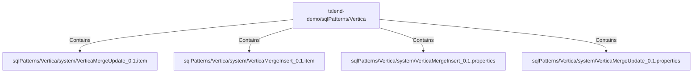

# talend-demo/sqlPatterns/Vertica (Rollup)

## Definition

_Not documented in source._

## Properties

| Key | Value |
|---|---|
| `boundary_relationships` | {} |
| `components` | {"File":4} |
| `group_key` | project:talend-demo/dir:sqlPatterns/Vertica |
| `member_count` | 4 |

## Relationships

### Contains

- → sqlPatterns/Vertica/system/VerticaMergeUpdate_0.1.item (`08a0b47b-885d-505c-bce5-522d48630ae5`) — evidence: sqlPatterns/Vertica/system/VerticaMergeUpdate_0.1.item is a member of project:talend-demo/dir:sqlPatterns/Vertica
- → sqlPatterns/Vertica/system/VerticaMergeInsert_0.1.item (`ab4b202e-b89b-5b03-8605-7e8bcaf85370`) — evidence: sqlPatterns/Vertica/system/VerticaMergeInsert_0.1.item is a member of project:talend-demo/dir:sqlPatterns/Vertica
- → sqlPatterns/Vertica/system/VerticaMergeInsert_0.1.properties (`523424cd-ce80-5aed-80e9-4921c13855b9`) — evidence: sqlPatterns/Vertica/system/VerticaMergeInsert_0.1.properties is a member of project:talend-demo/dir:sqlPatterns/Vertica
- → sqlPatterns/Vertica/system/VerticaMergeUpdate_0.1.properties (`4c20d598-41e2-56c4-a8cc-09441d48de48`) — evidence: sqlPatterns/Vertica/system/VerticaMergeUpdate_0.1.properties is a member of project:talend-demo/dir:sqlPatterns/Vertica

## Diagram

## Evidence

- `738152d1-b581-59e7-9398-766d4cd60bf4` — sqlPatterns/Vertica/system/VerticaMergeInsert_0.1.properties is a member of project:talend-demo/dir:sqlPatterns/Vertica (confidence: 1.00)
- `768e5558-3666-5e9f-a3a9-6ed8e1d0a03c` — sqlPatterns/Vertica/system/VerticaMergeInsert_0.1.item is a member of project:talend-demo/dir:sqlPatterns/Vertica (confidence: 1.00)
- `b2a9a493-688f-5ae3-a438-881996277690` — sqlPatterns/Vertica/system/VerticaMergeUpdate_0.1.properties is a member of project:talend-demo/dir:sqlPatterns/Vertica (confidence: 1.00)
- `cf106bdf-270e-5046-b95d-adf6f1eb6e47` — sqlPatterns/Vertica/system/VerticaMergeUpdate_0.1.item is a member of project:talend-demo/dir:sqlPatterns/Vertica (confidence: 1.00)
